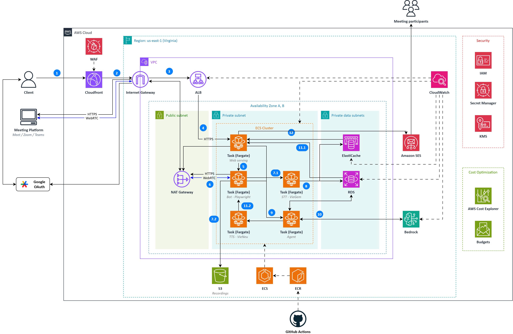

# TINA – AI Meeting Assistant on AWS
## A Containerized AWS Solution for Real-Time Meeting Transcription, Notes and Follow-ups

**Group:** `KimThiem`

| Full Name | Student ID | University | Email |
| --- | --- | --- | --- |
| Trần Kiến Quốc | SE190250 | FPT University | quockientran100@gmail.com |
| Hoàng Đình Quang | SE192303 | FPT University | quanghd023@gmail.com |
| Lê Hoài Thanh Quang | SE190062 | FPT University | lethanhquang094@gmail.com |
| Thái Việt Nam | SE192065 | FPT University | vnam27122005@gmail.com |

### 1. Executive Summary
TINA is an AI meeting assistant built by a four-person team during the First Cloud AI Journey (FCAJ) internship. A meeting bot joins Google Meet, Zoom or Microsoft Teams, transcribes the conversation in real time (Vietnamese first, with English and bilingual views), produces live notes and a summary, and lets participants ask questions about the meeting ("Ask TINA"), including spoken replies through a wake word. When the meeting ends, every known attendee receives a follow-up email linking to the saved summary and recording.

The platform runs on AWS in `us-east-1`. Containerized services run on Amazon ECS with AWS Fargate behind CloudFront, AWS WAF and an Application Load Balancer. Google OAuth (integrated via NextAuth) handles sign-in. Amazon RDS and Amazon ElastiCache store transcripts and live state, Amazon S3 stores recordings, Amazon Bedrock powers summaries and the meeting agent, and Amazon SES delivers follow-up emails. The first version targets an internal pilot team of about 10 users holding around 5 meetings per week.

### 2. Problem Statement
### What's the Problem?
Teams lose information in meetings. Someone has to take notes by hand, so decisions, owners and deadlines are missed or recorded inconsistently. People who join late or miss the meeting have no reliable record to catch up from. Most commercial meeting assistants are expensive per seat, handle Vietnamese poorly, and store meeting data on third-party servers the team does not control.

### The Solution
TINA sends a bot into the meeting through a headless browser (Playwright). The bot streams the meeting audio to a self-hosted speech-to-text service (VieGem, tuned for Vietnamese). Finalized transcript segments are stored in Amazon RDS, and live updates are pushed through Amazon ElastiCache to the web app. An agent service uses Amazon Bedrock to keep notes and a summary current, translate transcripts for the English/bilingual view, and answer questions about the selected meeting. A TTS service (VieNeu) lets TINA answer aloud when someone calls its wake word. After the meeting, recordings are saved to Amazon S3 and Amazon SES emails each attendee a follow-up with links whose access is bound to the recipient's signed-in account.

Key features:
- Meeting bot for Google Meet, Zoom and Teams; live transcript with Vietnamese, English and bilingual views.
- Live notes, end-of-meeting summary and transcript search.
- "Ask TINA" agent with meeting context, plus wake-word and spoken replies.
- Post-meeting follow-up email with summary and recording links.
- Google OAuth sign-in (NextAuth); secrets in AWS Secrets Manager, encryption with AWS KMS.

### Benefits and Return on Investment
- **Time saved**: removes manual note-taking and follow-up writing, saving roughly 15–30 minutes per meeting for the note-taker; at ~5 meetings/week that is 5–10 hours per month for the pilot team.
- **Better follow-through**: decisions and action items are captured in a searchable record and sent to every attendee.
- **Data ownership**: all meeting data, recordings and models stay inside the team's own AWS account.
- **Learning value**: the project gives the team hands-on experience with ECS/Fargate, networking, managed databases, generative AI on Bedrock and CI/CD — a reusable foundation for future AI products.
- **Cost**: about **$148/month** on-demand with the full architecture running 24/7 (see section 6). With off-hours scale-down it fits within the team's AWS credits for the internship and pilot period, much lower than per-seat SaaS licenses for 10 users.

### 3. Solution Architecture
TINA uses a containerized architecture on Amazon ECS (AWS Fargate) inside a VPC across two Availability Zones in `us-east-1`. Public traffic enters through CloudFront and AWS WAF, then an Application Load Balancer. All application tasks run in private subnets. Data stores sit in separate private data subnets, and outbound traffic (meeting platforms, Google OAuth) leaves through a NAT Gateway.

**Request and data flow (numbers match the diagram):**
1. The user opens TINA through **CloudFront** (protected by **WAF**) and signs in with **Google OAuth**.
2. CloudFront forwards requests to the VPC through the **Internet Gateway**.
3. Traffic reaches the **Application Load Balancer**.
4. The ALB routes HTTPS traffic to the **Web serving** task (Next.js terminal, API, WebSocket gateway).
5. When a meeting starts, the Web task launches a **Bot** task (Playwright).
6. The bot joins Google Meet / Zoom / Teams through the **NAT Gateway** over HTTPS/WebRTC.
7. The bot streams audio to the **STT (VieGem)** task (7.1) and stores recordings in **Amazon S3** (7.2).
8. Transcript segments are written to **RDS** and live state to **ElastiCache**.
9. The Web and Bot tasks call the **Agent** task for notes, summaries, translation and Ask TINA.
10. The Agent calls **Amazon Bedrock** for LLM inference.
11. Live updates flow from ElastiCache/RDS back to the Web task (11.1); the **TTS (VieNeu)** task speaks agent replies into the meeting through the bot (11.2).
12. After the meeting, the Web task sends a follow-up email through **Amazon SES** to the participants.

**CI/CD:** GitHub Actions builds container images, pushes them to **Amazon ECR**, and **ECS** rolls out new task revisions. **CloudWatch** collects logs, metrics and alarms for the ALB, ECS tasks, RDS, ElastiCache and Bedrock.

### AWS Services Used
- **Amazon CloudFront + AWS WAF**: Global entry point, TLS, caching of static assets and protection against common web attacks.
- **Amazon VPC, Internet Gateway, NAT Gateway**: Network isolation with public, private and private-data subnets across 2 AZs; controlled outbound access.
- **Application Load Balancer**: HTTPS/WebSocket routing to the Web task with health checks.
- **Amazon ECS on AWS Fargate**: Runs five services — Web serving, Bot (Playwright), STT (VieGem), TTS (VieNeu), Agent — without managing servers.
- **Amazon ECR**: Private registry for container images.
- **Amazon RDS (PostgreSQL)**: Meetings, transcripts, notes, users and settings.
- **Amazon ElastiCache (Redis)**: Live transcript streams, pub/sub and short-lived state.
- **Amazon S3**: Meeting recordings and exported artifacts.
- **Amazon Bedrock**: LLM for notes, summaries, translation and the meeting agent.
- **Amazon SES**: Post-meeting follow-up emails.
- **IAM, AWS Secrets Manager, AWS KMS**: Least-privilege task roles, secret storage (DB password, OAuth client secret, service tokens) and encryption keys.
- **Amazon CloudWatch**: Logs, metrics, dashboards and alarms.
- **AWS Cost Explorer, AWS Budgets**: Cost tracking and budget alerts.

### Component Design
- **Client**: Web app (TINA Terminal) and Chrome extension; users sign in with Google OAuth (NextAuth).
- **Edge layer**: CloudFront + WAF in front of the ALB; only HTTPS is exposed publicly.
- **Web serving task**: UI, REST API, WebSocket gateway for live transcripts, meeting orchestration and email dispatch.
- **Bot task**: One Playwright browser per meeting; captures audio per participant channel and plays TTS audio back into the meeting.
- **Speech tasks**: STT (VieGem) converts audio windows to draft/confirmed transcript segments; TTS (VieNeu) generates spoken replies.
- **Agent task**: Builds meeting context and calls Bedrock for notes, summaries, bilingual translation and Ask TINA answers.
- **Data layer**: RDS for durable data, ElastiCache for real-time streams, S3 for recordings — all in private data subnets, encrypted with KMS.
- **Operations**: GitHub Actions → ECR → ECS deployment; CloudWatch monitoring; Budgets alerts.

### 4. Technical Implementation
**Implementation Phases**
The project follows four phases:
1. **Research and architecture design** (Weeks 1–6): Learn core AWS services through FCAJ labs; study the TINA codebase (meeting bot, ASR, agent); draw the AWS architecture.
2. **Cost estimation and feasibility check** (Weeks 7–8): Estimate costs with the AWS Pricing Calculator; test Bedrock models and Vietnamese ASR quality; adjust sizing to fit the credit budget.
3. **Architecture refinement** (Weeks 8–9): Containerize every service, move secrets to Secrets Manager, split networking into public/private/data subnets and define IAM roles per task.
4. **Development, testing and deployment** (Weeks 9–12): Build features (voice assistant, wake word, post-meeting email, bilingual translation), set up CI/CD with GitHub Actions and ECR, deploy to ECS Fargate, run end-to-end tests with real meetings and tune costs.

**Technical Requirements**
- **Application**: TypeScript/Next.js (web), Python (meeting API, agent), Playwright (bot), Docker images for every service; pnpm/turbo monorepo.
- **Speech**: VieGem STT and VieNeu TTS models served over authenticated HTTP inside the VPC; model artifacts stored in S3/ECR.
- **AWS**: ECS Fargate task definitions and services, ALB target groups with health checks, RDS PostgreSQL, ElastiCache Redis/Valkey, S3 buckets with encryption and lifecycle rules, Google OAuth via Secrets Manager, Bedrock model access, SES verified domain.
- **Security**: Least-privilege IAM task roles, Secrets Manager for credentials, KMS encryption at rest, TLS in transit, security groups that only allow ALB → Web and internal service-to-service traffic.
- **DevOps**: GitHub Actions for build/test, image push to ECR and ECS deployment; CloudWatch logs and alarms.

### 5. Timeline & Milestones
| Week | Team Member | Planned Tasks |
| --- | --- | --- |
| Week 7 | **All Members** | Kickoff meeting, agree on MVP scope (bot, live transcript, notes/summary, Ask TINA, follow-up email), finalize the architecture diagram, set up the shared Git repo and IAM accounts. |
| | Trần Kiến Quốc | Analyse the voice flow (wake word → Agent → TTS) and the post-meeting email requirements. |
| | Thái Việt Nam | Finalize architecture documentation, plan the VPC/subnets across 2 AZs and draft IAM policies. |
| | Hoàng Đình Quang | Evaluate Vietnamese STT (VieGem) accuracy and latency on sample meeting recordings. |
| | Lê Hoài Thanh Quang | Test Bedrock models for notes/summaries and estimate costs with the AWS Pricing Calculator. |
| Week 8 | **All Members** | Agree on contracts between Web, Bot, STT, TTS and Agent (transcript segments, events, APIs); containerize every service. |
| | Trần Kiến Quốc | Containerize the TTS (VieNeu) service and set up GitHub Actions to build and push images to ECR. |
| | Thái Việt Nam | Provision VPC, NAT Gateway, ALB, ECS cluster, CloudFront + WAF and Google OAuth sign-in configuration. |
| | Hoàng Đình Quang | Containerize the Bot (Playwright) and STT services and write their Fargate task definitions. |
| | Lê Hoài Thanh Quang | Set up RDS PostgreSQL, ElastiCache Redis and the S3 recordings bucket with encryption. |
| Week 9 | **All Members** | Peer code review; integrate the Bot → STT → RDS/ElastiCache → Web live transcript flow. |
| | Trần Kiến Quốc | Build the voice assistant and wake word; play TTS replies into the meeting through the bot. |
| | Thái Việt Nam | Configure Secrets Manager, KMS, least-privilege IAM task roles and security groups. |
| | Hoàng Đình Quang | Capture audio per participant channel, tune endpointing and add the bilingual transcript view. |
| | Lê Hoài Thanh Quang | Build the Agent: live notes, end-of-meeting summary and Ask TINA via Bedrock. |
| Week 10 | **All Members** | End-to-end tests with real Google Meet meetings and bug fixes. |
| | Trần Kiến Quốc | Post-meeting follow-up email via Amazon SES with recipient-bound summary/recording links. |
| | Thái Việt Nam | CloudWatch dashboards/alarms and AWS Budgets cost alerts. |
| | Hoàng Đình Quang | Support Zoom/Teams capture and reduce STT latency. |
| | Lê Hoài Thanh Quang | Tune prompts, add transcript search and track Bedrock token cost. |
| Week 11 | **All Members** | Review test results, find bottlenecks and optimize costs. |
| | Trần Kiến Quốc | Regression tests for the voice, wake word and email flows; keep CI green. |
| | Thái Việt Nam | Off-hours scale-down, Fargate Spot, VPC endpoints; basic security audit (WAF, IAM). |
| | Hoàng Đình Quang | Load test concurrent meetings and tune Fargate CPU/memory for Bot and STT. |
| | Lê Hoài Thanh Quang | Evaluate notes/summary quality in Vietnamese and English; configure a fallback model. |
| Week 12 | **All Members** | Full system run, record the demo video, complete documentation and presentation, and submit. |

### 6. Budget Estimation
Estimates use on-demand prices in `us-east-1` (US East – N. Virginia) and the pilot workload: ~10 users, ~5 meetings/week of about 1 hour (~20 meeting-hours/month). Always-on services run 24/7; meeting services (Bot, STT, TTS) run only while a meeting is active. Final figures should be confirmed with the AWS Pricing Calculator.

### Infrastructure Costs
- **Compute (ECS Fargate)**:
    - Web serving (0.5 vCPU, 1 GB, 24/7): $18.02/month.
    - Agent (0.5 vCPU, 1 GB, 24/7): $18.02/month.
    - Bot – Playwright (1 vCPU, 2 GB, 20 h): $0.99/month.
    - STT – VieGem (2 vCPU, 4 GB, 20 h): $1.97/month.
    - TTS – VieNeu (1 vCPU, 2 GB, 20 h): $0.99/month.
- **Networking**:
    - Application Load Balancer (1 ALB, low LCU): $18.00/month.
    - NAT Gateway (1 gateway, ~10 GB processed): $33.30/month.
    - Public IPv4 addresses (3): $10.95/month.
    - CloudFront: $1.00/month (mostly within the free tier).
- **Data**:
    - Amazon RDS PostgreSQL (db.t4g.micro, Single-AZ, 20 GB gp3): $14.00/month.
    - Amazon ElastiCache Redis (cache.t4g.micro): $11.68/month.
    - Amazon S3 (~10 GB recordings + requests): $0.33/month.
- **AI and messaging**:
    - Amazon Bedrock (notes, summaries, translation, Q&A): ~$3.00/month.
    - Amazon SES (~200 emails): $0.01/month.
- **Security and operations**:
    - AWS WAF (1 web ACL, 3 rules): $8.00/month.
    - AWS Secrets Manager (5 secrets): $2.00/month.
    - AWS KMS (1 customer managed key): $1.00/month.
    - Amazon CloudWatch (~5 GB logs, alarms): $3.50/month.
    - Amazon ECR (~10 GB images): $1.00/month.

**Total: ~$147.76/month, ~$1,773/12 months** (full architecture, 24/7).

**Cost optimization**: Stopping the Web/Agent tasks, RDS and ElastiCache outside working hours (~10 h/day, weekdays) and removing WAF in the development environment brings the demo/pilot cost to about **$70–80/month**. Further options: Fargate Spot for the Bot/STT/TTS tasks, VPC endpoints for S3/ECR to reduce NAT data charges, and S3 lifecycle rules that move old recordings to cheaper storage classes. AWS Budgets alerts at 50%, 80% and 100% of the monthly limit.

### 7. Risk Assessment
#### Risk Matrix
- **Cost overrun** (NAT Gateway, ALB, always-on tasks): High impact, medium probability.
- **Vietnamese ASR accuracy** (accents, noise, mixed English terms): High impact, medium probability.
- **Meeting platform changes** (Meet/Zoom/Teams UI or bot blocking): High impact, medium probability.
- **Real-time latency** (audio → transcript → notes): Medium impact, medium probability.
- **Data privacy** (recordings, transcripts of internal meetings): High impact, low probability.
- **Bedrock quota or model availability**: Medium impact, low probability.

#### Mitigation Strategies
- **Cost**: AWS Budgets alerts, Cost Explorer reviews, off-hours scale-down, Fargate Spot for meeting tasks, run meeting tasks only on demand.
- **ASR accuracy**: Use VieGem tuned for Vietnamese, endpointing that confirms stable text, measure accuracy on recorded test meetings.
- **Platform changes**: Per-platform capture adapters, regression tests on Playwright flows, quick image rollout through CI/CD.
- **Latency**: Keep STT inside the VPC, stream partial results, use a fast/low-cost Bedrock model for live notes.
- **Privacy**: Consent notice before recording, Google OAuth (NextAuth) authentication, recipient-bound links, KMS encryption, private subnets, least-privilege IAM, retention rules on S3.
- **Bedrock**: Request quota in advance, keep a fallback model configured.

#### Contingency Plans
- If the budget is close to the limit, scale the ECS services to zero and stop RDS/ElastiCache; keep only S3 and the database snapshot.
- If a deployment fails, roll back to the previous ECS task definition revision.
- If live transcription is unavailable, keep the bot recording to S3 and transcribe after the meeting.
- If Bedrock is unavailable, deliver the transcript and recording links without the AI summary.

### 8. Expected Outcomes
#### Technical Improvements
- Meetings are transcribed and summarized automatically, in real time, with Vietnamese as a first-class language.
- Attendees receive notes and recordings right after the meeting; no manual note-taking.
- A secure, monitored, containerized deployment on AWS with automated CI/CD.
- Each service scales independently; meeting tasks run only when needed.

#### Long-term Value
- A reusable foundation for AI meeting products: more integrations (Notion, Calendar), action-item extraction, speaker diarization.
- A growing set of meeting data for improving Vietnamese ASR and evaluating LLM output quality.
- Practical team experience with AWS architecture, cost management and generative AI on Bedrock.
