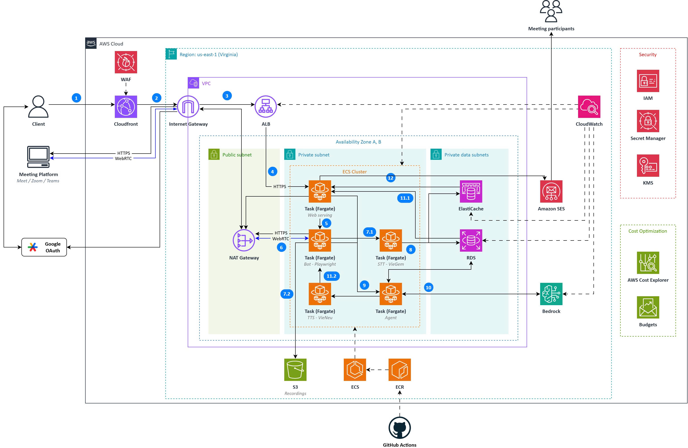

# TINA – Trợ lý cuộc họp AI trên AWS
## Giải pháp AWS dạng container cho phiên âm, ghi chú và theo dõi cuộc họp theo thời gian thực

**Nhóm (Group):** `KimThiem`

| Họ và tên | Mã số sinh viên | Trường | Email |
| --- | --- | --- | --- |
| Trần Kiến Quốc | SE190250 | FPT University | quockientran100@gmail.com |
| Hoàng Đình Quang | SE192303 | FPT University | quanghd023@gmail.com |
| Lê Hoài Thanh Quang | SE190062 | FPT University | lethanhquang094@gmail.com |
| Thái Việt Nam | SE192065 | FPT University | vnam27122005@gmail.com |

### 1. Tóm tắt điều hành
TINA là trợ lý cuộc họp AI do nhóm 4 thành viên xây dựng trong kỳ thực tập First Cloud AI Journey (FCAJ). Bot của TINA tham gia Google Meet, Zoom hoặc Microsoft Teams, phiên âm hội thoại theo thời gian thực (ưu tiên tiếng Việt, có chế độ xem tiếng Anh và song ngữ), tạo ghi chú và tóm tắt trực tiếp, đồng thời cho phép người tham gia đặt câu hỏi về cuộc họp ("Ask TINA"), kể cả trả lời bằng giọng nói khi gọi wake word. Khi cuộc họp kết thúc, mỗi người tham dự nhận được email follow-up kèm link tới bản tóm tắt và bản ghi âm.

Nền tảng chạy trên AWS tại `us-east-1`. Các dịch vụ được đóng gói container, chạy trên Amazon ECS với AWS Fargate, phía sau CloudFront, AWS WAF và Application Load Balancer. Google OAuth (tích hợp qua NextAuth) xử lý đăng nhập. Amazon RDS và Amazon ElastiCache (Valkey/Redis) lưu transcript và trạng thái trực tiếp, Amazon S3 lưu bản ghi âm, Amazon Bedrock tạo tóm tắt và vận hành agent, Amazon SES gửi email follow-up.

#### Mục tiêu & phạm vi
- **Đối tượng thí điểm:** Nhóm nội bộ khoảng 10 người dùng với ~5 cuộc họp/tuần (~20 giờ họp/tháng).
- **Mục tiêu kỹ thuật:** Xây dựng kiến trúc container bảo mật trên AWS (VPC 2 AZ, private subnet, KMS, Secrets Manager), phiên âm tiếng Việt thời gian thực và tự động hóa ghi chú/email sau họp.
- **Phạm vi triển khai:** Tập trung vào luồng họp trực tuyến cốt lõi (Google Meet, Zoom, Teams), bản ghi & tóm tắt AI, trợ lý giọng nói và vận hành tối ưu chi phí trong hạn mức AWS credits thực tập (Single-AZ cho lớp dữ liệu, chưa triển khai HA production).

### 2. Tuyên bố vấn đề
Các nhóm làm việc thường bị thất lạc thông tin trong cuộc họp. Phải có người ghi chép thủ công nên quyết định, người phụ trách và deadline dễ bị bỏ sót hoặc ghi không thống nhất. Người vào muộn hoặc vắng mặt không có bản ghi đáng tin cậy để nắm lại nội dung.

Bên cạnh đó, phần lớn trợ lý cuộc họp thương mại hiện nay gặp ba rào cản lớn với các nhóm tại Việt Nam:
- **Chi phí cao theo đầu người:** Mô hình thuê bao per-seat tốn kém khi mở rộng cho cả nhóm.
- **Hạn chế với tiếng Việt:** Độ chính xác phiên âm tiếng Việt và hội thoại pha thuật ngữ tiếng Anh chưa tốt.
- **Rủi ro làm chủ dữ liệu:** Bản ghi âm và nội dung họp nội bộ bị lưu trên máy chủ bên thứ ba mà nhóm không kiểm soát được.

### 3. Giải pháp đề xuất & Lợi ích
#### Giải pháp
TINA đưa một bot vào cuộc họp thông qua trình duyệt headless (Playwright). Bot stream âm thanh cuộc họp tới dịch vụ speech-to-text tự vận hành (**VieGem**, tối ưu cho tiếng Việt). Các đoạn transcript đã xác nhận được lưu vào Amazon RDS, cập nhật trực tiếp được đẩy qua Amazon ElastiCache (Valkey/Redis) tới ứng dụng web. Dịch vụ Agent dùng Amazon Bedrock để cập nhật ghi chú và tóm tắt, dịch transcript cho chế độ xem tiếng Anh/song ngữ và trả lời câu hỏi về cuộc họp đang chọn. Dịch vụ TTS (**VieNeu**) giúp TINA trả lời bằng giọng nói khi có người gọi wake word. Sau cuộc họp, bản ghi âm được lưu vào Amazon S3 và Amazon SES gửi email follow-up cho từng người tham dự, với link chỉ truy cập được bằng tài khoản đã đăng nhập của người nhận.

**Tính năng chính:**
- Bot cuộc họp cho Google Meet, Zoom và Teams; transcript trực tiếp với chế độ xem tiếng Việt, tiếng Anh và song ngữ.
- Ghi chú trực tiếp, tóm tắt cuối buổi và tìm kiếm transcript.
- Agent "Ask TINA" hiểu ngữ cảnh cuộc họp, hỗ trợ wake word và trả lời bằng giọng nói.
- Email follow-up sau cuộc họp kèm link tóm tắt và bản ghi âm gắn quyền theo người nhận.
- Đăng nhập Google OAuth (NextAuth); bí mật lưu trong AWS Secrets Manager, mã hóa bằng AWS KMS.

#### Lợi ích và hoàn vốn đầu tư (ROI)
- **Tiết kiệm thời gian:** Bỏ việc ghi chép và soạn follow-up thủ công, tiết kiệm khoảng 15–30 phút mỗi cuộc họp cho người ghi chép; với ~5 cuộc họp/tuần là 5–10 giờ mỗi tháng cho nhóm thí điểm.
- **Theo dõi công việc tốt hơn:** Quyết định và đầu việc được lưu thành bản ghi có thể tìm kiếm và gửi tới mọi người tham dự.
- **Làm chủ dữ liệu:** Toàn bộ dữ liệu cuộc họp, bản ghi âm và mô hình nằm trong tài khoản AWS của nhóm.
- **Giá trị học tập:** Nhóm có kinh nghiệm thực tế với ECS/Fargate, networking, cơ sở dữ liệu managed, generative AI trên Bedrock và CI/CD — nền tảng tái sử dụng cho các sản phẩm AI sau này.
- **Chi phí:** Khoảng **148 USD/tháng** (on-demand) khi toàn bộ kiến trúc chạy 24/7 (xem mục 6). Khi tắt dịch vụ ngoài giờ, chi phí nằm trong hạn mức AWS credits của nhóm cho giai đoạn thực tập và thí điểm, thấp hơn nhiều so với license SaaS tính theo đầu người cho 10 người dùng.

### 4. Kiến trúc & Triển khai kỹ thuật
#### Kiến trúc giải pháp
TINA sử dụng kiến trúc container trên Amazon ECS (AWS Fargate) trong một VPC trải trên 2 Availability Zone tại `us-east-1`. Lưu lượng công khai đi vào qua CloudFront và AWS WAF, rồi tới Application Load Balancer. Mọi task ứng dụng chạy trong private subnet. Các kho dữ liệu nằm trong private data subnet riêng, và lưu lượng đi ra ngoài (nền tảng họp, Google OAuth) đi qua NAT Gateway.

**Luồng xử lý (số thứ tự khớp với sơ đồ):**
1. Người dùng truy cập TINA qua **CloudFront** (được bảo vệ bởi **WAF**) và đăng nhập bằng **Google OAuth**.
2. CloudFront chuyển request vào VPC qua **Internet Gateway**.
3. Lưu lượng tới **Application Load Balancer**.
4. ALB định tuyến HTTPS tới task **Web serving** (Next.js terminal, API, WebSocket gateway).
5. Khi cuộc họp bắt đầu, task Web khởi chạy task **Bot** (Playwright).
6. Bot tham gia Google Meet / Zoom / Teams qua **NAT Gateway** bằng HTTPS/WebRTC.
7. Bot stream âm thanh tới task **STT (VieGem)** (7.1) và lưu bản ghi âm vào **Amazon S3** (7.2).
8. Các đoạn transcript được ghi vào **RDS**, trạng thái trực tiếp vào **ElastiCache**.
9. Task Web và Bot gọi task **Agent** để tạo ghi chú, tóm tắt, bản dịch và trả lời Ask TINA.
10. Agent gọi **Amazon Bedrock** để suy luận LLM.
11. Cập nhật trực tiếp từ ElastiCache/RDS được trả về task Web (11.1); task **TTS (VieNeu)** phát câu trả lời của agent vào cuộc họp qua bot (11.2).
12. Sau cuộc họp, task Web gửi email follow-up qua **Amazon SES** tới người tham dự.

**CI/CD:** GitHub Actions build image container, đẩy lên **Amazon ECR**, và **ECS** triển khai task revision mới. **CloudWatch** thu thập log, metric và cảnh báo cho ALB, ECS task, RDS, ElastiCache và Bedrock.

#### Dịch vụ AWS sử dụng
- **Amazon CloudFront + AWS WAF:** Điểm truy cập toàn cầu, TLS, cache tài nguyên tĩnh và chống các tấn công web phổ biến.
- **Amazon VPC, Internet Gateway, NAT Gateway:** Cô lập mạng với public, private và private data subnet trên 2 AZ; kiểm soát truy cập ra ngoài.
- **Application Load Balancer:** Định tuyến HTTPS/WebSocket tới task Web kèm health check.
- **Amazon ECS trên AWS Fargate:** Chạy 5 nhóm dịch vụ — Web serving, Bot (Playwright), STT (VieGem), TTS (VieNeu), Agent — không cần quản lý máy chủ.
- **Amazon ECR:** Registry riêng cho image container.
- **Amazon RDS (PostgreSQL):** Lưu cuộc họp, transcript, ghi chú, người dùng và cấu hình.
- **Amazon ElastiCache (Valkey/Redis):** Stream transcript trực tiếp, pub/sub và trạng thái ngắn hạn.
- **Amazon S3:** Lưu bản ghi âm cuộc họp và tệp xuất.
- **Amazon Bedrock:** LLM cho ghi chú, tóm tắt, dịch và agent cuộc họp.
- **Amazon SES:** Gửi email follow-up sau cuộc họp.
- **IAM, AWS Secrets Manager, AWS KMS:** Role tối thiểu quyền cho từng task, lưu bí mật (mật khẩu DB, OAuth client secret, token dịch vụ) và khóa mã hóa.
- **Amazon CloudWatch:** Log, metric, dashboard và cảnh báo.
- **AWS Cost Explorer, AWS Budgets:** Theo dõi chi phí và cảnh báo ngân sách.

#### Thiết kế thành phần
- **Client:** Ứng dụng web (TINA Terminal) và Chrome extension; người dùng đăng nhập bằng Google OAuth (NextAuth).
- **Lớp biên:** CloudFront + WAF đứng trước ALB; chỉ mở HTTPS ra Internet.
- **Task Web serving:** Giao diện, REST API, WebSocket gateway cho transcript trực tiếp, điều phối cuộc họp và gửi email.
- **Task Bot:** Mỗi cuộc họp một trình duyệt Playwright; thu âm theo kênh từng người tham gia và phát âm thanh TTS vào cuộc họp.
- **Task giọng nói:** STT (VieGem) chuyển các cửa sổ âm thanh thành đoạn transcript nháp/đã xác nhận; TTS (VieNeu) tạo câu trả lời bằng giọng nói.
- **Task Agent:** Xây dựng ngữ cảnh cuộc họp và gọi Bedrock để tạo ghi chú, tóm tắt, bản dịch song ngữ và câu trả lời Ask TINA.
- **Lớp dữ liệu:** RDS cho dữ liệu bền vững, ElastiCache cho stream thời gian thực, S3 cho bản ghi âm — tất cả trong private data subnet, mã hóa bằng KMS.
- **Vận hành:** Triển khai GitHub Actions → ECR → ECS; giám sát bằng CloudWatch; cảnh báo bằng Budgets.

#### Các giai đoạn triển khai
1. **Nghiên cứu và thiết kế kiến trúc (Tuần 1–6):** Học các dịch vụ AWS cốt lõi qua lab FCAJ; tìm hiểu codebase TINA (meeting bot, ASR, agent); vẽ kiến trúc AWS.
2. **Ước tính chi phí và kiểm tra tính khả thi (Tuần 7–8):** Ước tính bằng AWS Pricing Calculator; thử nghiệm model Bedrock và chất lượng ASR tiếng Việt; điều chỉnh cấu hình để phù hợp ngân sách credits.
3. **Tinh chỉnh kiến trúc (Tuần 8–9):** Đóng gói container cho mọi dịch vụ, chuyển bí mật sang Secrets Manager, tách mạng thành public/private/data subnet và định nghĩa IAM role cho từng task.
4. **Phát triển, kiểm thử và triển khai (Tuần 9–12):** Xây dựng tính năng (trợ lý giọng nói, wake word, email sau cuộc họp, dịch song ngữ), thiết lập CI/CD với GitHub Actions và ECR, triển khai lên ECS Fargate, kiểm thử end-to-end với cuộc họp thật và tối ưu chi phí.

#### Yêu cầu kỹ thuật
- **Ứng dụng:** TypeScript/Next.js (web), Python (meeting API, agent), Playwright (bot), Docker image ARM64 cho mọi dịch vụ; monorepo pnpm/turbo.
- **Giọng nói:** Model STT VieGem và TTS VieNeu phục vụ qua HTTP có xác thực bên trong VPC; artifact model lưu trên S3/ECR.
- **AWS:** Task definition và service ECS Fargate, target group ALB có health check, RDS PostgreSQL, ElastiCache Valkey/Redis, S3 bucket có mã hóa và lifecycle rule, Google OAuth qua Secrets Manager, quyền truy cập model Bedrock, domain đã xác minh trên SES.
- **Bảo mật:** IAM task role tối thiểu quyền, Secrets Manager cho thông tin xác thực, mã hóa KMS khi lưu trữ, TLS khi truyền, security group chỉ cho phép ALB → Web và lưu lượng nội bộ giữa các dịch vụ.
- **DevOps:** GitHub Actions để build/test, đẩy image lên ECR và triển khai ECS; log và cảnh báo trên CloudWatch.

### 5. Lộ trình & Mốc triển khai
| Tuần | Thành viên | Công việc dự kiến |
| --- | --- | --- |
| Tuần 7 | **Cả nhóm** | Họp kickoff, thống nhất phạm vi MVP (bot, transcript trực tiếp, ghi chú/tóm tắt, Ask TINA, email follow-up), chốt sơ đồ kiến trúc, tạo Git repo chung và tài khoản IAM. |
| | Trần Kiến Quốc | Phân tích luồng giọng nói (wake word → Agent → TTS) và yêu cầu email sau cuộc họp. |
| | Thái Việt Nam | Hoàn thiện tài liệu kiến trúc, quy hoạch VPC/subnet trên 2 AZ và soạn thảo IAM policy. |
| | Hoàng Đình Quang | Đánh giá độ chính xác và độ trễ của STT tiếng Việt (VieGem) trên các bản ghi cuộc họp mẫu. |
| | Lê Hoài Thanh Quang | Thử nghiệm model Bedrock cho ghi chú/tóm tắt và ước tính chi phí bằng AWS Pricing Calculator. |
| Tuần 8 | **Cả nhóm** | Thống nhất contract giữa Web, Bot, STT, TTS và Agent (đoạn transcript, sự kiện, API); đóng gói container cho mọi dịch vụ. |
| | Trần Kiến Quốc | Đóng gói container dịch vụ TTS (VieNeu), thiết lập GitHub Actions để build và đẩy image lên ECR. |
| | Thái Việt Nam | Dựng VPC, NAT Gateway, ALB, ECS cluster, CloudFront + WAF và cấu hình đăng nhập Google OAuth. |
| | Hoàng Đình Quang | Đóng gói container Bot (Playwright) và STT, viết task definition Fargate. |
| | Lê Hoài Thanh Quang | Thiết lập RDS PostgreSQL, ElastiCache Valkey/Redis và S3 bucket lưu bản ghi âm có mã hóa. |
| Tuần 9 | **Cả nhóm** | Review chéo code; tích hợp luồng transcript trực tiếp Bot → STT → RDS/ElastiCache → Web. |
| | Trần Kiến Quốc | Xây dựng trợ lý giọng nói và wake word; phát câu trả lời TTS vào cuộc họp qua bot. |
| | Thái Việt Nam | Cấu hình Secrets Manager, KMS, IAM task role tối thiểu quyền và security group. |
| | Hoàng Đình Quang | Thu âm theo kênh từng người tham gia, tinh chỉnh endpointing và thêm chế độ xem transcript song ngữ. |
| | Lê Hoài Thanh Quang | Xây dựng Agent: ghi chú trực tiếp, tóm tắt cuối buổi và Ask TINA qua Bedrock. |
| Tuần 10 | **Cả nhóm** | Kiểm thử end-to-end với cuộc họp Google Meet thật và sửa lỗi. |
| | Trần Kiến Quốc | Gửi email follow-up sau cuộc họp qua Amazon SES, kèm link tóm tắt/bản ghi âm gắn với người nhận. |
| | Thái Việt Nam | Dashboard và cảnh báo CloudWatch, cảnh báo chi phí bằng AWS Budgets. |
| | Hoàng Đình Quang | Hỗ trợ thu âm Zoom/Teams và giảm độ trễ STT. |
| | Lê Hoài Thanh Quang | Tinh chỉnh prompt, thêm tìm kiếm transcript và theo dõi chi phí token Bedrock. |
| Tuần 11 | **Cả nhóm** | Đánh giá kết quả kiểm thử, tìm điểm nghẽn và tối ưu chi phí. |
| | Trần Kiến Quốc | Regression test cho luồng giọng nói, wake word và email; giữ CI ổn định. |
| | Thái Việt Nam | Tắt dịch vụ ngoài giờ, dùng Fargate Spot, VPC endpoint; kiểm tra bảo mật cơ bản (WAF, IAM). |
| | Hoàng Đình Quang | Load test nhiều cuộc họp đồng thời, tinh chỉnh CPU/memory Fargate cho Bot và STT. |
| | Lê Hoài Thanh Quang | Đánh giá chất lượng ghi chú/tóm tắt tiếng Việt và tiếng Anh; cấu hình model dự phòng. |
| Tuần 12 | **Cả nhóm** | Chạy toàn bộ hệ thống, quay video demo, hoàn thiện tài liệu và slide thuyết trình, nộp bài. |

### 6. Ước tính ngân sách
Ước tính dùng giá on-demand tại `us-east-1` (US East – N. Virginia) theo AWS Pricing Calculator với tải thí điểm: ~10 người dùng, ~5 cuộc họp/tuần, mỗi cuộc khoảng 1 giờ (~20 giờ họp/tháng). Các dịch vụ thường trực chạy 24/7; dịch vụ cuộc họp (Bot, STT, TTS) chỉ chạy khi có cuộc họp.

#### Bảng chi phí hạ tầng
| Nhóm | Dịch vụ | Cấu hình / Mức sử dụng | Chi phí/tháng (USD) |
| --- | --- | --- | ---: |
| **Tính toán (ECS Fargate)** | Web serving | 0,5 vCPU, 1 GB, 24/7 | 18,02 |
| | Agent | 0,5 vCPU, 1 GB, 24/7 | 18,02 |
| | Bot – Playwright | 1 vCPU, 2 GB, 20 giờ | 0,99 |
| | STT – VieGem | 2 vCPU, 4 GB, 20 giờ | 1,97 |
| | TTS – VieNeu | 1 vCPU, 2 GB, 20 giờ | 0,99 |
| **Mạng** | Application Load Balancer | 1 ALB, LCU thấp | 18,00 |
| | NAT Gateway | 1 gateway, ~10 GB xử lý | 33,30 |
| | Địa chỉ IPv4 công khai | 3 địa chỉ | 10,95 |
| | Amazon CloudFront | Chủ yếu trong free tier | 1,00 |
| **Dữ liệu** | Amazon RDS PostgreSQL | `db.t4g.micro`, Single-AZ, 20 GB gp3 | 14,00 |
| | Amazon ElastiCache (Valkey/Redis) | `cache.t4g.micro` | 11,68 |
| | Amazon S3 | ~10 GB bản ghi âm + request | 0,33 |
| **AI & Gửi thư** | Amazon Bedrock | Ghi chú, tóm tắt, dịch, hỏi đáp | ~3,00 |
| | Amazon SES | ~200 email | 0,01 |
| **Bảo mật & Vận hành** | AWS WAF | 1 Web ACL, 3 rule | 8,00 |
| | AWS Secrets Manager | 5 secret | 2,00 |
| | AWS KMS | 1 customer managed key | 1,00 |
| | Amazon CloudWatch | ~5 GB log, cảnh báo | 3,50 |
| | Amazon ECR | ~10 GB image | 1,00 |
| **Tổng cộng** | **Toàn bộ kiến trúc (24/7)** | **~1.773 USD / 12 tháng** | **~147,76** |

**Tối ưu chi phí:** Tắt task Web/Agent, RDS và ElastiCache ngoài giờ làm việc (~10 giờ/ngày, các ngày trong tuần) và bỏ WAF ở môi trường phát triển giúp giảm chi phí demo/thí điểm xuống khoảng **70–80 USD/tháng**. Các lựa chọn khác: Fargate Spot cho task Bot/STT/TTS, VPC endpoint cho S3/ECR để giảm phí dữ liệu qua NAT, và lifecycle rule trên S3 để chuyển bản ghi âm cũ sang lớp lưu trữ rẻ hơn. AWS Budgets cảnh báo ở mức 50%, 80% và 100% hạn mức tháng.

### 7. Đánh giá rủi ro
#### Ma trận rủi ro
| Rủi ro | Mô tả | Mức ảnh hưởng | Xác suất |
| --- | --- | --- | --- |
| Vượt ngân sách | NAT Gateway, ALB và các task chạy 24/7 | Cao | Trung bình |
| Độ chính xác ASR tiếng Việt | Giọng vùng miền, tiếng ồn, pha thuật ngữ tiếng Anh | Cao | Trung bình |
| Thay đổi từ nền tảng họp | Giao diện Meet/Zoom/Teams thay đổi hoặc chặn bot | Cao | Trung bình |
| Độ trễ thời gian thực | Chuỗi xử lý âm thanh → transcript → ghi chú | Trung bình | Trung bình |
| Quyền riêng tư dữ liệu | Bản ghi âm và transcript cuộc họp nội bộ | Cao | Thấp |
| Hạn mức / khả dụng Bedrock | Giới hạn quota hoặc gián đoạn model | Trung bình | Thấp |

#### Chiến lược giảm thiểu
- **Chi phí:** Cảnh báo AWS Budgets, theo dõi Cost Explorer, tắt dịch vụ ngoài giờ, dùng Fargate Spot cho task cuộc họp, chỉ chạy task cuộc họp khi cần.
- **Độ chính xác ASR:** Dùng VieGem tối ưu cho tiếng Việt, cơ chế endpointing xác nhận phần text ổn định, đo độ chính xác trên các cuộc họp mẫu đã ghi.
- **Thay đổi nền tảng:** Adapter thu âm riêng cho từng nền tảng, regression test cho luồng Playwright, cập nhật image nhanh qua CI/CD.
- **Độ trễ:** Đặt STT trong VPC, stream kết quả tạm thời, dùng model Bedrock nhanh/chi phí thấp cho ghi chú trực tiếp.
- **Quyền riêng tư:** Thông báo xin đồng ý trước khi ghi âm, xác thực Google OAuth (NextAuth), link gắn với người nhận, mã hóa KMS, private subnet, IAM tối thiểu quyền, quy tắc lưu giữ trên S3.
- **Bedrock:** Đăng ký hạn mức trước, cấu hình sẵn model dự phòng.

#### Kế hoạch dự phòng
- Nếu ngân sách gần chạm hạn mức, scale các dịch vụ ECS về 0 và dừng RDS/ElastiCache; chỉ giữ S3 và snapshot cơ sở dữ liệu.
- Nếu triển khai lỗi, rollback về task definition revision trước đó trên ECS.
- Nếu phiên âm trực tiếp không khả dụng, bot vẫn ghi âm vào S3 và phiên âm sau cuộc họp.
- Nếu Bedrock không khả dụng, vẫn gửi transcript và link bản ghi âm, chưa kèm tóm tắt AI.

### 8. Kết quả kỳ vọng
#### Cải tiến kỹ thuật
- Cuộc họp được phiên âm và tóm tắt tự động theo thời gian thực, tiếng Việt là ngôn ngữ ưu tiên.
- Người tham dự nhận ghi chú và bản ghi âm ngay sau cuộc họp, không cần ghi chép thủ công.
- Hệ thống container trên AWS bảo mật, có giám sát và CI/CD tự động.
- Mỗi dịch vụ mở rộng độc lập; task cuộc họp chỉ chạy khi cần.

#### Giá trị dài hạn
- Nền tảng tái sử dụng cho các sản phẩm AI về cuộc họp: thêm tích hợp (Notion, Calendar), trích xuất đầu việc, phân tách người nói.
- Kho dữ liệu cuộc họp ngày càng lớn để cải thiện ASR tiếng Việt và đánh giá chất lượng đầu ra của LLM.
- Kinh nghiệm thực tế của nhóm về kiến trúc AWS, quản lý chi phí và generative AI trên Bedrock.
