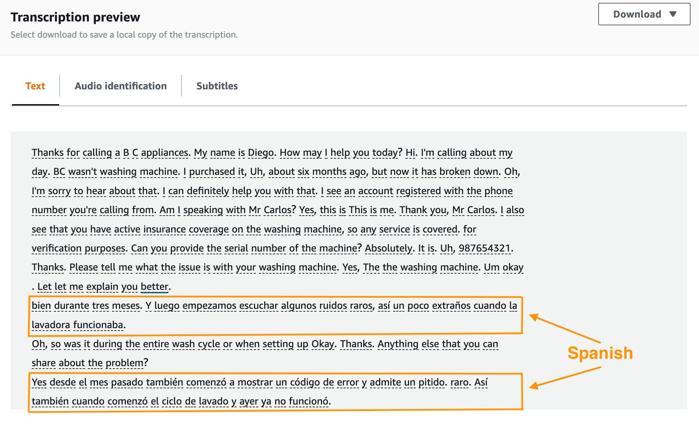
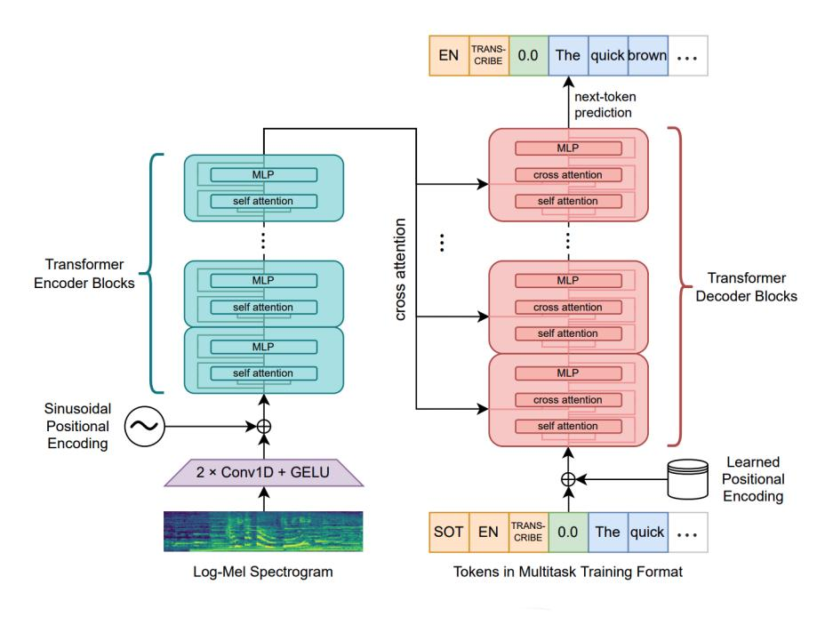

# Amazon Transcribe vs OpenAI Whisper: Which Speech-to-Text Solution Is Better Suited to Vietnamese?

Speech-to-Text (STT) technology is increasingly common, from automatic video captions and meeting transcripts to customer support call analysis. Two notable solutions are Amazon Transcribe and OpenAI Whisper. Both convert audio into text, but they differ significantly in their deployment models, capabilities, pricing structures, and operational requirements.

These differences are particularly relevant for Vietnamese, a tonal language with regional accents and frequent mixing of Vietnamese and English technical terms. Choosing the wrong service can lead to low transcription accuracy, unexpected operational costs, or excessive infrastructure maintenance.

This article provides a comprehensive comparison of the two options across speech recognition capabilities, Vietnamese language support, deployment models, cost analysis, practical architectures, evaluation metrics, and real-world decision guidance.

---

## 1. Overview of Amazon Transcribe and OpenAI Whisper

### Amazon Transcribe

Amazon Transcribe is an Automatic Speech Recognition (ASR) service from AWS. It converts audio into text without requiring developers to build or operate their own machine learning model.

As a fully managed service, AWS maintains the underlying infrastructure, speech recognition models, scaling, and updates. The application provides audio input and the necessary processing configuration.

Amazon Transcribe offers two main processing modes:

- **Batch Transcription:** Transcribes existing audio recordings stored in Amazon S3. Suitable for offline processing of lectures, interviews, and call center recordings.
- **Streaming Transcription:** Transcribes incoming audio with near-real-time results. Suitable for live captioning, virtual assistants, and real-time meeting assistants.

Depending on the language, the service also provides features such as Custom Vocabulary, Speaker Diarization, Language Identification, Content Redaction, and Call Analytics.

Its ability to integrate with Amazon S3, AWS Lambda, Amazon CloudWatch, AWS Step Functions, and other AWS services makes it useful for automated audio-processing workflows without managing servers.

### OpenAI Whisper

Whisper is an open-source speech recognition model introduced by OpenAI in 2022. It uses a Transformer architecture and was trained on approximately 680,000 hours of multilingual and multitask supervised data collected from the web.

Whisper supports multilingual speech transcription, language detection, and translation of speech into English.

It is available in several model sizes, including Tiny, Base, Small, Medium, Large-v1, Large-v2, Large-v3, and Turbo, with different compute requirements and performance trade-offs.

Unlike Amazon Transcribe, the open-source model can run locally or on cloud infrastructure such as Amazon EC2, Amazon ECS, or Amazon EKS.

This gives developers control over the runtime environment, model selection, versioning, and data processing. In exchange, they must manage the computing resources, dependencies, model weights, application infrastructure, security patches, and scaling themselves.

---

*Figure 2. OpenAI Whisper's Transformer encoder-decoder architecture for multilingual speech recognition. Source: OpenAI GitHub.*

## 2. Vietnamese Speech Recognition Capabilities

Vietnamese is a tonal language with six tones, rich diacritics, regional accents (Northern, Central, Southern), and frequent code-switching between Vietnamese and English technical terms. Noisy recordings and unclear pronunciation make accurate transcription more difficult.

### Vietnamese Support in Amazon Transcribe

According to AWS documentation referenced for this post, Amazon Transcribe supports Vietnamese (`vi-VN`) in both batch and streaming modes.

Custom Vocabulary is useful for adding names, product terms, and domain-specific terminology to improve recognition accuracy for Vietnamese technical conversations.

However, Vietnamese was not supported by Amazon Transcribe's automatic Language Identification feature in the referenced language support table. Applications processing Vietnamese audio should therefore specify `vi-VN` explicitly rather than relying on auto-detection.

Custom Language Models and some advanced analysis features were also unavailable for Vietnamese in that language support information at the time of publication.

### Vietnamese Support in Whisper

Whisper supports Vietnamese through its multilingual models. It can detect the input language automatically or be configured to use a specified language code (`vi`).

Its diverse audio training data provides a basis for handling various speakers and recording conditions, although the model does not produce perfect results in every setting.

For example, consider the sentence:

> "Hôm nay sẽ deploy ứng dụng lên Amazon EC2, sau đó cấu hình Security Group và kết nối với RDS."

English technical terms such as "deploy", "Security Group", and "RDS" may be misrecognized when pronunciation is unclear or background noise is present.

With Amazon Transcribe, Custom Vocabulary is one possible way to improve recognition of technical expressions. With Whisper, developers can experiment with different model sizes (Large-v3 typically performs best) and context prompts where supported.

Without a common benchmark dataset, it would be misleading to claim that either system is consistently more accurate for Vietnamese. A fair comparison should cover Northern, Central, and Southern accents, audio quality (telephony vs. studio), background noise levels, and different speaking scenarios (formal presentations vs. casual conversations).

---

## 3. Deployment Cost Comparison

Cost matters, particularly for applications that process hundreds or thousands of hours of audio.

### Amazon Transcribe

Amazon Transcribe uses pay-as-you-go pricing based on the processed audio duration.

Using an illustrative first-tier Standard Transcription rate of **USD 0.024 per minute** in US East (N. Virginia), processing ten hours of audio would cost approximately **USD 14.40**.

Actual charges depend on AWS Region, pricing tiers, optional features (such as speaker diarization or content redaction), and additional services such as S3 storage and Lambda invocations.

A key benefit is that the application does not have to keep a GPU server running or manage the ASR model. This can be valuable when workloads are irregular or unpredictable.

### OpenAI Whisper

The open-source Whisper model has no model license fee, but inference still requires computing resources.

When deployed on Amazon EC2, costs depend on instance type, runtime duration, storage, data transfer, and performance requirements.

Whisper can run on CPUs, but larger models (Large-v2, Large-v3) typically require GPUs for acceptable inference speed. GPUs can speed up inference in many scenarios, at the cost of more expensive infrastructure.

For applications processing just a few recordings each day, keeping a GPU instance online continuously may be inefficient. On the other hand, existing infrastructure or Spot Instances that can be started only when needed may make self-hosting worthwhile.

The open-source model should not be confused with the hosted OpenAI Whisper API. The `whisper-1` API is a separately billed service, and OpenAI announced its discontinuation for February 26, 2027. This does not discontinue the open-source Whisper model.

A fair cost comparison therefore needs to include compute, storage, operations, maintenance, scalability, and engineering time—not just a price per audio minute.

### Summary Table

| Factor         | Amazon Transcribe       | OpenAI Whisper (self-hosted)             |
| -------------- | ----------------------- | ---------------------------------------- |
| Pricing model  | Pay per audio minute    | Compute instance cost + engineering time |
| Infrastructure | Fully managed by AWS    | Self-managed on EC2/ECS/EKS              |
| GPU required   | No                      | Recommended for Large models             |
| Scaling        | Automatic               | Manual or Auto Scaling group             |
| Model updates  | Managed by AWS          | Manual version management                |
| Data residency | Configurable AWS Region | Full control over deployment location    |

---

## 4. Practical Use Case: Turning Lectures into Text

A useful Speech-to-Text application is a service that automatically converts recorded lectures to searchable transcripts. Students can look up key passages, extract information, or generate summaries rather than listening to the entire recording again.

Both Amazon Transcribe and Whisper can support this workflow.

### Option A: Amazon Transcribe

The architecture can combine Amazon S3, AWS Lambda, and Amazon Transcribe:

1. A user uploads an audio file to Amazon S3.
2. The upload event triggers AWS Lambda.
3. Lambda starts a Transcription Job with the language code `vi-VN`.
4. Amazon Transcribe processes the audio and produces the transcript.
5. The transcript is stored in S3 for the application to retrieve.

This approach uses managed AWS services and requires no self-hosted speech recognition model.

### Option B: Whisper on Amazon EC2

The architecture can combine Amazon S3, Amazon SQS, and Amazon EC2:

1. An audio recording is uploaded to S3.
2. A processing request is sent to an Amazon SQS queue.
3. An EC2 worker receives the request and downloads the audio.
4. Whisper transcribes the recording into Vietnamese text.
5. The result is saved to Amazon S3.

The second option requires direct control of the inference environment, but makes it possible to choose the Whisper version, configure compute resources, and optimize the pipeline.

Either solution could later include automatic lecture summarization using an LLM through Amazon Bedrock.

---

## 5. How Should Accuracy Be Evaluated?

A few individual recordings are not enough to evaluate a Speech-to-Text system fairly.

A useful test dataset could include:

- Recordings of speakers from different Vietnamese regions (Northern, Central, Southern).
- Clear studio-quality recordings and recordings with background noise.
- Everyday conversations and conversations containing technical vocabulary.
- Code-switched Vietnamese-English technical discussions.

The same dataset should then be processed by both services and compared against human-verified reference transcripts.

Two common evaluation metrics are:

**Word Error Rate (WER):** Measures recognition errors at the word level compared with a reference transcript.

**Character Error Rate (CER):** Measures recognition errors at the character level.

Lower values generally indicate better recognition under the selected metric. For Vietnamese, a consistent text normalization procedure (handling diacritics, case, and punctuation) is important before calculating the scores.

Processing time, cost per audio hour, and operational complexity should also be considered. A small accuracy gain may not justify substantially higher infrastructure costs for every application.

---

## 6. When Should Each Solution Be Considered?

Amazon Transcribe is a practical option for applications already using AWS, especially when the goal is to deliver a speech transcription feature quickly without maintaining the ML infrastructure.

Its near-real-time Vietnamese streaming support and integration with other AWS services are significant advantages.

Self-hosted Whisper is worth considering for research, custom inference workflows, or environments where direct control of model deployment, versioning, and data handling is important.

However, hardware requirements, model versioning, and ongoing operations should be evaluated carefully before choosing a self-hosted deployment.

---

## 7. Conclusion

Amazon Transcribe and OpenAI Whisper address the same Speech-to-Text problem with different approaches.

Amazon Transcribe provides a managed recognition service, reducing deployment and operations work. The open-source Whisper model offers greater flexibility and control over the runtime and model configuration.

Both support Vietnamese, but comparative accuracy needs to be tested on the same input data rather than assumed.

The right decision depends on transcript quality, cost, performance, scalability, and operational requirements. A useful next step would be to benchmark both solutions against a Vietnamese dataset containing multiple regional accents and recording conditions.

---

## References

1. [Amazon Transcribe – Documentation](https://docs.aws.amazon.com/transcribe/)
2. [Amazon Transcribe – Supported Languages](https://docs.aws.amazon.com/transcribe/latest/dg/supported-languages.html)
3. [Amazon Transcribe – Pricing](https://aws.amazon.com/transcribe/pricing/)
4. [OpenAI Whisper – GitHub Repository](https://github.com/openai/whisper)
5. [OpenAI – Introducing Whisper](https://openai.com/index/whisper/)
6. [OpenAI API – Speech-to-Text](https://developers.openai.com/api/docs/guides/speech-to-text)

---

**Bài viết đã đăng trên AWS Study Group:** [https://www.facebook.com/groups/awsstudygroupfcj/permalink/2312872199477739/?rdid=D6LZtjRCUfR9S4t9#](https://www.facebook.com/groups/awsstudygroupfcj/permalink/2312872199477739/?rdid=D6LZtjRCUfR9S4t9#)
