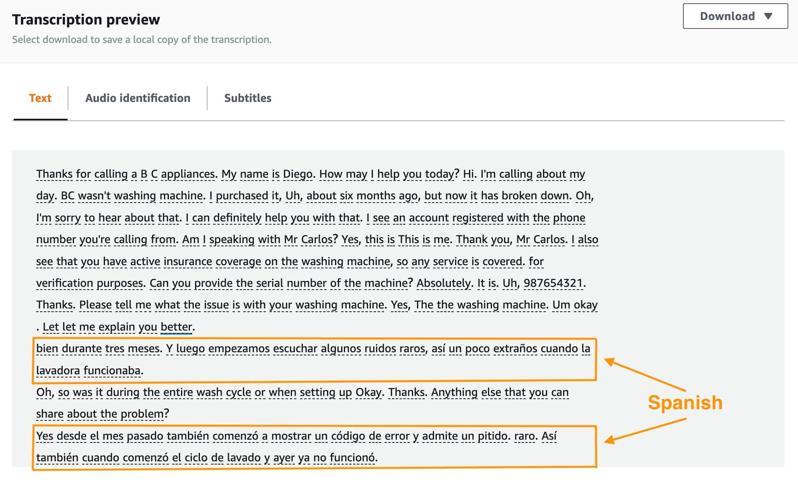

# Amazon Transcribe vs OpenAI Whisper: Giải pháp Nhận dạng Giọng nói-Văn bản nào phù hợp hơn với tiếng Việt?

**Đăng ngày: 22/10/2026**

Công nghệ Speech-to-Text (STT) ngày càng phổ biến, từ ghi chú video tự động và phiên cuộc họp đến phân tích cuộc gọi chăm sóc khách hàng. Hai giải pháp đáng chú ý là Amazon Transcribe và OpenAI Whisper. Cả hai đều chuyển đổi âm thanh thành văn bản, nhưng chúng khác biệt đáng kể về mô hình triển khai, khả năng, cấu trúc giá cả và yêu cầu vận hành.

Những khác biệt này đặc biệt liên quan đến tiếng Việt, một ngôn ngữ thanh điều với nhiều vùng miền và việc trộn lẫn tiếng Việt với thuật ngữ kỹ thuật tiếng Anh trong các cuộc trò chuyện, đặc biệt là trong các nhóm công nghệ. Việc chọn dịch vụ sai có thể dẫn đến độ chính xác phiên âm thấp, chi phí vận hành không mong đợi, hoặc quá trình bảo trì cơ sở hạ tầng quá nhiều.

Bài viết này cung cấp một so sánh toàn diện hai tùy chọn về khả năng nhận dạng giọng nói, hỗ trợ tiếng Việt, mô hình triển khai, phân tích chi phí, kiến trúc thực tế, chỉ số đánh giá và hướng dẫn quyết định trong thực tế.

---

## 1. Tổng quan về Amazon Transcribe và OpenAI Whisper

### Amazon Transcribe

Amazon Transcribe là dịch vụ Nhận dạng Giọng nói Tự động (ASR) từ AWS. Nó chuyển đổi âm thanh thành văn bản mà không yêu cầu lập trình viên phải xây dựng hoặc vận hành mô hình học máy của riêng mình.

Là một dịch vụ được quản lý hoàn toàn, AWS duy trì hạ tầng cơ sở sở hạ tầng, hệ thống nhận dạng giọng nói, việc mở rộng và các bản cập nhật. Ứng dụng cung cấp đầu vào âm thanh và cấu hình xử lý cần thiết.

Amazon Transcribe cung cấp hai chế độ xử lý chính:

- **Phiên âm đệm (Batch Transcription):** Phiên âm các bản ghi âm thanh hiện có lưu trong Amazon S3. Phù hợp cho xử lý ngoại tuyến các bài giảng, cuộc phỏng vấn và bản ghi trung tâm chăm sóc khách hàng.
- **Phiên âm dòng (Streaming Transcription):** Phiên âm âm thanh đầu vào với kết quả gần thời gian thực. Phù hợp cho ghi chú trực tiếp, trợ lý ảo và trợ lý cuộc họp thời gian thực.

Tùy theo ngôn ngữ, dịch vụ cũng cung cấp các tính năng như Từ vựng tùy chỉnh, Phân biệt người nói, Xác định ngôn ngữ, Loại bỏ nội dung nhạy cảm và Phân tích cuộc gọi.

Khả năng tích hợp với Amazon S3, AWS Lambda, Amazon CloudWatch, AWS Step Functions và các dịch vụ AWS khác khiến nó hữu ích cho các quy trình làm việc xử lý âm thanh tự động mà không cần quản lý máy chủ.

### OpenAI Whisper

Whisper là mô hình nhận dạng giọng nói mã nguồn mở được giới thiệu bởi OpenAI vào năm 2022. Nó sử dụng kiến trúc Transformer và được đào tạo trên khoảng 680.000 giờ âm thanh đa ngôn ngữ và đa tác vụ được giám sát được thu thập từ web.

Whisper hỗ trợ phiên âm đa ngôn ngữ, phát hiện ngôn ngữ và dịch giọng nói sang tiếng Anh.

Nó có sẵn trong một số kích thước mô hình, bao gồm Tiny, Base, Small, Medium, Large-v1, Large-v2, Large-v3 và Turbo, với các yêu cầu tính toán và trade-off hiệu suất khác nhau.

Không giống như Amazon Transcribe, mô hình mã nguồn mở có thể chạy cục bộ hoặc trên cơ sở hạ tầng đám mây như Amazon EC2, Amazon ECS hoặc Amazon EKS.

Điều này cho phép lập trình viên kiểm soát môi trường thời gian chạy, lựa chọn mô hình, quản lý phiên bản và xử lý dữ liệu. Mà im المقابل, họ phải tự quản lý tài nguyên tính toán, phụ thuộc, trọng số mô hình, cơ sở hạ tầng ứng dụng, bản bảo mật và việc mở rộng bản thân.

---

## 2. Khả năng nhận dạng giọng nói tiếng Việt

Tiếng Việt là một ngôn ngữ thanh điều với sáu thanh âm, dấu thanh phong phú, nhiều vùng miền (Bắc, Trung, Nam) và việc trộn lẫn tiếng Việt với thuật ngữ kỹ thuật tiếng Anh. Bản ghi âm ồn và phát âm không rõ khiến việc phiên âm chính xác khó khăn hơn.

### Hỗ trợ tiếng Việt trong Amazon Transcribe

Theo tài liệu AWS được tham khảo cho bài viết này, Amazon Transcribe hỗ trợ tiếng Việt (`vi-VN`) trong cả chế độ đệm và dòng.

Từ vựng tùy chỉnh hữu ích để thêm tên, thuật ngữ chuyên ngành nhằm cải thiện nhận dạng cho các cuộc trò chuyện kỹ thuật tiếng Việt.

Tuy nhiên, tiếng Việt không được hỗ trợ bởi tính năng Xác định ngôn ngữ tự động của Amazon Transcribe trong bảng hỗ trợ ngôn ngữ được tham khảo. Các ứng dụng xử lý âm thanh tiếng Việt nên chỉ định rõ `vi-VN` thay vì dựa vào phát hiện tự động.

Một số tính năng mô hình ngôn ngữ tùy chỉnh và tính năng phân tích nâng cao cũng không khả dụng cho tiếng Việt trong thông tin hỗ trợ ngôn ngữ tại thời điểm xuất bản.

### Hỗ trợ tiếng Việt trong Whisper

Whisper hỗ trợ tiếng Việt thông qua các mô hình đa ngôn ngữ của nó. Nó có thể phát hiện ngôn ngữ đầu vào hoặc được cấu hình để sử dụng ngôn ngữ được chỉ định (`vi`).

Dữ liệu âm thanh đào tạo đa dạng của nó cung cấp cơ sở để xử lý nhiều người nói và điều kiện ghi âm khác nhau, mặc dù mô hình không tạo ra kết quả hoàn hảo trong mọi trường hợp.

Ví dụ, xem xét câu:

> "Hôm nay sẽ deploy ứng dụng lên Amazon EC2, sau đó cấu hình Security Group và kết nối với RDS."

Các thuật ngữ kỹ thuật tiếng Anh như "deploy", "Security Group" và "RDS" có thể bị nhận dạng sai khi phát âm không rõ hoặc có tiếng nền.

Với Amazon Transcribe, Từ vựng tùy chỉnh là một cách có thể để cải thiện nhận dạng các biểu thức kỹ thuật. Với Whisper, lập trình viên có thể thử nghiệm các kích thước mô hình khác nhau (Large-v3 thường hoạt động tốt nhất) và nhắc bối cảnh khi được hỗ trợ.

Tuy nhiên, không có một tập dữ liệu chuẩn chung, do đó sẽ gây hiểu nhầm nếu khẳng định rằng bất kỳ hệ thống nào liên tục chính xác hơn cho tiếng Việt. So sánh nên bao gồm các accent miền Bắc, Trung và Nam, chất lượng âm thanh và các tình huống nói khác nhau.

---

## 3. So sánh chi phí triển khai

Chi phí quan trọng, đặc biệt đối với các ứng dụng xử lý hàng trăm hoặc hàng nghìn giờ âm thanh.

### Amazon Transcribe

Amazon Transcribe sử dụng định giá trả theo sử dụng dựa trên thời lượng âm thanh đã xử lý.

Sử dụng mức định giá Standard Transcription đầu tiên minh họa là **USD 0,024 mỗi phút** ở US East (N. Virginia), xử lý mười giờ âm thanh sẽ có chi phí khoảng **USD 14,40**.

Phí thực tế phụ thuộc vào Vùng AWS, cấp giá, tính năng tùy chọn (như phân biệt người nói hoặc loại bỏ nội dung nhạy cảm) và các dịch vụ bổ sung như lưu trữ S3 và gọi hàm Lambda.

Lợi ích chính là ứng dụng không phải giữ máy chủ GPU chạy liên tục hoặc quản lý mô hình ASR. Điều này có thể hữu ích khi khối lượng công việc không đều.

### OpenAI Whisper

Mô hình mã nguồn mở Whisper không có phí giấy phép mô hình, nhưng suy luận vẫn đòi hỏi tài nguyên tính toán.

Khi triển khai trên Amazon EC2, chi phí phụ thuộc vào loại máy chủ, thời gian chạy, lưu trữ, chuyển dữ liệu và yêu cầu hiệu suất.

Whisper có thể chạy trên CPU, nhưng các mô hình lớn (Large-v2, Large-v3) thường yêu cầu GPU để có tốc độ suy luận chấp nhận được. GPU có thể tăng tốc suy luận trong nhiều kịch bản, với chi phí cơ sở hạ tầng đắt hơn.

Đối với các ứng dụng chỉ xử lý một số bản ghi mỗi ngày, giữ máy chủ GPU luôn trực tuyến có thể không hiệu quả. Ngược lại, cơ sở hạ tầng hiện có hoặc các Spot Instance chỉ có thể bắt đầu khi cần có thể làm cho việc tự triển khai đáng giá.

Mô hình mã nguồn mở không nên bị nhầm lẫn với API Whisper lưu trữ của OpenAI. API `whisper-1` là một dịch vụ được tính phí riêng biệt, và OpenAI đã công bố việc ngừng hoạt động vào ngày 26 tháng 2 năm 2027. Điều này không ngừng hoạt động mô hình mã nguồn mở Whisper.

Vì vậy, một so sánh giá công bằng cần bao gồm tính toán, lưu trữ, vận hành, bảo trì và khả năng mở rộng—không chỉ là giá mỗi phút âm thanh.

### Bảng tóm tắt

| Yếu tố | Amazon Transcribe | OpenAI Whisper (tự triển khai) |
|--------|-------------------|------------------------------|
| Mô hình giá | Trả mỗi phút âm thanh | Chi phí máy chủ tính toán + thời gian kỹ thuật |
| Cơ sở hạ tầng | Được quản lý hoàn toàn bởi AWS | Tự quản lý trên EC2/ECS/EKS |
| GPU yêu cầu | Không | Khuyến khích cho mô hình lớn |
| Mở rộng | Tự động | Thủ công hoặc nhóm mở rộng tự động |
| Cập nhật mô hình | Được quản lý bởi AWS | Quản lý phiên bản thủ công |
| Tư duy dữ liệu | Có thể cấu hình Vùng AWS | Kiểm soát hoàn toàn nơi triển khai |

---

## 4. Trường hợp sử dụng thực tế: chuyển bài giảng thành văn bản

Một ứng dụng Speech-to-Text hữu ích là một dịch vụ tự động chuyển đổi các bài giảng đã ghi âm thành bản ghi chép có thể tìm kiếm. Sinh viên có thể tra cứu các đoạn chính, trích xuất thông tin hoặc tạo tóm tắt thay vì phải nghe lại toàn bộ bản ghi.

Cả Amazon Transcribe và Whisper đều có thể hỗ trợ quy trình làm việc này.

### Tùy chọn A: Amazon Transcribe

Kiến trúc có thể kết hợp Amazon S3, AWS Lambda và Amazon Transcribe:

1. Người dùng tải tệp âm thanh lên Amazon S3.
2. Sự kiện tải lên kích hoạt AWS Lambda.
3. Lambda bắt đầu Công việc Phiên âm với mã ngôn ngữ `vi-VN`.
4. Amazon Transcribe xử lý âm thanh và tạo bản ghi chép.
5. Bản ghi chép được lưu vào S3 để ứng dụng truy xuất.

Cách tiếp cận này sử dụng các dịch vụ AWS được quản lý và không yêu cầu mô hình nhận dạng giọng nói tự triển khai.

### Tùy chọn B: Whisper trên Amazon EC2

Kiến trúc có thể kết hợp Amazon S3, Amazon SQS và Amazon EC2:

1. Một bản ghi âm thanh được tải lên S3.
2. Một yêu cầu xử lý được gửi đến hàng đợi Amazon SQS.
3. Một nhân viên EC2 nhận yêu cầu và tải xuống âm thanh.
4. Whisper phiên âm bản ghi thành văn bản tiếng Việt.
5. Kết quả được lưu vào Amazon S3.

Tùy chọn thứ hai yêu cầu kiểm soát trực tiếp môi trường suy luận, nhưng giúp bạn chọn phiên bản Whisper, cấu hình tài nguyên tính toán và tối ưu hóa đường ống.

Một trong hai giải pháp có thể sau đó bao gồm tóm tắt bài giảng tự động bằng một LLM qua Amazon Bedrock.

---

## 5. Làm sao để đánh giá độ chính xác?

Một số bản ghi cá nhân không đủ để đánh giá một hệ thống Speech-to-Text một cách công bằng.

Một tập dữ liệu kiểm tra hữu ích có thể bao gồm:

- Các bản ghi của người nói từ các vùng miền khác nhau của Việt Nam (Bắc, Trung, Nam).
- Các bản ghi rõ và các bản ghi có tiếng nền.
- Cuộc trò chuyện hàng ngày và các cuộc trò chuyện chứa từ vựng kỹ thuật.
- Các cuộc trò chuyện chuyển đổi mã tiếng Việt-anh kỹ thuật.

Tập dữ liệu tương tự sau đó sẽ được xử lý bởi cả hai dịch vụ và so sánh với các bản ghi chép tham khảo được xác minh bởi con người.

Hai chỉ số đánh giá phổ biến là:

**Word Error Rate (WER):** Đo lường các lỗi nhận dạng ở cấp độ từ so với bản ghi chép tham khảo.

**Character Error Rate (CER):** Đo lường các lỗi nhận dạng ở cấp độ ký tự.

Giá trị thấp hơn thường chỉ ra khả năng nhận dạng tốt hơn theo chỉ số được chọn. Với tiếng Việt, một quy trình chuẩn hóa văn bản nhất quán (xử lý dấu thanh, chữ hoa/thường và dấu câu) là quan trọng trước khi tính toán các điểm số.

Thời gian xử lý, chi phí mỗi giờ âm thanh và độ phức tạp vận hành cũng nên được xem xét. Một độ chính xác tăng một chút có thể không bù đắp chi phí cơ sở hạ tầng cao hơn đáng kể đối với mọi ứng dụng.

---

## 6. Khi nào nên cân nhắc từng giải pháp?

Amazon Transcribe là một tùy chọn thực tế cho các ứng dụng đã sử dụng AWS, đặc biệt khi mục tiêu là cung cấp tính năng phiên âm giọng nói nhanh chóng mà không phải duy trì cơ sở hạ tầng ML.

Hỗ trợ dòng tiếng Việt gần thời gian thực và tích hợp với các dịch vụ AWS khác là những lợi ích đáng kể.

Whisper tự triển khai đáng cân nhắc cho nghiên cứu, quy trình suy luận tùy chỉnh, hoặc các môi trường mà việc kiểm soát trực tiếp việc triển khai mô hình và xử lý dữ liệu là quan trọng.

Tuy nhiên, yêu cầu phần cứng và hoạt động liên tục nên được đánh giá cẩn thận trước khi chọn một triển khai tự triển khai.

---

## 7. Kết luận

Amazon Transcribe và OpenAI Whisper giải quyết cùng vấn đề Speech-to-Text với các cách tiếp cận khác nhau.

Amazon Transcribe cung cấp dịch vụ nhận dạng được quản lý, giảm công việc triển khai và vận hành. Mô hình mã nguồn mở Whisper cung cấp sự linh hoạt và kiểm soát lớn hơn đối với thời gian chạy và cấu hình mô hình.

Cả hai đều hỗ trợ tiếng Việt, nhưng độ chính xác so sánh cần được kiểm tra trên cùng dữ liệu đầu vào thay vì presumed.

Quyết định đúng đắn phụ thuộc vào chất lượng bản ghi chép, chi phí, hiệu suất, khả năng mở rộng và yêu cầu vận hành. Một bước tiếp theo hữu ích sẽ là so sánh cả hai giải pháp với một tập dữ liệu tiếng Việt chứa nhiều accent vùng miền khác nhau và điều kiện ghi âm.

---

## Tài liệu tham khảo

1. [Amazon Transcribe – Tài liệu](https://docs.aws.amazon.com/transcribe/)
2. [Amazon Transcribe – Ngôn ngữ được hỗ trợ](https://docs.aws.amazon.com/transcribe/latest/dg/supported-languages.html)
3. [Amazon Transcribe – Giá](https://aws.amazon.com/transcribe/pricing/)
4. [OpenAI Whisper – Kho lưu trữ GitHub](https://github.com/openai/whisper)
5. [OpenAI – Giới thiệu Whisper](https://openai.com/index/whisper/)
6. [OpenAI API – Speech-to-Text](https://developers.openai.com/api/docs/guides/speech-to-text)

---

**Bài viết đã đăng trên AWS Study Group:** [https://www.facebook.com/groups/awsstudygroupfcj/permalink/2312872199477739/?rdid=D6LZtjRCUfR9S4t9#](https://www.facebook.com/groups/awsstudygroupfcj/permalink/2312872199477739/?rdid=D6LZtjRCUfR9S4t9#)
