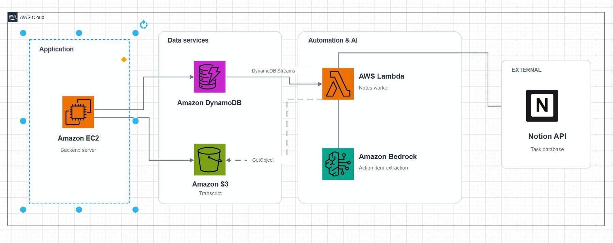

# From Meeting Transcripts to Notion Tasks: When DynamoDB Streams, Lambda, and Bedrock Work Together

Having a complete transcript after a meeting does not necessarily solve the follow-up problem. A transcript might contain thousands of words, while the most useful information is often much simpler: Who is responsible for which task? What is the deadline? Which action items still need attention?

One practical approach is to combine **Amazon DynamoDB Streams, AWS Lambda, and Amazon Bedrock** to extract action items automatically and synchronize them with Notion.

## 1. How does the architecture work?

Imagine that someone says during a meeting:

> "Lan will finish the login API by October 30."

After the meeting ends, the system can follow this workflow:

**Amazon DynamoDB and DynamoDB Streams**

The backend updates the meeting status to `COMPLETED` in DynamoDB. DynamoDB Streams captures the data change, and AWS Lambda can be configured to process the stream event.

The useful separation here is that the backend does not need to invoke the entire AI workflow directly. Post-meeting analysis can run independently.

**AWS Lambda**

Lambda acts as the coordinator. It receives the event, retrieves the corresponding transcript, and prepares the content for AI processing.

Instead of copying a long transcript into Notion, the Lambda function asks a model available through Amazon Bedrock to identify relevant action items.

**Amazon Bedrock**

The language model turns conversational content into structured data. For example:

- **Task:** Complete the login API
- **Assignee:** Lan
- **Deadline:** October 30
- **Source:** The relevant transcript segment

After receiving the response, Lambda validates the data and calls the Notion API to create an item in a task database.

## 2. Why not process everything in the backend?

AI processing time can vary depending on transcript length and the model being used.

If the entire workflow is included in the main request, the backend must also handle timeouts, retries, and failures from external services.

Combining DynamoDB Streams with Lambda decouples the database update from AI analysis. The backend only needs to persist the meeting status; a separate worker handles the subsequent work.

## 3. Important design considerations

There are several details that require careful handling.

First, an LLM may assign the wrong person to a task or invent a deadline. Fields that are not clearly supported by the transcript should remain empty rather than being inferred.

Second, DynamoDB Streams events can be retried. Without duplicate protection, the same task could be created in Notion more than once. An idempotency key associated with each event or action item can help prevent this.

Finally, important tasks may benefit from an explicit user confirmation step before they are created or updated in the external system.

## Conclusion

The interesting part of this architecture is not any single service but how the services complement one another.

DynamoDB Streams detects changes, Lambda coordinates processing, Bedrock converts natural language into structured information, and Notion makes the results actionable.

This is a practical generative AI pattern for an AI Meeting Assistant: moving beyond storing meeting transcripts toward helping people follow up on the work agreed during a meeting.

## References

1. [AWS – DynamoDB Streams and Lambda Triggers](https://docs.aws.amazon.com/amazondynamodb/latest/developerguide/Streams.Lambda.html)
2. [Amazon Bedrock – Structured Outputs](https://docs.aws.amazon.com/bedrock/latest/userguide/structured-output.html)
3. [Notion – Create a Page API](https://developers.notion.com/reference/post-page)

---
**Bài viết đã đăng trên AWS Study Group:** [https://www.facebook.com/groups/awsstudygroupfcj/permalink/2318521822246110/?rdid=ZaQ8iG8gfsmGlEWb#](https://www.facebook.com/groups/awsstudygroupfcj/permalink/2318521822246110/?rdid=ZaQ8iG8gfsmGlEWb#)
