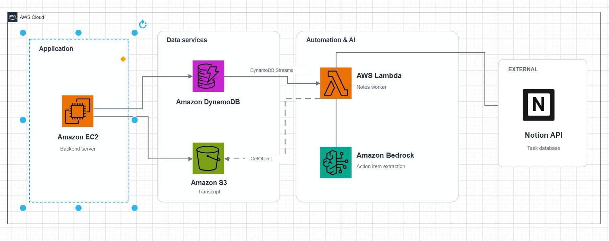
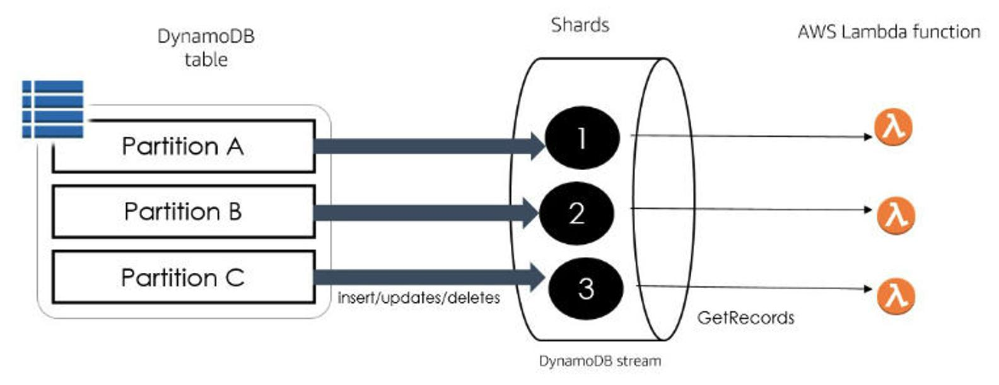

# Từ Bản transcript Cuộc họp sang Nhiệm vụ Notion: Khi DynamoDB Streams, Lambda và Bedrock Làm Cùng Nhau

**Đăng ngày: 28/10/2026**

Có một bản transcript hoàn chỉnh sau một cuộc họp không nhất thiết có nghĩa là vấn đề theo dõi đã được giải quyết. Một bản transcript có thể chứa hàng nghìn từ, trong khi thông tin hữu ích nhất thường đơn giản hơn nhiều: Ai phụ trách nhiệm vụ nào? Hạn chót là khi nào? Mục tiêu hành động nào vẫn cần quan tâm?

Việc nghe lại bản ghi âm, đọc toàn bộ bản transcript, quyết định việc cần làm, ghi lại và tạo nhiệm vụ trong công cụ quản lý dự án là quá trình tốn thời gian và dễ bị lỗi. Các mục quan trọng có thể bị quên, hạn chót bị bỏ lỡ, và ngữ cảnh bị mất giữa cuộc họp và công cụ theo dõi nhiệm vụ.

Một cách tiếp cận thực tế là kết hợp **Amazon DynamoDB Streams, AWS Lambda, và Amazon Bedrock** để trích xuất các mục hành động tự động và đồng bộ hóa chúng với Notion. Bài viết này đi sâu vào kiến trúc, các cân nhắc khi triển khai, ví dụ mã Python, chiến lược idempotency, xác nhận của con người, cân nhắc về chi phí và cách mở rộng mô hình này cho các công cụ khác.



---

## 1. Kiến trúc hoạt động như thế nào?

Hãy tưởng tượng rằng ai đó nói trong cuộc họp:

> "Lan sẽ hoàn thành API đăng nhập đến ngày 30 tháng 10."

Sau cuộc họp kết thúc, hệ thống có thể theo quy trình sau:

### Amazon DynamoDB và DynamoDB Streams

Hệ thống backend cập nhật trạng thái cuộc họp thành `COMPLETED` trong DynamoDB. DynamoDB Streams bắt nắm sự thay đổi dữ liệu, và AWS Lambda có thể được cấu hình để xử lý sự kiện stream.

Phân tách hữu ích ở đây là backend không cần trực tiếp gọi toàn bộ quy trình AI. Phân tích sau cuộc họp có thể chạy độc lập, và ứng dụng chính vẫn phản hồi nhanh.

### AWS Lambda

Lambda đóng vai trò điều phối. Nó nhận sự kiện, truy xuất transcript tương ứng từ Amazon S3 và chuẩn bị nội dung để xử lý bằng AI.

Thay vì sao chép một bản transcript dài vào Notion, hàm Lambda yêu cầu một mô hình có sẵn qua Amazon Bedrock xác định các mục hành động liên quan.

### Amazon Bedrock

Mô hình ngôn ngữ biến nội dung cuộc trò chuyện thành dữ liệu có cấu trúc. Ví dụ:

- **Nhiệm vụ:** Hoàn thành API đăng nhập
- **Người phụ trách:** Lan
- **Hạn chót:** 30 tháng 10
- **Nguồn:** Đoạn transcript liên quan

Sau khi nhận phản hồi, Lambda xác thực dữ liệu và gọi Notion API để tạo một mục trong cơ sở dữ liệu nhiệm vụ.

### Tại sao thiết kế này hoạt động

- **Hướng sự kiện**: Không cần polling. Đường ống bắt đầu tự động khi siêu dữ liệu cuộc họp thay đổi trong DynamoDB.
- **Không máy chủ**: Không cần quản lý EC2 instances. Bạn chỉ trả tiền cho thời gian compute và gọi API bạn thực sự sử dụng.
- **Tách rời**: Lưu trữ transcript, trích xuất AI và tạo nhiệm vụ là các vấn đề riêng biệt. Bạn có thể thay thế Bedrock bằng một mô hình khác, hoặc Notion bằng một công cụ quản lý nhiệm vụ khác,Without viết lại toàn bộ đường ống.
- **Quan sát được**: Mỗi bước phát ra nhật ký và số liệu đến Amazon CloudWatch, giúp dễ dàng gỡ lỗi khi có sự cố.

---



*Hình 2. Các mảnh luồng DynamoDB Stream và xử lý sự kiện AWS Lambda. Nguồn: AWS Database Blog.*

## 2. Cách hoạt động từng bước

### Bước 1: Siêu dữ liệu cuộc họp đến DynamoDB

Khi một cuộc họp kết thúc, một mục được ghi (hoặc cập nhật) trong một bảng DynamoDB gọi là `Meetings`:

| meeting_id (PK) | status | transcript_s3_url | created_at |
|-----------------|--------|-------------------|------------|
| mtg-2026-10-28-001 | completed | s3://meeting-transcripts/mtg-001.txt | 2026-10-28T10:00:00Z |

Trường `status` chuyển từ `pending` sang `completed`. DynamoDB Streams bắt nắm sự thay đổi này.

### Bước 2: Lambda trích xuất các mục hành động với Bedrock

Một hàm Lambda (`process-meeting-transcript`) được kích hoạt bởi stream. Nó:

1. Đọc `meeting_id` và `transcript_s3_url` từ bản ghi stream.
2. Tải xuống transcript từ S3.
3. Gọi Amazon Bedrock với một prompt như:

> Bạn là một trợ trích xuất các mục hành động từ bản transcript cuộc họp.
>
> Bản transcript:
> {{transcript}}
>
> Trả về CHỈ một mảng JSON. Mỗi mục: {{"title": "...", "description": "...", "assignee": "...", "due_date": "...", "priority": "Cao|Trung bình|Thấp"}}
> Chỉ bao gồm các mục rõ ràng là có thể thực hành. Bỏ qua cuộc thảo luận chung.

4. Phân tích phản hồi JSON từ Bedrock.

### Bước 3: Xác nhận của con người

Trước khi ghi các nhiệm vụ vào Notion, các mục hành động đã trích xuất được tạm dừng để xem xét. Các tùy chọn bao gồm:

* Lưu các nhiệm vụ được đề xuất vào một bảng DynamoDB gọi là `ProposedTasks` với `status = pending_review`.
* Gửi một thông báo (Slack, email, hoặc bảng thông báo nội bộ) với các nhiệm vụ được đề xuất và các nút Approve/Reject.
* Chỉ ghi vào Notion sau khi một người phê duyệt đánh dấu mục là `approved`.

### Bước 4: Tạo nhiệm vụ trong Notion

Sau khi được xác nhận, một hàm Lambda gọi Notion API (`POST https://api.notion.com/v1/pages`) để tạo một trang trong cơ sở dữ liệu Notion:

* **Tiêu đề**: Tiêu đề mục hành động
* **Người phụ trách**: Người phụ trách nhiệm vụ
* **Hạn chót**: Khi nào nên hoàn thành
* **Mức độ ưu tiên**: Cao / Trung bình / Thấp
* **Cuộc họp liên quan**: Đường link ngược lại bản ghi cuộc họp gốc

### Bước 5: Tính idempotency

Để tránh tạo các nhiệm vụ trùng lặp nếu Lambda bị thử lại hoặc sự kiện stream được gửi hai lần:

* Mỗi bộ nhiệm vụ được đề xuất được lưu với một khóa duy nhất `meeting_id` + `batch_id`.
* Trước khi ghi vào Notion, hàm kiểm tra xem các nhiệm vụ cho `meeting_id` này đã tồn tại trong bảng `ProposedTasks` hay chưa.
* Notion page ghi lại `notion_page_id` vào DynamoDB để cuộc họp không được xử lý lại.

---

## 4. Ví dụ: Xử lý Lambda (Python)

```python
import json
import boto3
import os
from botocore.exceptions import ClientError

s3 = boto3.client("s3")
bedrock = boto3.client("bedrock-runtime")
dynamodb = boto3.resource("dynamodb")

MODEL_ID = os.environ.get("BEDROCK_MODEL_ID", "anthropic.claude-3-sonnet-20240229-v1:0")
NOTION_DATABASE_ID = os.environ["NOTION_DATABASE_ID"]
NOTION_API_KEY = os.environ["NOTION_API_KEY"]
PROPOSED_TABLE = os.environ["PROPOSED_TASKS_TABLE"]

def extract_action_items(transcript: str) -> list:
    prompt = f"""Trích xuất các mục hành động từ bản transcript cuộc họp này.
Trả về CHỈ một mảng JSON. Mỗi mục: {{"title": "...", "description": "...", "assignee": "...", "due_date": "...", "priority": "Cao|Trung bình|Thấp"}}
Bản transcript:
{transcript}"""

    response = bedrock.invoke_model(
        modelId=MODEL_ID,
        body=json.dumps({
            "anthropic_version": "bedrock-2023-05-31",
            "max_tokens": 1000,
            "messages": [{"role": "user", "content": prompt}]
        })
    )
    result = json.loads(response["body"].read())
    return json.loads(result["content"][0]["text"])

def save_proposed_tasks(meeting_id: str, items: list):
    table = dynamodb.Table(PROPOSED_TABLE)
    table.put_item(Item={
        "meeting_id": meeting_id,
        "status": "pending_review",
        "items": items,
        "created_at": json.dumps({"__type": "timestamp", "iso": str(__import__("datetime").datetime.utcnow())})
    })

def already_processed(meeting_id: str) -> bool:
    table = dynamodb.Table(PROPOSED_TABLE)
    resp = table.get_item(Key={"meeting_id": meeting_id})
    return "Item" in resp

def lambda_handler(event, context):
    for record in event["Records"]:
        if record["eventName"] not in ("INSERT", "MODIFY"):
            continue

        meeting_id = record["dynamodb"]["Keys"]["meeting_id"]["S"]
        status = record["dynamodb"]["NewImage"].get("status", {}).get("S")
        s3_url = record["dynamodb"]["NewImage"].get("transcript_s3_url", {}).get("S")

        if status != "completed" or not s3_url:
            continue

        # Kiểm tra tính idempotency
        if already_processed(meeting_id):
            continue

        bucket, key = parse_s3_url(s3_url)
        transcript = s3.get_object(Bucket=bucket, Key=key)["Body"].read().decode("utf-8")

        items = extract_action_items(transcript)

        # Tạm dừng để xác nhận của con người trước khi ghi vào Notion
        save_proposed_tasks(meeting_id, items)

        # Sau khi xác nhận (bước riêng biệt), gọi create_notion_tasks(items)

    return {"statusCode": 200}
```

---

## 5. Tính idempotency và xác nhận của con người

| Lo | Cách xử lý |
|-----|-------------|
| Xử lý trùng lặp | Bảng DynamoDB lưu `processed_meeting_ids`; Lambda kiểm tra trước khi tạo Notion tasks. |
| Stream gửi lại | Cùng `meeting_id` tạo ra cùng các nhiệm vụ được đề xuất; Ghi Notion bị khóa bước trước khi xác nhận. |
| Tạo nhầm nhiệm vụ | Bước xem xét của con người cho phép người phê duyệt chỉnh sửa hoặc từ chối các mục trước khi chúng đến Notion. |
| Thất bại một phần | Các nhiệm vụ được đề xuất được lưu trong DynamoDB trước; Ghi Notion là một bước riêng biệt, có thể thử lại. |
| LLM bị ảo giác | Các trường không được hỗ trợ rõ ràng bởi transcript nên được để trống thay vì bị suy luận. |

---

## 6. Cân nhắc về chi phí

* **Amazon S3**: Trả tiền theo GB lưu trữ và mỗi yêu cầu. Các bản transcript là các tệp văn bản nhỏ, do đó chi phí gần như không đáng kể.
* **DynamoDB**: Trả tiền mỗi yêu cầu đọc/ghi và lưu trữ. Lý tưởng cho siêu dữ liệu cuộc họp nhẹ.
* **AWS Lambda**: Trả tiền mỗi lần gọi và thời gian. Các hàm Python ngắn gọn giữ chi phí thấp.
* **Amazon Bedrock**: Trả tiền mỗi token đầu vào/đầu ra được mô hình xử lý. Transcript rất dài tốn kém hơn; hãy cân nhắc tóm tắt các transcript rất dài trước khi gửi đến Bedrock.
* **Notion API**: Gói miễn phí có sẵn cho các nhóm nhỏ; gói trả phí cho giới hạn cao hơn.

---

## 7. Mở rộng mô hình

Mô hình tương tự có thể được mở rộng cho:

* **Jira, Asana, Trello, hoặc ClickUp**: Thay thế lệnh gọi Notion API bằng lệnh gọi API của công cụ quản lý nhiệm vụ tương ứng.
- **Email transcripts**: Thay thế S3 + DynamoDB bằng một SES inbound email handler.
- **Call center transcripts**: Thay thế bản ghi âm cuộc họp bằng các bản ghi cuộc gọi trung tâm chăm sóc khách hàng từ Amazon Connect.
- **Báo cáo định kỳ**: Thêm một Lambda quét hàng tuần quét tất cả các mục `pending_review` và gửi một tóm tắt email.

---

## 8. Kết luận

Kiến trúc này chuyển đổi bản transcript cuộc họp thành các công việc có cấu trúc và có thể theo dõi mà không cần sao chép thủ công. Bằng cách kết hợp DynamoDB Streams, AWS Lambda, Amazon Bedrock và Notion API, bạn có một đường ống không máy chủ mà:

* Bắt đầu tự động khi một cuộc họp kết thúc.
* Trích xuất các mục hành động bằng AI sinh tạo.
* Giữ con người trong vòng lặp trước khi các nhiệm vụ được tạo.
* Tránh các bản sao chép bằng cách kiểm tra tính idempotency.

Mô hình tương tự có thể được mở rộng cho các nguồn tài liệu khác (email, vé hỗ trợ, bản ghi cuộc gọi trung tâm chăm sóc khách hàng) và các điểm đến nhiệm vụ khác (Jira, Asana, Trello, hoặc cơ sở dữ liệu tùy chỉnh).

---

## Tài liệu tham khảo

1. [AWS – DynamoDB Streams và Lambda Triggers](https://docs.aws.amazon.com/amazondynamodb/latest/developerguide/Streams.Lambda.html)
2. [Amazon Bedrock – Structured Outputs](https://docs.aws.amazon.com/bedrock/latest/userguide/structured-output.html)
3. [Notion – Create a Page API](https://developers.notion.com/reference/post-page)
4. [AWS Lambda – Tài liệu](https://docs.aws.amazon.com/lambda/)

---

**Bài viết đã đăng trên AWS Study Group:** [https://www.facebook.com/groups/awsstudygroupfcj/permalink/2318521822246110/?rdid=ZaQ8iG8gfsmGlEWb#](https://www.facebook.com/groups/awsstudygroupfcj/permalink/2318521822246110/?rdid=ZaQ8iG8gfsmGlEWb#)
