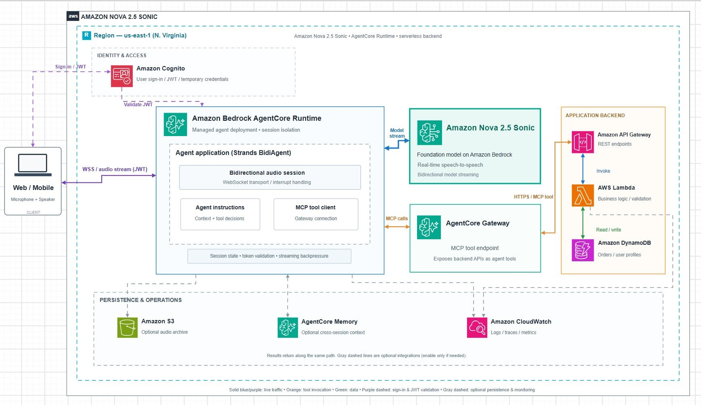

# Amazon Nova 2.5 Sonic – When a Voice Agent Can Do More Than Talk

**Published: October 28, 2026**

An AI voice assistant is often described as a three-stage pipeline: convert speech to text (Speech-to-Text), send the text to an LLM, and convert the answer back to audio (Text-to-Speech).

This design is familiar and straightforward. However, chaining different components can increase latency in real-time conversations. It also introduces challenges when a user interrupts a response, changes the question, or asks the assistant to carry out an action.

On **October 5, 2026**, AWS announced **Amazon Nova 2.5 Sonic**, a new speech-to-speech model available through Amazon Bedrock, designed for natural real-time conversations and task execution through connected tools.

The interesting aspect is not only voice generation and understanding but also how the model can work with AWS services to create a complete voice agent.

---

## 1. What Makes Amazon Nova 2.5 Sonic Different?

Instead of requiring a separate STT → LLM → TTS pipeline, Nova 2.5 Sonic can take audio input and generate audio output within the same model.

AWS has also improved reasoning, instruction following, and tool-calling capabilities compared with Nova 2 Sonic.

Several features stand out:

- **Real-time speech-to-speech:** Two-way voice interactions with low latency.
- **Barge-in:** Users can interrupt the agent while it is speaking.
- **Tool calling:** The model can request that the application call an API to retrieve information or perform an action.
- **Asynchronous tool calling:** The conversation does not always have to stop completely while external tools are running.
- **Cross-modal interaction:** Voice and text can be combined in the same session.

Tool calling and barge-in are particularly important for voice agents used in real applications.

---

## 2. Combining Nova Sonic with AWS Services

One possible architecture combines Amazon Nova 2.5 Sonic with Amazon Bedrock AgentCore, AWS Lambda, and Amazon DynamoDB.

### Amazon Bedrock AgentCore Runtime

**Amazon Bedrock AgentCore Runtime** provides a runtime for agents and can support bidirectional WebSocket communication for transmitting and receiving audio. This allows developers to use a managed agent runtime rather than building the entire session infrastructure themselves.

Within the runtime, **Strands BidiAgent** can manage the conversation session, communicate with Nova Sonic, and handle tool requests.

### Amazon Bedrock

**Amazon Bedrock** provides the Nova 2.5 Sonic model, which interprets speech, maintains conversation context, and generates responses.

### AgentCore Gateway and AWS Lambda

When the agent needs external data, **AgentCore Gateway** can provide access to MCP-based tools. Behind the gateway, **AWS Lambda** handles business logic while **Amazon DynamoDB** stores application data.

The model therefore does not need unrestricted direct access to the database. Business APIs can enforce authorization, validation, and other safeguards.

### Supporting Services

- **Amazon S3**: Optional audio archive for recorded sessions.
- **Amazon CloudWatch**: Logs, traces, and metrics for observability.
- **Amazon Cognito**: User sign-in / JWT / temporary credentials for identity and access.

---

## 3. The Interesting Part: Talking and Completing Tasks

Consider a customer-service voice agent.

A customer asks:

> "Can you check my latest order?"

The agent invokes a tool to check order status. While the system is retrieving that information, the customer adds:

> "Actually, can I change the delivery address?"

A well-designed agent must preserve context, understand the new request, and identify the necessary actions.

If an address change is possible, it can request the corresponding API. However, any actual update must follow access controls, business rules, and appropriate confirmation steps.

This separates an AI system that merely speaks from a voice agent that can interact with external systems.

Another example is when an agent is explaining a delivery policy and the user interrupts:

> "Just tell me when it arrives."

Barge-in support helps the application respond to this interruption rather than forcing the user to listen to the entire previous answer.

### Key Capabilities of a Production Voice Agent

A production-ready AI Agent requires more than a Large Language Model. Important components include:

- **LLM:** Processes requests and generates responses.
- **Runtime:** Provides an environment in which the Agent can execute.
- **Tools and APIs:** Allow the Agent to interact with external systems.
- **Memory and Context:** Help retain relevant information across interactions.
- **Security and Guardrails:** Restrict unsafe operations and protect sensitive resources.
- **Monitoring and Cost Management:** Help track usage, performance, and operating expenses.

---

## 4. Should Nova 2.5 Sonic Be Used for Every Audio Application?

Not necessarily.

Nova 2.5 Sonic is more suited to live voice interaction, such as customer support, appointment scheduling, and spoken information retrieval.

For a workflow that simply converts a recorded audio file into text for storage or later analysis, Amazon Transcribe remains a reasonable option.

AWS lists seven supported languages for Nova 2.5 Sonic, and Vietnamese was not on the officially supported list at the time of this post. This is an important limitation for applications serving Vietnamese-speaking users.

The overall cost is not limited to model usage. AgentCore Runtime, Gateway, Lambda, DynamoDB, and other infrastructure components may add operating costs.

---

## 5. Conclusion

The important shift illustrated by Nova 2.5 Sonic is the move from voice assistants to voice agents.

Rather than only listening and responding, the system can maintain a conversation, retrieve information, and invoke authorized tools to carry out tasks.

Combining Nova Sonic with AgentCore and other AWS services offers developers a practical approach to building real-time conversational applications without managing every part of the agent infrastructure on their own.

This direction is worth exploring as AI applications evolve from answering questions to helping users complete real work.

---

## References

1. [AWS – Amazon Nova 2.5 Sonic Announcement](https://aws.amazon.com/about-aws/whats-new/2026/10/amazon-nova-2.5-Sonic/)
2. [Amazon Bedrock – Nova 2.5 Sonic Model Card](https://docs.aws.amazon.com/bedrock/latest/userguide/model-card-amazon-nova-2-5-sonic.html)
3. [AWS Machine Learning Blog – Build a Voice Travel Concierge](https://aws.amazon.com/blogs/machine-learning/build-a-voice-travel-concierge-with-amazon-bedrock-agentcore-managed-knowledge-base-and-nova-sonic/)

---

**Bài viết đã đăng trên AWS Study Group:** [https://www.facebook.com/groups/awsstudygroupfcj/permalink/2318573642240928/?rdid=KuaalDDzF6dEIiTz#](https://www.facebook.com/groups/awsstudygroupfcj/permalink/2318573642240928/?rdid=KuaalDDzF6dEIiTz#)
