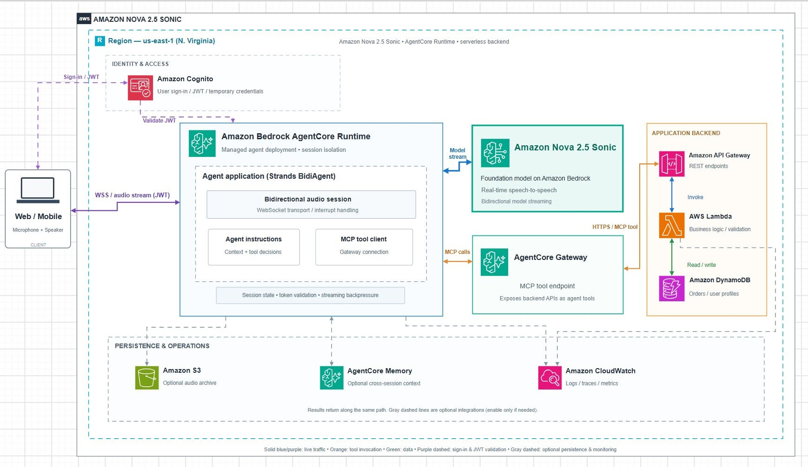
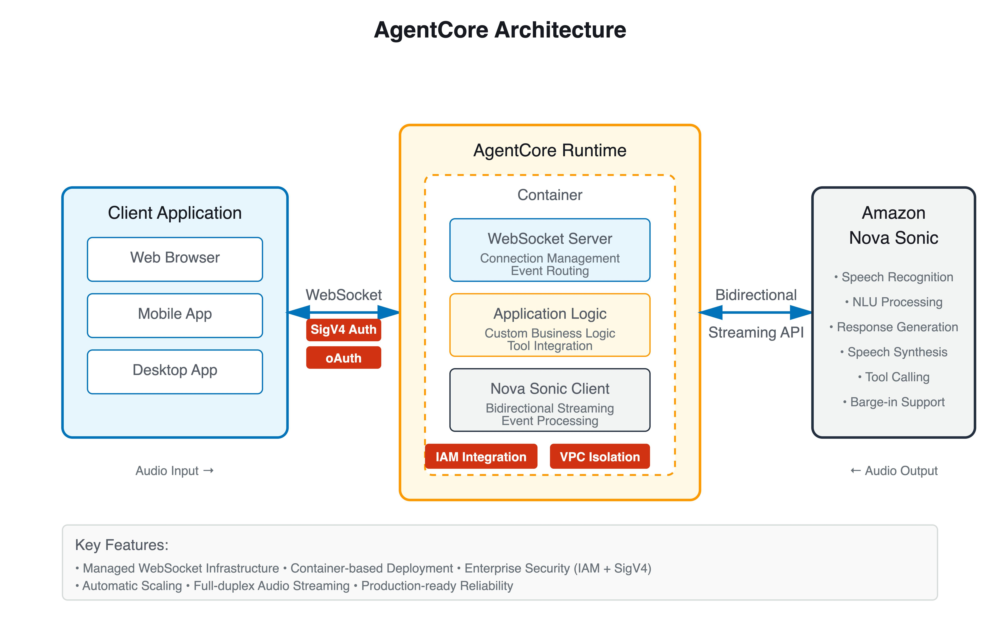

# Amazon Nova 2.5 Sonic – Khi một trợ lý giọng nói có thể làm nhiều hơn chỉ nói chuyện

Một trợ lý giọng nói AI thường được mô tả là một quy trình ba giai đoạn: chuyển đổi giọng nói thành văn bản (Speech-to-Text), gửi văn bản đến LLM, và chuyển đổi câu trả lời trở lại âm thanh (Text-to-Speech).

Thiết kế này là quen thuộc và đơn giản. Tuy nhiên, việc kết nối các thành phần khác nhau có thể làm tăng độ trễ trong các cuộc trò chuyện thời gian thực. Nó cũng tạo ra những thách thức khi người dùng ngắt câu trả lời, thay đổi câu hỏi, hoặc yêu cầu trợ lý thực hiện một hành động.

Vào ngày **5 tháng 10 năm 2026**, AWS đã công bố **Amazon Nova 2.5 Sonic**, một mô hình giọng nói-giọng nói mới có sẵn thông qua Amazon Bedrock, được thiết kế cho các cuộc trò chuyện giọng nói thời gian thực tự nhiên và thực thi nhiệm vụ thông qua các công cụ được kết nối.

Điều thú vị không chỉ là việc sinh tạo và hiểu giọng nói mà còn là cách mô hình có thể làm việc với các dịch vụ AWS để tạo ra một trợ lý giọng nói hoàn chỉnh.

---

## 1. Điều gì làm Amazon Nova 2.5 Sonic khác biệt?

Thay vì yêu cầu một quy trình STT → LLM → TTS riêng biệt, Nova 2.5 Sonic có thể nhận đầu vào âm thanh và tạo ra đầu ra âm thanh trong cùng một mô hình.

AWS cũng đã cải thiện khả năng suy luận, tuân thủ hướng dẫn và gọi công cụ so với Nova 2 Sonic.

Có một số tính năng nổi bật:

- **Nhận dạng giọng nói-giọng nói thời gian thực:** Tương tác giọng nói hai chiều với độ trễ thấp.
- **Barge-in:** Người dùng có thể ngắt lời của trợ lý khi nó đang nói.
- **Tool calling:** Mô hình có thể yêu cầu ứng dụng gọi một API để truy xuất thông tin hoặc thực hiện một hành động.
- **Tool calling bất đồng bộ:** Cuộc trò chuyện không nhất thiết phải ngừng hoàn toàn khi các công cụ bên ngoài đang chạy.
- **Tương tác đa chế độ:** Giọng nói và văn bản có thể được kết hợp trong cùng một phiên.

Tool calling và barge-in đặc biệt quan trọng đối với các trợ lý giọng nói được sử dụng trong các ứng dụng thực tế.

---

## 2. Kết hợp Nova Sonic với các dịch vụ AWS

Một kiến trúc có thể kết hợp Amazon Nova 2.5 Sonic với Amazon Bedrock AgentCore, AWS Lambda và Amazon DynamoDB.

### Amazon Bedrock AgentCore Runtime

**Amazon Bedrock AgentCore Runtime** cung cấp một thời gian chạy cho các trợ lý và có thể hỗ trợ giao tiếp WebSocket hai chiều để truyền và nhận âm thanh. Điều này cho phép các nhà phát triển sử dụng thời gian chạy trợ lý được quản lý thay vì xây dựng toàn bộ cơ sở hạ tầng phiên họp của riêng mình.

Trong thời gian chạy này, **Strands BidiAgent** có thể quản lý phiên trò chuyện, giao tiếp với Nova Sonic và xử lý các yêu cầu công cụ.

### Amazon Bedrock

**Amazon Bedrock** cung cấp mô hình Nova 2.5 Sonic, diễn giải giọng nói, duy trì ngữ cảnh cuộc trò chuyện và tạo ra các câu trả lời.

### AgentCore Gateway và AWS Lambda

Khi trợ lý cần dữ liệu bên ngoài, **AgentCore Gateway** có thể cung cấp quyền truy cập vào các công cụ dựa trên MCP. Phía sau cổng, **AWS Lambda** xử lý logic kinh doanh trong khi **Amazon DynamoDB** lưu trữ dữ liệu ứng dụng.

Do đó, mô hình không cần truy cập trực tiếp không hạn chế vào cơ sở dữ liệu. Các API kinh doanh có thể thực thi phân quyền, xác thực và các biện pháp bảo vệ khác.

### Các dịch vụ hỗ trợ

- **Amazon S3**: Lưu trữ âm thanh tùy chọn cho các phiên đã ghi.
- **Amazon CloudWatch**: Nhật ký, dấu vết và số liệu cho khả năng quan sát.
- **Amazon Cognito**: Đăng nhập người dùng / JWT / thông tin đăng nhập tạm thời cho danh tính và truy cập.

---

*Hình 2. Kiến trúc AgentCore Runtime cho tương tác giọng nói hai chiều bằng Amazon Nova Sonic. Nguồn: AWS Documentation.*

## 3. Phần thú vị: nói chuyện và hoàn thành nhiệm vụ

Hãy xem xét một trợ lý giọng nói chăm sóc khách hàng.

Một khách hàng hỏi:

> "Bạn có thể kiểm tra đơn hàng gần nhất của tôi không?"

Trợ lý gọi một công cụ để kiểm tra trạng thái đơn hàng. Khi hệ thống đang truy xuất thông tin đó, khách hàng thêm:

> "Thực ra, tôi có thể thay đổi địa chỉ giao hàng không?"

Một trợ lý tốt được thiết kế phải giữ ngữ cảnh, hiểu yêu cầu mới và xác định các hành động cần thiết.

Nếu việc thay đổi địa chỉ có thể thực hiện, nó có thể yêu cầu API tương ứng. Tuy nhiên, bất kỳ cập nhật thực tế nào cũng phải tuân theo kiểm soát truy cập, quy tắc kinh doanh và các bước xác nhận thích hợp.

Điều này tách biệt một hệ thống AI chỉ đơn thuần nói chuyện từ một trợ lý giọng nói có thể tương tác với các hệ thống bên ngoài.

Ví dụ khác là khi một trợ lý đang giải thích chính sách giao hàng và người dùng ngắt lời:

> "Chỉ cần bảo tôi khi nó đến."

Hỗ trợ barge-in giúp ứng dụng phản hồi với sự ngắt lời này thay vì buộc người dùng phải nghe toàn bộ câu trả lời trước đó.

### Các khả năng chính của một trợ lý giọng nói sản xuất

Một trợ lý giọng nói AI sẵn sàng sản xuất đòi hỏi nhiều hơn một Mô hình Ngôn ngữ Lớn. Các thành phần quan trọng bao gồm:

- **LLM:** Xử lý yêu cầu và tạo phản hồi.
- **Runtime:** Cung cấp môi trường mà trợ lý có thể thực thi.
- **Công cụ và API:** Cho phép trợ lý tương tác với các hệ thống bên ngoài.
- **Bộ nhớ và Ngữ cảnh:** Giúp giữ lại thông tin liên quan qua các tương tác.
- **Bảo mật và Guardrails:** Hạn chế các hoạt động không an toàn và bảo vệ tài nguyên nhạy cảm.
- **Giám sát và Quản lý chi phí:** Giúp theo dõi việc sử dụng, hiệu suất và chi phí vận hành.

---

## 4. Nova 2.5 Sonic nên được sử dụng cho mọi ứng dụng âm thanh không?

Không nhất thiết.

Nova 2.5 Sonic phù hợp hơn với tương tác giọng nói trực tiếp, chẳng hạn như chăm sóc khách hàng, lên lịch hẹn và truy xuất thông tin qua giọng nói.

Đối với một quy trình đơn giản chuyển đổi một tệp âm thanh đã ghi thành văn bản để lưu trữ hoặc phân tích sau này, Amazon Transcribe vẫn là một lựa chọn hợp lý.

AWS liệt kê bảy ngôn ngữ được hỗ trợ cho Nova 2.5 Sonic, và tiếng Việt không có trong danh sách được hỗ trợ chính thức tại thời điểm viết bài này. Đây là một hạn chế quan trọng đối với các ứng dụng phục vụ người nói tiếng Việt.

Tổng chi phí không chỉ giới hạn ở việc sử dụng mô hình. AgentCore Runtime, Gateway, Lambda, DynamoDB và các thành phần cơ sở hạ tầng khác có thể làm tăng chi phí vận hành.

---

## 5. Kết luận

Sự thay đổi quan trọng được minh họa bởi Nova 2.5 Sonic là sự chuyển đổi từ trợ lý giọng nói sang tác nhân giọng nói.

Thay vì chỉ nghe và phản hồi, hệ thống có thể duy trì một cuộc trò chuyện, truy xuất thông tin và gọi các công cụ được cho phép để thực hiện các nhiệm vụ.

Kết hợp Nova Sonic với AgentCore và các dịch vụ AWS khác mang lại cho các nhà phát triển một cách tiếp cận thực tế để xây dựng các ứng dụng trò chuyện thời gian thực mà không cần quản lý mọi phần của cơ sở hạ tầng trợ lý của riêng mình.

Hướng này đáng để khám phá khi các ứng dụng AI phát triển từ trả lời câu hỏi sang giúp người dùng hoàn thành công việc thực tế.

---

## Tài liệu tham khảo

1. [AWS – Thông báo Amazon Nova 2.5 Sonic](https://aws.amazon.com/about-aws/whats-new/2026/10/amazon-nova-2.5-Sonic/)
2. [Amazon Bedrock – Thẻ mô hình Nova 2.5 Sonic](https://docs.aws.amazon.com/bedrock/latest/userguide/model-card-amazon-nova-2-5-sonic.html)
3. [Blog Máy học AWS – Xây dựng Trợ lý Du lịch Giọng nói](https://aws.amazon.com/blogs/machine-learning/build-a-voice-travel-concierge-with-amazon-bedrock-agentcore-managed-knowledge-base-and-nova-sonic/)

---

**Bài viết đã đăng trên AWS Study Group:** [https://www.facebook.com/groups/awsstudygroupfcj/permalink/2318573642240928/?rdid=KuaalDDzF6dEIiTz#](https://www.facebook.com/groups/awsstudygroupfcj/permalink/2318573642240928/?rdid=KuaalDDzF6dEIiTz#)
