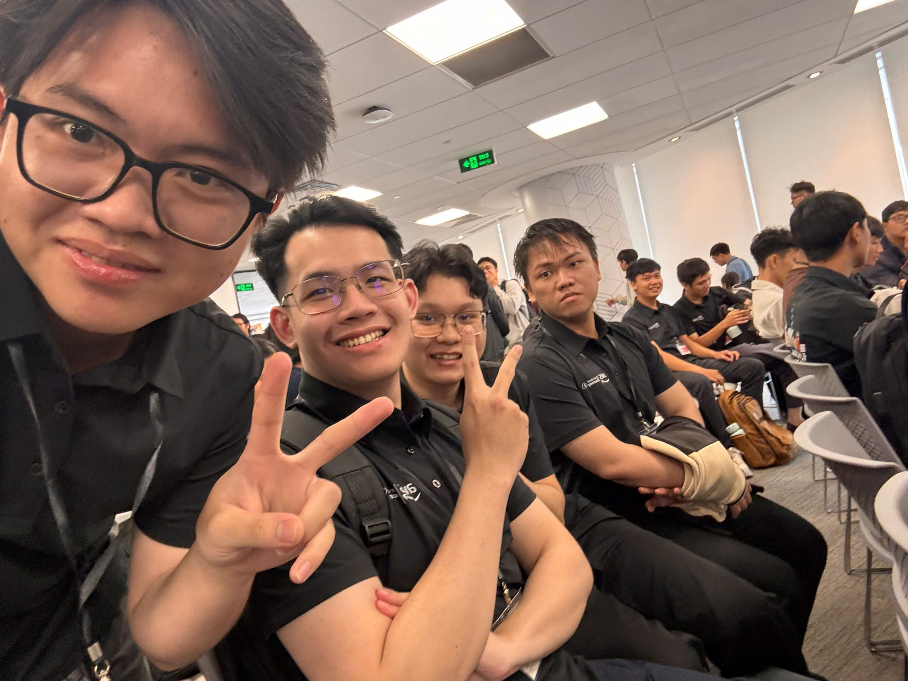
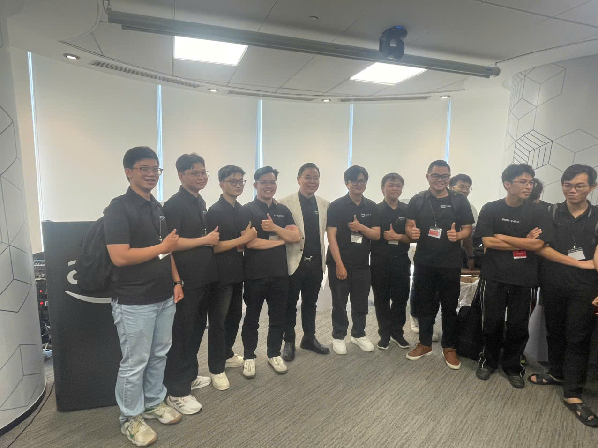

# Event Takeaways: "Buildrathon Kickoff: Code the Future with CMC Global"

### Event Objectives

- Learn more about **AWS Cloud** and real-world applications of **Generative AI**.
- Catch up on the **Agentic AI** trend and how AI Agents can be applied to solve practical problems.
- Join a **hands-on** activity building an AI Agent solution under the guidance of experts.
- Network and connect with experts from **CMC Global** and people who share the same Cloud & AI orientation.
- Gain additional perspectives on career development in **Cloud, AI and information technology**.

### Speakers

- **Thien Lu** – Program Manager, FCAJ
- **Truong Bui** – Tech Lead, CMC Global
- **Phong Pham** – Program Manager, FCAJ

### Key Highlights

#### AWS Cloud and Generative AI

- Explored the role of **AWS Cloud** in building and deploying modern applications.
- Updated on how **Generative AI** is being applied to real-world problems.
- Gained additional perspectives on combining Cloud and AI in product development.

#### Agentic AI and AI Agents

- Learned the concepts of **Agentic AI** and **AI Agents**.
- Gained a better understanding of the trend of using AI Agents in modern systems and products.
- Observed how businesses can apply AI to help solve practical problems.

#### Hands-on: building an AI Agent solution

- Joined a hands-on activity related to building an **AI Agent** solution.
- Had the opportunity to turn theoretical AI knowledge into a practical problem.
- Discussed with experts during the hands-on session to better understand how to approach and develop an AI solution.

#### Networking and career orientation

- Networked with experts from **CMC Global** and the **First Cloud Journey AI** program.
- Exchanged ideas with people who share the same orientation toward AWS, Cloud and AI.
- Gained additional perspectives on the skills and knowledge needed to grow in the technology field.

### What I Learned

#### Cloud and Generative AI knowledge

- Better understood the role of **AWS Cloud** in building AI applications.
- Caught up on more trends in applying **Generative AI** in practice.
- Realized that combining Cloud and AI knowledge is essential when developing modern AI products.

#### Agentic AI

- Gained a broader overview of **Agentic AI** and AI Agents.
- Understood that AI Agents go beyond content generation toward the ability to handle tasks and help solve practical problems.
- Gained more direction to continue exploring AI Agent systems in depth.

#### Hands-on experience

- Reinforced knowledge through **hands-on** activities.
- Better understood the difference between learning theory and deploying a practical solution.
- Recognized the importance of analyzing the problem before choosing technologies and building a solution.

#### Skills and career orientation

- Learned more about the skills needed to pursue the **Cloud & AI** field.
- Realized that besides technical knowledge, teamwork, communication and problem-solving skills are also very important.
- Gained more motivation to build practical projects instead of stopping at theoretical learning.

### Applying to Work

- Continue researching **AI Agents** and how to integrate Agents into current AI projects.
- Combine knowledge of **RAG, LLMs and Agentic AI** to experiment with systems capable of handling more complex tasks.
- Learn more about deploying AI applications on **AWS Cloud**.
- Apply a practical product-building mindset instead of focusing only on individual models or algorithms.
- Practice more through small projects to reinforce Cloud and Generative AI knowledge.

### Event Experience

Joining **"Buildrathon Kickoff: Code the Future with CMC Global"** was an opportunity for me to get closer to real-world applications of Cloud, Generative AI and Agentic AI. The event focused not only on knowledge but also emphasized building products, hands-on practice and connecting with people who share the same technology orientation.

#### Learning from the speakers

- The speakers shared perspectives on **Cloud, Generative AI and AI Agents**.
- Practical sharing helped me better understand how AI technologies are approached and applied in business environments.
- I gained additional perspectives on skill development orientation in Cloud & AI.

#### Hands-on experience

- The hands-on activity helped me approach the problem of **building an AI Agent solution** in a more practical way.
- Through the practice, I understood that building an AI product requires combining knowledge of AI, software and Cloud.
- It was also an opportunity to review what I had learned before and identify areas for further improvement.

#### Connecting and exchanging ideas

- Had the opportunity to connect with experts from **CMC Global**, FCAJ members and people who share the same passion for Cloud & AI.
- Direct exchanges gave me additional perspectives on technology, real-world projects and career orientation.
- Networking also helps expand the learning and knowledge-sharing environment going forward.

#### Lessons learned

- Learning Cloud and AI should go hand in hand with **practice and building real products**.
- Generative AI is evolving toward systems capable of performing tasks, in which **AI Agents and Agentic AI** are topics to keep researching.
- Technical knowledge is only one part; problem-solving ability, teamwork and understanding real-world problems are equally important.

#### Some event photos

*Poster introducing the "Buildrathon Kickoff: Code the Future with CMC Global" event.*

*Buildrathon Kickoff program information with speakers from FCAJ and CMC Global.*

> Overall, the event gave me additional perspectives on AWS Cloud, Generative AI and Agentic AI, while emphasizing the importance of turning knowledge into real products, actively practicing and connecting with the tech community.
