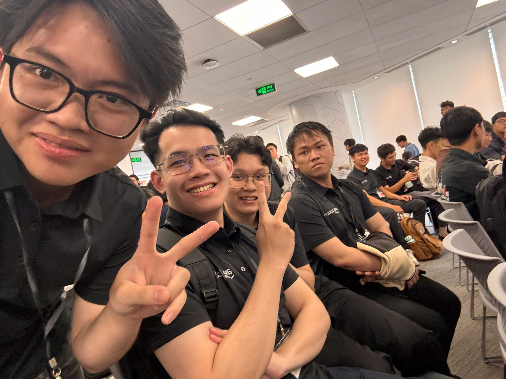
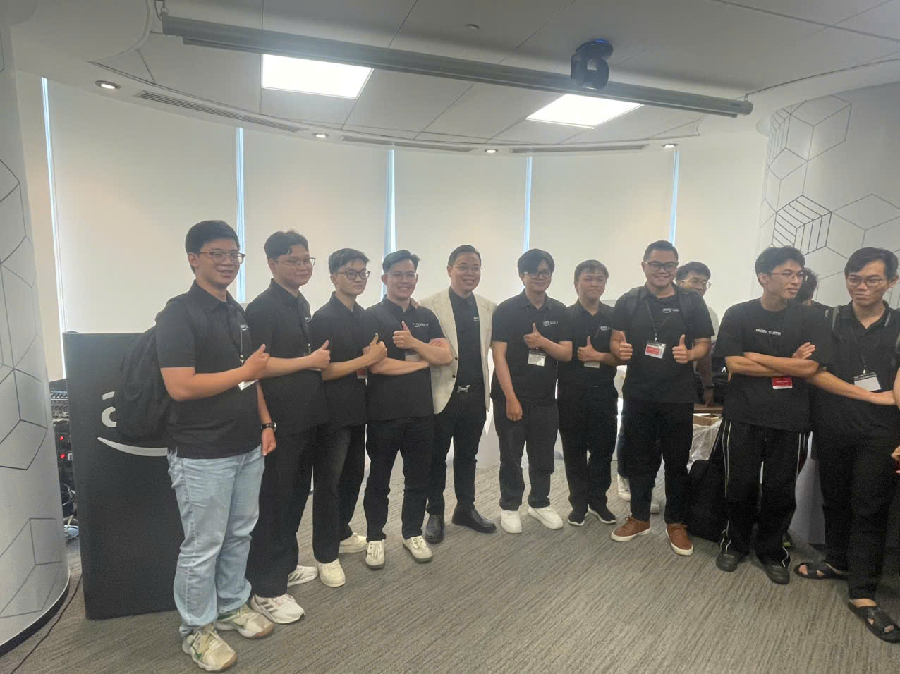

---
title: "Event 1"
date: 2026-09-26
weight: 1
chapter: false
pre: " <b> 4.1. </b> "
---

# Bài thu hoạch sự kiện “Buildrathon Kickoff: Code the Future with CMC Global”

### Mục Đích Của Sự Kiện

- Tìm hiểu thêm về **AWS Cloud** và những ứng dụng thực tế của **Generative AI**.
- Cập nhật xu hướng **Agentic AI** và cách AI Agent có thể được ứng dụng để giải quyết các bài toán thực tế.
- Tham gia hoạt động **hands-on** xây dựng giải pháp AI Agent dưới sự hướng dẫn của các chuyên gia.
- Giao lưu, kết nối với các chuyên gia đến từ **CMC Global** và những người có cùng định hướng về Cloud & AI.
- Có thêm góc nhìn về lộ trình phát triển nghề nghiệp trong lĩnh vực **Cloud, AI và công nghệ thông tin**.

### Danh Sách Diễn Giả

- **Thien Lu** – Program Manager, FCAJ
- **Truong Bui** – Tech Lead, CMC Global
- **Phong Pham** – Program Manager, FCAJ

### Nội Dung Nổi Bật

#### AWS Cloud và Generative AI

- Tìm hiểu vai trò của **AWS Cloud** trong việc xây dựng và triển khai các ứng dụng hiện đại.
- Cập nhật cách **Generative AI** đang được ứng dụng vào các bài toán thực tế.
- Có thêm góc nhìn về sự kết hợp giữa Cloud và AI trong quá trình phát triển sản phẩm.

#### Agentic AI và AI Agent

- Tìm hiểu khái niệm **Agentic AI** và **AI Agent**.
- Hiểu thêm về xu hướng sử dụng AI Agent trong các hệ thống và sản phẩm hiện đại.
- Quan sát cách doanh nghiệp có thể ứng dụng AI để hỗ trợ giải quyết các bài toán thực tế.

#### Hands-on xây dựng giải pháp AI Agent

- Tham gia hoạt động thực hành liên quan đến việc xây dựng giải pháp **AI Agent**.
- Có cơ hội chuyển những kiến thức lý thuyết về AI thành một bài toán thực tế.
- Trao đổi với chuyên gia trong quá trình thực hành để hiểu rõ hơn cách tiếp cận và phát triển một giải pháp AI.

#### Networking và định hướng nghề nghiệp

- Giao lưu với các chuyên gia đến từ **CMC Global** và chương trình **First Cloud Journey AI**.
- Trao đổi với những người có cùng định hướng về AWS, Cloud và AI.
- Có thêm góc nhìn về kỹ năng và kiến thức cần chuẩn bị để phát triển trong lĩnh vực công nghệ.

### Những Gì Học Được

#### Kiến thức về Cloud và Generative AI

- Hiểu rõ hơn vai trò của **AWS Cloud** trong quá trình xây dựng các ứng dụng AI.
- Cập nhật thêm xu hướng ứng dụng **Generative AI** trong thực tế.
- Nhận thấy việc kết hợp kiến thức Cloud và AI là cần thiết khi phát triển các sản phẩm AI hiện đại.

#### Agentic AI

- Có cái nhìn tổng quan hơn về **Agentic AI** và AI Agent.
- Hiểu rằng AI Agent không chỉ tạo nội dung mà còn hướng tới khả năng xử lý nhiệm vụ và hỗ trợ giải quyết các bài toán thực tế.
- Có thêm định hướng để tiếp tục tìm hiểu sâu về các hệ thống AI Agent.

#### Kinh nghiệm thực hành

- Củng cố kiến thức thông qua hoạt động **hands-on**.
- Hiểu rõ hơn sự khác biệt giữa việc học lý thuyết và triển khai một giải pháp thực tế.
- Nhận thấy tầm quan trọng của việc phân tích bài toán trước khi lựa chọn công nghệ và xây dựng giải pháp.

#### Kỹ năng và định hướng nghề nghiệp

- Hiểu thêm về những kỹ năng cần thiết khi theo đuổi lĩnh vực **Cloud & AI**.
- Nhận thấy bên cạnh kiến thức kỹ thuật, khả năng làm việc nhóm, giao tiếp và giải quyết vấn đề cũng rất quan trọng.
- Có thêm động lực xây dựng các project thực tế thay vì chỉ dừng lại ở việc học lý thuyết.

### Ứng Dụng Vào Công Việc

- Tiếp tục nghiên cứu về **AI Agent** và cách tích hợp Agent vào các project AI hiện tại.
- Kết hợp kiến thức về **RAG, LLM và Agentic AI** để thử nghiệm các hệ thống có khả năng xử lý tác vụ phức tạp hơn.
- Tìm hiểu thêm cách triển khai các ứng dụng AI trên **AWS Cloud**.
- Áp dụng tư duy xây dựng sản phẩm thực tế thay vì chỉ tập trung vào mô hình hoặc thuật toán riêng lẻ.
- Thực hành nhiều hơn thông qua các project nhỏ để củng cố kiến thức về Cloud và Generative AI.

### Trải nghiệm trong event

Tham gia sự kiện **“Buildrathon Kickoff: Code the Future with CMC Global”** là cơ hội để tôi tiếp cận gần hơn với các ứng dụng thực tế của Cloud, Generative AI và Agentic AI. Sự kiện không chỉ tập trung vào kiến thức mà còn nhấn mạnh việc xây dựng sản phẩm, thực hành và kết nối với những người có cùng định hướng công nghệ.

#### Học hỏi từ các diễn giả

- Các diễn giả chia sẻ những góc nhìn về **Cloud, Generative AI và AI Agent**.
- Những chia sẻ thực tế giúp tôi hiểu thêm cách các công nghệ AI được tiếp cận và ứng dụng trong môi trường doanh nghiệp.
- Tôi có thêm góc nhìn về định hướng phát triển kỹ năng trong lĩnh vực Cloud & AI.

#### Trải nghiệm hands-on

- Hoạt động thực hành giúp tôi tiếp cận bài toán **xây dựng giải pháp AI Agent** theo hướng thực tế hơn.
- Qua quá trình thực hành, tôi hiểu rằng để xây dựng một sản phẩm AI cần kết hợp kiến thức về AI, phần mềm và Cloud.
- Đây cũng là cơ hội để kiểm tra lại những kiến thức đã học trước đó và xác định những phần cần tiếp tục cải thiện.

#### Kết nối và trao đổi

- Có cơ hội kết nối với các chuyên gia của **CMC Global**, các thành viên của FCAJ và những người có cùng đam mê về Cloud & AI.
- Việc trao đổi trực tiếp giúp tôi có thêm góc nhìn về công nghệ, project thực tế và định hướng nghề nghiệp.
- Networking cũng giúp mở rộng môi trường học hỏi và trao đổi kiến thức trong thời gian tới.

#### Bài học rút ra

- Việc học Cloud và AI nên đi kèm với **thực hành và xây dựng sản phẩm thực tế**.
- Generative AI đang phát triển theo hướng các hệ thống có khả năng thực hiện nhiệm vụ, trong đó **AI Agent và Agentic AI** là những chủ đề cần tiếp tục nghiên cứu.
- Kiến thức kỹ thuật chỉ là một phần; khả năng giải quyết vấn đề, làm việc nhóm và hiểu bài toán thực tế cũng rất quan trọng.

#### Một số hình ảnh sự kiện

*Ảnh chụp tại sự kiện Buildrathon Kickoff (người thứ 3 từ trái qua).*

*Ảnh chụp tại sự kiện Buildrathon Kickoff (người thứ 2 từ trái qua).*

> Tổng thể, sự kiện giúp tôi có thêm góc nhìn về AWS Cloud, Generative AI và Agentic AI, đồng thời nhấn mạnh tầm quan trọng của việc biến kiến thức thành các sản phẩm thực tế, chủ động thực hành và kết nối với cộng đồng công nghệ.
