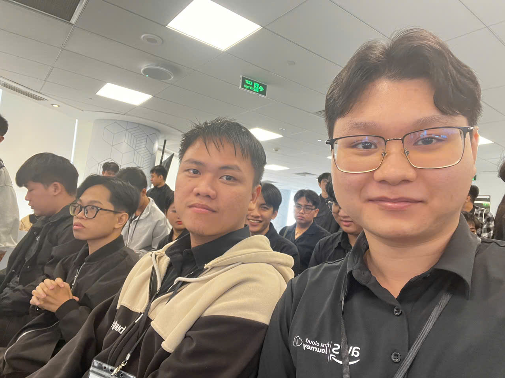

# Bản thu hoạch: "First Cloud AI Journey Meet Up"

### Mục tiêu sự kiện

- Khám phá các ứng dụng thực tế của **Điện toán đám mây, Trí tuệ nhân tạo và AI Agent** thông qua các bài trình bày ngành công nghiệp thực tế.
- Hiểu cách các doanh nghiệp sử dụng các dịch vụ AWS để xây dựng hệ thống Voice AI, quản lý tài nguyên đám mây và cải thiện bảo mật ứng dụng.
- Tìm hiểu các cách triển khai AI Agent vào sản xuất, bao gồm thời gian chạy, quản lý bộ nhớ và kiểm soát bảo mật.
- Khám phá cách AI Agent có thể hỗ trợ phát triển phần mềm, đánh giá mã, theo dõi hệ thống và quy trình tự động hóa.
- Nhận những thông tin thực tế từ các kỹ sư ngành và Tech Lead, và kết nối với cộng đồng Đám mây và AI.

### Diễn giả

Sự kiện có năm phiên kỹ thuật do các kỹ sư và lãnh đạo công nghệ làm việc trong Đám mây, AI và phát triển phần mềm trình bày:

- **Kiet Tran** – Revve AI, diễn giả của phiên **"Hear, Think, Speak – Xây dựng Trung tâm Liên lạc Voice-AI tiếng Việt trên AWS"**.
- **Long Huynh** – Styl Solution, diễn giả của phiên **"AWS Resource Access Manager"**.
- **Thinh Nguyen** – Styl Solution, diễn giả của phiên **"AWS Pentest với AWS Continuum / Security Agent"**.
- **Xuan An** – Trưởng AWS Student Builder Group HCMUTE, diễn giả của phiên **"Amazon Bedrock AgentCore"**.
- **Khoa Kieu** – Tech Lead tại ACB, và **Nghi Danh** – AWS Community Builder, diễn giả của phiên **"Kiro Crew"**.

Cuộc gặp gỡ diễn ra từ **9:00 sáng đến 12:00 trưa ngày 24 tháng 10 năm 2026**, ở tầng 26 của Bitexco Financial Tower tại Thành phố Hồ Chí Minh.

### Nội dung nổi bật

#### Hear, Think, Speak – Xây dựng Trung tâm Liên lạc Voice-AI tiếng Việt trên AWS

- Khám phá kiến trúc của hệ thống Voice AI được xây dựng trên AWS.
- Hiểu tầm quan trọng của việc giảm độ trễ xuống khoảng **1,8 giây** để cuộc trò chuyện bằng giọng nói trở nên tự nhiên hơn.
- Quan sát một bản trình diễn trực tiếp của hệ thống AI tiến hành phỏng vấn ban đầu cho vị trí Kỹ sư Đám mây qua cuộc gọi điện thoại bằng tiếng Việt.
- Nắm rõ hơn những thách thức khi xây dựng tương tác giọng nói thời gian thực.

#### AWS Resource Access Manager

- Hiểu cách **AWS Resource Access Manager (AWS RAM)** cho phép chia sẻ tài nguyên giữa các tài khoản trong một AWS Organization.
- Khám phá cách chia sẻ tài nguyên tập trung có thể đơn giản hóa quản lý mạng và giảm bớt sự trùng lặp không cần thiết.
- Hiểu mối quan hệ giữa chính sách IAM và Chính sách Kiểm soát Dịch vụ (SCP) trong quản lý quyền truy cập.
- Nhận thấy tầm quan trọng của việc xác định ranh giới quyền và áp dụng nguyên tắc quyền tối thiểu trong môi trường đa tài khoản.

#### AWS Pentest với AWS Continuum / Security Agent

- Khám phá các cách tiếp cận để xác định các vấn đề bảo mật sớm hơn trong quá trình phát triển phần mềm.
- Hiểu cách mã Terraform có thể được xem xét và kiểm tra bảo mật có thể được tích hợp vào Pull Requests của GitLab/GitHub.
- Khám phá cách Security Agent có thể giúp tự động hóa kiểm tra bảo mật trong môi trường SIT/UAT trước khi triển khai sản xuất.
- Hiểu lợi ích của việc tích hợp kiểm tra bảo mật vào quy trình phát triển thay vì chờ đến giai đoạn triển khai cuối cùng.

#### Amazon Bedrock AgentCore

- Khám phá **Amazon Bedrock AgentCore** và vai trò của nó trong việc hỗ trợ AI Agent trong môi trường sản xuất.
- Học về AgentCore Runtime và việc sử dụng môi trường MicroVM nhẹ trên EC2 Spot để giúp tối ưu hóa chi phí vận hành.
- Nghiên cứu sự phân biệt giữa Bộ nhớ Ngắn hạn Đồng bộ và Bộ nhớ Dài hạn Bất đồng bộ.
- Hiểu cách các cơ chế bộ nhớ giúp AI Agent giữ lại thông tin liên quan và duy trì bối cảnh trong các tương tác.
- Nhận thấy rằng việc triển khai AI Agent đòi hỏi nhiều hơn một LLM; cơ sở hạ tầng thời gian chạy, bộ nhớ, bảo mật và kiểm soát vận hành cũng quan trọng.

#### Kiro Crew

- Khám phá cách AI Agent có thể hoạt động liên tục để hỗ trợ đánh giá mã và kiểm tra hệ thống.
- Hiểu cách Kiro Crew có thể tạo Artifacts bằng cách thu thập dữ liệu thực tế, tổ chức thông tin và tạo trực tiếp các trực quan hóa trong giao diện chat.
- Nghiên cứu **Quản lý Cửa sổ Bối cảnh**, bao gồm Tự động Thu gọn khi mức sử dụng bối cảnh đạt khoảng 70–90%.
- Học về việc phân tích mức sử dụng bối cảnh để xem xét mức tiêu thụ token trên các thành phần khác nhau.
- Khám phá các kỹ thuật quản lý Bộ nhớ để xóa thông tin cũ và tránh sự tăng trưởng bối cảnh không cần thiết.
- Hiểu tầm quan trọng của Guardrails để ngăn chặn các hành động nguy hiểm, bảo vệ cơ sở hạ tầng và giảm nguy cơ lộ bí mật hoặc thông tin đăng nhập máy chủ.

### Những gì tôi học được

#### Voice AI và Ứng dụng Thời gian Thực

- Hệ thống Voice AI phải cân bằng chất lượng phản hồi, độ trễ và dòng tự nhiên của cuộc trò chuyện.
- Các ứng dụng thời gian thực yêu cầu sự cân nhắc kỹ lưỡng đối với toàn bộ pipeline tương tác, không chỉ mô hình AI cơ bản.
- Các bản trình diễn thực tế giúp tôi hiểu cách AI có thể được áp dụng vào quy trình hỗ trợ khách hàng và tuyển dụng.

#### Quản lý Tài nguyên và Bảo mật AWS

- AWS RAM hỗ trợ chia sẻ tài nguyên giữa các tài khoản, giúp đơn giản hóa quản lý trong môi trường đa tài khoản.
- Chính sách IAM và SCP phục vụ những mục đích khác nhau và có thể hoạt động cùng nhau để thiết lập các hạn chế truy cập phù hợp.
- Kiểm tra bảo mật có thể được tích hợp vào quy trình phát triển để xác định các vấn đề tiềm ẩn trước khi triển khai.
- Kiểm tra bảo mật tự động có thể giúp các nhóm xác định rủi ro sớm hơn và giảm sự phụ thuộc vào các kiểm tra thủ công thuần túy.

#### Kiến trúc AI Agent

Một AI Agent sẵn sàng sản xuất đòi hỏi nhiều hơn một Mô hình Ngôn ngữ Lớn. Các thành phần quan trọng bao gồm:

- **LLM:** Xử lý yêu cầu và tạo phản hồi.
- **Runtime:** Cung cấp môi trường mà Agent có thể thực thi.
- **Công cụ và API:** Cho phép Agent tương tác với các hệ thống bên ngoài.
- **Bộ nhớ và Bối cảnh:** Giúp giữ lại thông tin liên quan qua các tương tác.
- **Bảo mật và Guardrails:** Hạn chế các hoạt động không an toàn và bảo vệ tài nguyên nhạy cảm.
- **Giám sát và Quản lý chi phí:** Giúp theo dõi việc sử dụng, hiệu suất và chi phí vận hành.

Tôi có thêm nhận thức về cách hệ thống thời gian chạy và bộ nhớ của Agent hỗ trợ các ứng dụng AI tin cậy trong sản xuất.

#### AI Coding và Quản lý Bối cảnh

- AI Agent có thể hỗ trợ các tác vụ phát triển phần mềm lặp đi lặp lại, bao gồm đánh giá mã và kiểm tra hệ thống.
- Quản lý Cửa sổ Bối cảnh rất quan trọng vì bối cảnh quá nhiều có thể tăng mức tiêu thụ token và chi phí vận hành.
- Bộ nhớ nên được tổ chức và duy trì thay vì giữ mọi thông tin vô thời hạn.
- Guardrails là cần thiết khi AI Agent có thể thực thi các công cụ hoặc tương tác với cơ sở hạ tầng.
- Tự động hóa AI nên được thiết kế với các ranh giới rõ ràng và sự giám sát của con người thích hợp.

### Ứng Dụng Vào Công Việc

- Khám phá việc sử dụng AI Agent để hỗ trợ đánh giá mã, điều tra vấn đề và các kiểm tra tự động trong các dự án phát triển phần mềm.
- Nghiên cứu quản lý truy cập đa tài khoản AWS và áp dụng nguyên tắc quyền tối thiểu khi thiết kế cơ sở hạ tầng đám mây.
- Đào tạo cách các kiểm tra bảo mật tự động có thể được tích hợp vào quy trình làm việc GitHub/GitLab.
- Khám phá **Amazon Bedrock AgentCore** và các tùy chọn thời gian chạy Agent khác khi thiết kế AI Agent cho môi trường sản xuất.
- Xem xét các chiến lược quản lý bộ nhớ và bối cảnh để kiểm soát mức tiêu thụ token và duy trì thông tin liên quan.
- Thiết kế Guardrails và kiểm soát quyền trước khi cho phép AI Agent thực thi các thao tác nhạy cảm.
- Đánh giá các giải pháp AI dựa trên độ tin cậy, độ trễ, bảo mật và chi phí vận hành, chứ không chỉ tập trung vào chất lượng phản hồi.

### Trải nghiệm sự kiện

Tham gia **First Cloud AI Journey Meet Up** tại Bitexco Financial Tower là một trải nghiệm học tập có giá trị. Năm phiên đã bao quát các thách thức thực tế về Voice AI, quản lý tài nguyên AWS, tự động hóa bảo mật, cơ sở hạ tầng AI Agent và phát triển phần mềm hỗ trợ bằng AI.

#### Học từ Các Ứng dụng Thực tế

- Bản trình diễn Voice AI đã cho thấy cách AI có thể hỗ trợ các tương tác thời gian thực tự nhiên trong các kịch bản kinh doanh thực tế.
- Các phiên AWS RAM và Security Agent đã nhấn mạnh tầm quan trọng của kiểm soát truy cập và bảo mật trong suốt quá trình phát triển.
- Phiên Amazon Bedrock AgentCore đã cung cấp cái nhìn rõ ràng hơn về cơ sở hạ tầng và cơ chế bộ nhớ cần thiết để vận hành AI Agent trong sản xuất.
- Phiên Kiro Crew rất thú vị vì đã chứng minh cách AI Agent có thể hỗ trợ đánh giá mã liên tục và kiểm tra hệ thống.

#### Hiểu Nhiều Về Những Thách thức trong Sản xuất

- Xây dựng một AI Agent liên quan nhiều hơn việc kết nối một LLM với một câu lệnh; thời gian chạy, bộ nhớ, công cụ và bảo mật cũng phải được xem xét.
- Cửa sổ Bối cảnh và Bộ nhớ ảnh hưởng cả đến chất lượng hệ thống và chi phí vận hành.
- Các Agent có thể tương tác với các hệ thống thực tế cần có quyền và biện pháp bảo vệ rõ ràng để ngăn chặn các hành động không mong muốn.
- Các quy trình làm việc tự động nên được thiết kế để cân bằng giữa hiệu quả, độ tin cậy và sự điều khiển của con người.

#### Kết nối và Phát triển Cá nhân

- Cuộc gặp gỡ đã tạo cơ hội để tôi học hỏi từ các kỹ sư và Tech Lead đang làm việc trên các giải pháp Đám mây và AI thực tế.
- Các cuộc thảo luận kỹ thuật đã khuyến khích tôi khám phá sâu hơn về kiến trúc AI Agent và triển khai sản xuất.
- Trải nghiệm cũng nhắc nhở tôi phải chủ động hơn trong việc kết nối, đặt câu hỏi và trao đổi ý tưởng với cộng đồng công nghệ.

#### Bài học rút ra

- **AI Agent cần nhiều hơn một mô hình:** thời gian chạy, công cụ, bộ nhớ, bảo mật và giám sát đều là các phần quan trọng của hệ thống.
- **Độ trễ thấp rất quan trọng:** các ứng dụng thời gian thực phải cung cấp phản hồi đủ nhanh để hỗ trợ tương tác tự nhiên với người dùng.
- **Bảo mật cần được tích hợp sớm:** các kiểm tra tự động và kiểm soát truy cập thích hợp giúp giảm rủi ro trước khi triển khai.
- **Bối cảnh và Bộ nhớ cần được quản lý:** giữ lại thông tin liên quan trong khi kiểm soát mức tiêu thụ token là một sự cân nhắc thiết kế quan trọng.
- **Tự động hóa cần Guardrails:** AI Agent nên hoạt động trong các quyền và ranh giới được xác định rõ ràng.
- **Sẵn sàng sản xuất liên quan đến các đánh đổi:** độ tin cậy, bảo mật, chi phí và hiệu suất phải được xem xét cùng nhau.

### Một số ảnh sự kiện

*Ảnh chụp tại sự kiện First Cloud AI Journey Meet Up (người đầu tiên từ phải qua).*

> Tổng thể, First Cloud AI Journey Meet Up đã giúp tôi kết nối các khái niệm kỹ thuật với các ứng dụng thực tế trong Đám mây và AI. Các phiên đã mở rộng hiểu biết của tôi về Voice AI, bảo mật AWS, kiến trúc thời gian chạy của Agent và phát triển phần mềm hỗ trợ bằng AI. Tôi cũng nhận thức rõ hơn về quản lý bối cảnh, Guardrails bảo mật và tối ưu hóa chi phí khi triển khai AI Agent trong sản xuất. Quan trọng nhất là sự kiện đã thúc đẩy tôi tiếp tục học hỏi, kết nối với cộng đồng và áp dụng những kiến thức này vào các dự án trong tương lai.
