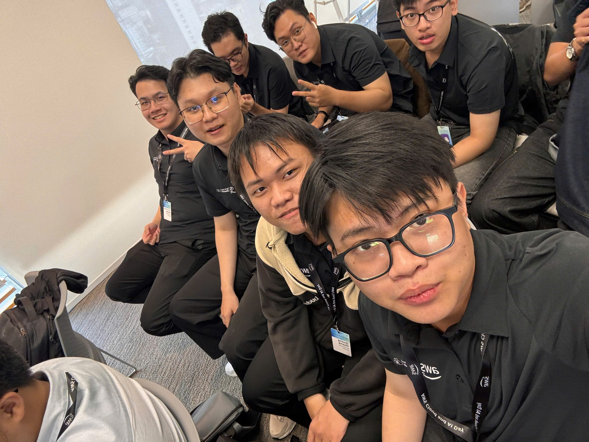
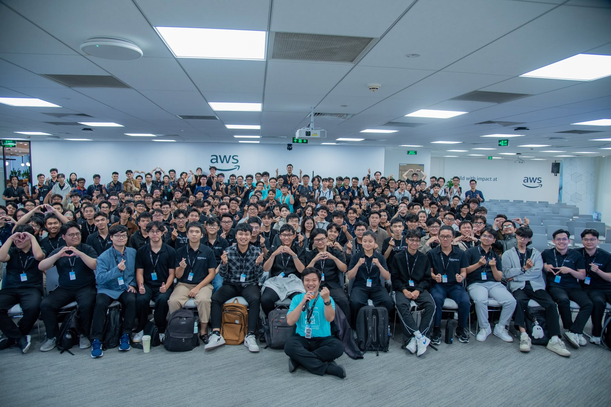

# Bài thu hoạch “AWS Cloud & AI Day 2026: HCMC Watch Party”

### Mục Đích Của Sự Kiện

- Cập nhật các xu hướng mới về **Cloud Computing, Artificial Intelligence và Agentic AI**.
- Tìm hiểu cách AWS và các doanh nghiệp ứng dụng **AI Agent** vào quá trình phát triển, hiện đại hóa và vận hành hệ thống.
- Cập nhật các nội dung thực tế từ track **Builders x AI**, tập trung vào AI-driven software development.
- Tìm hiểu vai trò của AI trong các giai đoạn của **Software Development Lifecycle (SDLC)** như coding, security, deployment và troubleshooting.
- Tìm hiểu các framework, nền tảng và công nghệ hỗ trợ xây dựng AI Agent như **LangGraph, Strands, Amazon Bedrock AgentCore và MCP Server**.
- Có thêm góc nhìn về **Data Foundation, Cloud Modernization và AWS Local Zone** trong quá trình xây dựng các hệ thống hiện đại.
- Giao lưu, trao đổi và kết nối với cộng đồng AWS Builders, developers, solution architects và những người quan tâm đến Cloud & AI tại TP.HCM.

### Danh Sách Diễn Giả

Sự kiện quy tụ các đại diện từ Chính phủ, AWS, doanh nghiệp công nghệ, đối tác và cộng đồng builders. Một số diễn giả và đại diện tiêu biểu gồm:

- **Ông Phạm Đức Long** – Thứ trưởng Bộ Khoa học và Công nghệ.
- **Bà Jennifer Wicks** – Đại sứ Hoa Kỳ tại Việt Nam.
- **Dr. Werner Vogels** – Chief Technology Officer (CTO), Amazon.com.
- **Ông Eric Yeo** – Tổng Giám đốc AWS Việt Nam.
- **Dr. Jens Lottner** – Tổng Giám đốc (CEO), Techcombank.
- **Bà Mai Lê** – Director of Product Management, Katalon.
- **Dung Luong Tien** – AWS Student Builder Group UTC, diễn giả phiên **“Don't use a Ferrari to Get Phở” (DEV303)**.
- **Nguyen Duc Manh** – Program Manager, AWS Student Builder Group UTC, diễn giả phiên **“Agent Harness & Agent Framework: Strands, LangGraph, Bedrock AgentCore” (DEV203)**.

Ngoài ra, sự kiện còn có sự tham gia của:

- Đội ngũ **AWS Solution Architects và Senior Engineers**.
- Các chuyên gia và CTO từ **Renova Cloud**.
- Chuyên gia công nghệ từ **Cloud Kinetics**.
- Đại diện từ **VIB, VPBank, Trusting Social và Green SM**.
- Chuyên gia tư vấn giải pháp từ **SoftwareOne**.

Tại điểm cầu TP.HCM, các nội dung keynote và technical sessions của **AWS Cloud & AI Day Vietnam 2026** được theo dõi thông qua **HCMC Watch Party tại AWS Office HCM**, kết hợp với các hoạt động thảo luận và networking với cộng đồng AWS Builders tại khu vực phía Nam.

### Nội Dung Nổi Bật

#### Opening Keynote

- Cập nhật xu hướng phát triển của **Cloud và AI**.
- Tìm hiểu vai trò của **Agentic AI Systems** trong quá trình hiện đại hóa và chuyển đổi doanh nghiệp.
- Có thêm góc nhìn về hạ tầng số, Data Foundation và chiến lược ứng dụng AI trong doanh nghiệp.
- Tìm hiểu cách AWS hỗ trợ doanh nghiệp xây dựng và triển khai các workload AI trên nền tảng Cloud.

#### Building Software Like Never Before with Agentic AI

- Tìm hiểu vai trò của **Agentic AI** trong phát triển phần mềm.
- AI Agent có thể hỗ trợ developer thực hiện nhiều tác vụ và workflow thay vì chỉ phản hồi câu hỏi đơn lẻ.
- Có thêm góc nhìn về việc đưa AI Agent từ giai đoạn thử nghiệm sang môi trường ứng dụng thực tế.
- Nhận thấy tiềm năng của Agentic AI trong việc hỗ trợ tự động hóa các công việc lặp lại trong quá trình phát triển phần mềm.

#### From Sprints to AI-Native Delivery: TCBS' Transformation of SDLC

- Tìm hiểu quá trình chuyển đổi từ quy trình phát triển phần mềm truyền thống sang **AI-Native Delivery**.
- AI có thể được tích hợp vào nhiều giai đoạn khác nhau của Software Development Lifecycle.
- Có thêm góc nhìn thực tế về việc ứng dụng AI trong môi trường doanh nghiệp và các hệ thống lớn.
- Hiểu thêm xu hướng chuyển từ **AI-assisted development** sang **AI-driven development**.

#### AWS Security Agent: Proactive AppSec from Design to Deployment

- Tìm hiểu cách AI được ứng dụng vào **Application Security (AppSec)**.
- Security có thể được đưa vào sớm từ giai đoạn thiết kế thay vì chỉ kiểm tra sau khi hệ thống đã hoàn thiện.
- AI có thể hỗ trợ developer phát hiện các vấn đề bảo mật xuyên suốt từ design đến deployment.
- Nhận thấy tầm quan trọng của việc kết hợp AI với security trong quá trình phát triển ứng dụng.

#### Tackling Anti-patterns with AI-Driven Development Lifecycle (AI-DLC)

- Tìm hiểu các vấn đề và anti-pattern có thể xuất hiện khi đưa AI vào quá trình phát triển phần mềm.
- Hiểu thêm khái niệm **AI-Driven Development Lifecycle (AI-DLC)**.
- Việc sử dụng AI hiệu quả cần có workflow, scope và cơ chế kiểm soát rõ ràng.
- Không nên phụ thuộc hoàn toàn vào AI mà cần kết hợp giữa automation và human validation.

#### Supercharging AI Coding with MCP Servers and Your Knowledge Servers

- Tìm hiểu vai trò của **MCP Server** trong AI Coding.
- MCP giúp AI kết nối với tools, dữ liệu và các nguồn knowledge bên ngoài.
- Các Knowledge Server có thể cung cấp context riêng của doanh nghiệp hoặc project cho AI.
- Hiểu thêm tầm quan trọng của context khi xây dựng AI Coding Assistant hoặc AI Agent.
- Có thêm định hướng sử dụng MCP để xây dựng các hệ thống AI có khả năng tương tác với nhiều công cụ khác nhau.

#### From Symptom to Source: AI-Driven Root Cause Analysis in Minutes

- Tìm hiểu cách AI có thể hỗ trợ **Root Cause Analysis**.
- AI có thể phân tích thông tin từ nhiều nguồn để hỗ trợ xác định nguyên nhân của sự cố.
- Có tiềm năng giảm thời gian troubleshooting trong quá trình vận hành hệ thống.
- AI không chỉ hỗ trợ development mà còn có thể tham gia vào monitoring và operations.

#### Agent Framework và Agent Harness

- Tìm hiểu các công nghệ và framework hỗ trợ xây dựng AI Agent:
  - **Strands**.
  - **LangGraph**.
  - **Amazon Bedrock AgentCore**.

- Hiểu thêm vai trò của Agent Framework trong việc:
  - Điều phối workflow.
  - Quản lý trạng thái.
  - Kết nối tools.
  - Tổ chức quá trình reasoning và execution của AI Agent.

- Nhận thấy rằng việc xây dựng AI Agent không chỉ phụ thuộc vào Large Language Model mà còn cần kiến trúc và hệ thống orchestration phù hợp.

#### Data Foundation và Cloud Modernization

- Tìm hiểu vai trò của **Data Foundation** khi triển khai các hệ thống AI.
- Dữ liệu cần được tổ chức, quản lý và chuẩn hóa tốt để hỗ trợ các ứng dụng AI.
- Hiểu thêm cách Cloud hỗ trợ doanh nghiệp hiện đại hóa workload và xây dựng kiến trúc có khả năng mở rộng.
- Có thêm góc nhìn về việc kết hợp Cloud, Data và AI trong quá trình chuyển đổi số.

#### AWS Local Zone và các use case thực tế

- Tìm hiểu vai trò của AWS Local Zone đối với các workload yêu cầu độ trễ thấp.
- Một số nhóm ứng dụng tiêu biểu gồm:
  - Tài chính – Ngân hàng.
  - Fintech.
  - Game realtime.
  - AI inference.
  * Các ứng dụng cần xử lý dữ liệu gần người dùng.

- Có thêm góc nhìn về cách lựa chọn hạ tầng phù hợp dựa trên yêu cầu latency của ứng dụng.

#### Networking và thảo luận thực tế

- Tham gia trao đổi về cách đưa **AI Agent từ prototype vào môi trường vận hành thực tế**.
- Thảo luận các vấn đề liên quan đến AI Coding, Cloud và tối ưu chi phí.
- Trao đổi thêm về những thách thức khi tích hợp AI vào workflow hiện tại.
- Kết nối với cộng đồng AWS Builders, developers và các chuyên gia công nghệ tại TP.HCM.

### Những Gì Học Được

#### Agentic AI

- Hiểu rõ hơn sự khác biệt giữa AI chatbot thông thường và **Agentic AI**.
- AI Agent có khả năng sử dụng tools, truy cập knowledge và thực hiện workflow gồm nhiều bước.
- Agentic AI có thể tham gia vào nhiều giai đoạn của quá trình phát triển và vận hành phần mềm.
- Việc xây dựng AI Agent cần xác định rõ scope, tools, data và cơ chế kiểm soát.

#### AI Agent Architecture

Hiểu rằng một hệ thống AI Agent thực tế không chỉ bao gồm LLM mà còn có nhiều thành phần:

- Large Language Model.
- Agent Framework.
- Tools.
- External APIs.
- Knowledge Sources.
- Context Management.
- Memory.
- Security.
- Monitoring.
- Human validation.

Có thêm kiến thức về các framework và nền tảng như:

- LangGraph.
- Strands.
- Amazon Bedrock AgentCore.
- MCP Server.

#### AI trong Software Development Lifecycle

AI có thể được áp dụng xuyên suốt SDLC:

- Planning.
- Development.
- Coding.
- Testing.
- Security.
- Delivery.
- Deployment.
- Monitoring.
- Troubleshooting.

Hiểu thêm xu hướng chuyển từ Software Development Lifecycle truyền thống sang **AI-Native / AI-Driven Development Lifecycle**.

#### AI Coding và MCP

- Hiểu thêm vai trò của **Model Context Protocol (MCP)** trong việc kết nối AI với tools và nguồn dữ liệu.
- MCP có thể giúp AI Coding Assistant truy cập context của project và các hệ thống bên ngoài.
- Nhận thấy chất lượng context và knowledge ảnh hưởng lớn đến khả năng hỗ trợ của AI.
- Có thêm định hướng nghiên cứu MCP cho các project AI Agent trong tương lai.

#### AI Security

- Hiểu thêm cách AI có thể hỗ trợ Application Security.
- Security nên được xem xét từ giai đoạn thiết kế.
- AI có thể hỗ trợ phát hiện vấn đề bảo mật trong quá trình development và deployment.
- Khi xây dựng AI Agent cần quan tâm đồng thời đến quyền truy cập, dữ liệu và security.

#### AI trong vận hành hệ thống

- Hiểu tiềm năng của AI trong **Root Cause Analysis**.
- AI có thể hỗ trợ phân tích log, metrics và các thông tin hệ thống để phục vụ troubleshooting.
- AI có thể được sử dụng trong monitoring và operations thay vì chỉ giới hạn ở coding.

#### Data và Cloud Infrastructure

- Hiểu thêm vai trò của Data Foundation đối với hệ thống AI.
- AI tốt cần được hỗ trợ bởi dữ liệu có chất lượng và kiến trúc hạ tầng phù hợp.
- Hiểu thêm vai trò của Cloud trong việc cung cấp khả năng scalability và flexibility.
- Có thêm góc nhìn về các workload cần latency thấp và khả năng sử dụng AWS Local Zone.

### Ứng Dụng Vào Công Việc

- Nghiên cứu khả năng áp dụng **AI Agent** vào project hiện tại thay vì chỉ sử dụng mô hình hỏi – đáp thông thường.
- Xem xét sử dụng các Agent Framework như **LangGraph hoặc Strands** để tổ chức workflow của Agent.
- Nghiên cứu **Amazon Bedrock AgentCore** khi xây dựng AI Agent trên AWS.
- Tìm hiểu khả năng sử dụng **MCP Server** để kết nối AI Agent với:
  - Tools.
  - APIs.
  - Databases.
  - Knowledge Base.
  - Các hệ thống bên ngoài.

- Thiết kế AI workflow với scope và boundary rõ ràng.
- Xây dựng cơ chế human validation đối với những tác vụ quan trọng.
- Quan tâm đến security và quyền truy cập khi Agent có khả năng sử dụng tools.
- Tìm hiểu cách đưa AI vào nhiều giai đoạn của development lifecycle:
  - Coding.
  - Testing.
  - Security.
  - Deployment.
  - Monitoring.

- Áp dụng tư duy **AI-Native Development** khi xây dựng các project mới.
- Chú trọng Data Foundation khi phát triển các ứng dụng sử dụng AI.
- Xem xét observability và troubleshooting ngay từ giai đoạn thiết kế hệ thống.
- Tiếp tục nghiên cứu các AWS services có thể hỗ trợ triển khai, mở rộng và vận hành các workload AI.

### Trải nghiệm trong event

Tham gia **AWS Cloud & AI Day 2026: HCMC Watch Party** tại AWS Office HCM là một trải nghiệm hữu ích, giúp tôi cập nhật thêm nhiều xu hướng mới về Cloud và AI, đặc biệt là **Agentic AI, AI-Native Software Development và AI-driven Development Lifecycle**.

#### Theo dõi các nội dung chuyên sâu

- Theo dõi Opening Keynote và các technical sessions của AWS Cloud & AI Day Vietnam 2026.
- Các session không chỉ tập trung vào AI Coding mà còn mở rộng sang Agentic AI, security, software development lifecycle và operations.
- Qua các nội dung được chia sẻ, tôi có thêm góc nhìn về cách AI đang được tích hợp ngày càng sâu vào quá trình phát triển và vận hành hệ thống.

#### Hiểu thêm về Agentic AI

- Agentic AI là một trong những chủ đề nổi bật của sự kiện.
- Hiểu thêm cách AI Agent có thể sử dụng tools và thực hiện workflow phức tạp thay vì chỉ sinh nội dung.
- Có thêm góc nhìn về các thành phần cần thiết để đưa AI Agent từ prototype sang ứng dụng thực tế.
- Nội dung này giúp tôi có thêm định hướng khi nghiên cứu và xây dựng các project Agentic AI trong tương lai.

#### Tiếp cận Agent Framework và MCP

- Các nội dung về **Strands, LangGraph, Amazon Bedrock AgentCore và MCP Server** giúp tôi hiểu rõ hơn kiến trúc của một AI Agent hiện đại.
- Hiểu rằng model chỉ là một phần trong hệ thống; Agent còn cần tool integration, context, knowledge và orchestration.
- MCP là một công nghệ đáng quan tâm để xây dựng khả năng kết nối giữa AI Agent và các hệ thống bên ngoài.

#### Góc nhìn về AI trong SDLC

- AI có thể hỗ trợ nhiều hơn việc sinh code.
- AI đang được tích hợp vào security, deployment, monitoring và troubleshooting.
- Điều này cho thấy AI có thể trở thành một thành phần xuyên suốt toàn bộ Software Development Lifecycle.

#### Kết nối và trao đổi

- Các khoảng thời gian networking tạo cơ hội trao đổi với cộng đồng AWS Builders tại TP.HCM.
- Có cơ hội trao đổi về AI Agent, Cloud, AI Coding và các vấn đề khi triển khai AI trong thực tế.
- Việc trao đổi trực tiếp giúp tôi có thêm những góc nhìn ngoài các nội dung technical session.

#### Bài học rút ra

- **AI Agent không chỉ là LLM**, mà là sự kết hợp giữa model, tools, knowledge, workflow và infrastructure.
- Agentic AI có tiềm năng tự động hóa nhiều workflow nhưng cần scope và cơ chế kiểm soát rõ ràng.
- Agent Framework đóng vai trò quan trọng trong việc tổ chức và điều phối hoạt động của AI Agent.
- MCP và Knowledge Integration là những thành phần đáng quan tâm khi xây dựng Agent làm việc với hệ thống thực tế.
- AI đang dần trở thành một phần của toàn bộ **Software Development Lifecycle**, không chỉ giới hạn ở coding.
- Security và observability cần được xem xét song song với khả năng automation của AI.
- Data Foundation và Cloud Infrastructure là nền tảng quan trọng khi triển khai AI ở quy mô lớn.
- Việc đưa AI vào môi trường thực tế cần cân bằng giữa:
  - Khả năng tự động hóa.
  - Độ chính xác.
  - Security.
  - Chi phí.
  - Reliability.
  - Khả năng kiểm soát.

### Một số hình ảnh khi tham gia sự kiện

*Ảnh chụp tại sự kiện (người thứ 3 tính từ người chụp ảnh đến trong hàng).*

*Ảnh chụp tại sự kiện (người ngồi ngoài cùng hàng đầu bên phải).*

> Tổng thể, **AWS Cloud & AI Day 2026: HCMC Watch Party** không chỉ giúp tôi cập nhật các xu hướng mới về Cloud và AI mà còn giúp tôi hiểu rõ hơn về hướng phát triển của Agentic AI và AI-Native Software Development. Qua các phiên chia sẻ và hoạt động networking, tôi có thêm kiến thức về AI Agent architecture, Agent Framework, MCP Server, AI Security, Data Foundation và AI-driven operations. Những nội dung này cũng giúp tôi xác định rõ hơn các công nghệ cần tiếp tục nghiên cứu và có thể ứng dụng vào các project trong tương lai.
