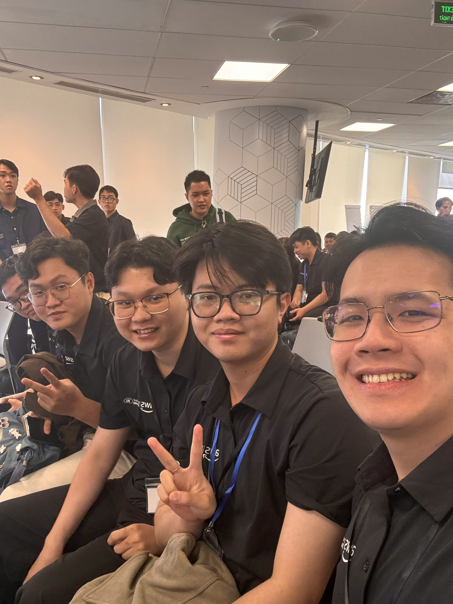

# Event Takeaways: "AWS First Cloud AI Journey Community Day"

### Event Objectives

- Learn how engineering teams approach software development at scale, including the practical challenges of building Software Factories.
- Explore the skills students need to bridge academic learning and real-world Cloud and software engineering work.
- Understand the ideas presented in the AWS Lambda Web Functions session, particularly HTTP handling, request concurrency, performance and cost considerations.
- Explore how Amazon Simple Queue Service (Amazon SQS) can decouple components and support asynchronous system design.
- Learn from an AWS internship journey and explore ways to begin and maintain contributions to open-source projects.
- Connect the technical topics to future Cloud projects and professional development.

### Speakers

The event poster introduced six speakers from industry and the FCAJ community:

- Thinh Nguyen – STYL Solutions.
- Henry Duc Bui – CloudThinker.
- Hung Tran – NAB.
- Dao Cu Long – FCAJ.
- Khang Duong – FCAJ.
- Tuan Tran – FCAJ.

The event was scheduled for 9:00 AM–12:00 PM on Saturday, October 31, 2026, at the 26th floor of Bitexco Financial Tower, 2 Hai Trieu Street, Ho Chi Minh City.

### Key Highlights

#### Lessons Learned from Building Software Factories (9:00–9:25 AM)

- The session focused on practical lessons from building Software Factories at scale rather than treating software delivery as a series of isolated coding tasks.
- Its agenda highlighted common implementation pitfalls and the importance of identifying approaches that work in real engineering teams.
- A useful topic for further study is how standardized workflows, automation and feedback loops support predictable software delivery.
- The session provides a reason to examine maintainability and developer experience alongside deployment speed.

#### Education (9:30–9:55 AM)

- This session examined how students can prepare for Cloud and software engineering careers from an educator's perspective.
- It addressed the gap between university learning and expectations in the workplace.
- Technical fundamentals, hands-on projects, communication and independent problem-solving are all relevant areas for students to reflect on.
- The discussion topic emphasizes that completing tutorials is different from explaining design decisions and working within a team.

#### AWS Lambda Web Functions: Rethinking Serverless Web Architecture (10:00–10:25 AM)

- The session introduced an approach to Serverless web applications involving native HTTP support and multi-concurrency of up to 128 requests, as described in the event agenda.
- It raised the question of when a Serverless approach can reduce adapter overhead compared with alternative deployment patterns.
- Active CPU Billing was included as a topic for analyzing cost efficiency rather than considering only the number of invocations.
- Performance benchmarking against container-based workloads on Amazon EC2 or Amazon ECS was part of the announced session scope.
- The key architectural question is how latency, request patterns, scaling behavior and total operating costs affect platform selection.

#### Amazon SQS: Building Asynchronous Systems (10:30–11:00 AM)

- Amazon SQS was presented as a building block for asynchronous processing and decoupling services.
- Queues allow work to be buffered rather than requiring every request to be completed immediately by a downstream component.
- A practical design should account for retries, visibility timeouts, duplicate messages and dead-letter queues where appropriate.
- An example is a file-processing application: the upload service receives a file, while workers independently process queued tasks.
- The session topic illustrates how asynchronous design can improve resilience and help systems handle fluctuating workloads.

#### My 3-Month AWS Internship Journey (11:00–11:25 AM)

- This session shared a three-month internship perspective, including the use of AWS services in a real project.
- A relevant lesson is to connect technical exercises with clear project objectives and measurable outcomes.
- Cloud projects involve more than launching resources: security, monitoring, documentation, cost and troubleshooting also matter.
- The session offered a useful context for reviewing learning progress and preparing for the transition from university projects to professional work.

#### Start & Maintain Consistency with Open Source Contributing (11:30 AM–12:00 PM)

- The session focused on how to begin contributing to open-source projects and maintain a consistent contribution habit.
- Contributions can start with documentation, issue reproduction, small bug fixes or tests instead of large feature implementations.
- Reviewing contribution guidelines and working with Git branches and pull requests are practical skills to develop.
- Regular, manageable contributions can help build familiarity with collaborative software development and code review.

### What I Learned

#### Software Engineering and Career Preparation

- A sustainable software delivery process needs clear conventions, repeatable workflows and feedback, not only faster coding.
- Engineering skills grow when academic concepts are applied to practical systems and their trade-offs can be explained.
- Internship projects should be documented with their goals, architecture, technical decisions and results.

#### Serverless Architecture and Cost Awareness

- Serverless design choices should be evaluated using workload characteristics such as request volume, execution time, concurrency and latency.
- Performance benchmarks need comparable conditions before conclusions can be drawn about AWS Lambda, EC2 or ECS.
- Cost analysis should include more than the advertised compute rate: supporting services, operational overhead and idle capacity can influence the final result.
- The Lambda Web Functions claims in the agenda are useful starting points for further documentation review and hands-on validation.

#### Asynchronous Processing with Amazon SQS

- A queue separates the rate at which requests arrive from the rate at which workers process them.
- Producers and consumers can be scaled and deployed independently when the application is designed around a queue.
- Reliability requires thoughtful handling of retries, idempotency, failed messages and monitoring of queue depth.
- Asynchronous processing is particularly relevant for workloads such as video conversion, background notifications and audio transcription.

#### Open Source and Continuous Learning

- Small, consistent contributions are a practical way to gain experience with real codebases.
- Reading existing code and documentation is an important part of contributing effectively.
- Technical growth also depends on communication, collaboration and the habit of evaluating lessons from completed work.

### Applying to Work

- Review project development workflows for opportunities to automate testing, builds, deployment and documentation.
- Compare Serverless and EC2/ECS deployment options using realistic request patterns, latency targets and cost assumptions.
- Explore Amazon SQS for asynchronous tasks that do not need to complete within the user-facing HTTP request.
- Design background workers with retry handling, visibility timeouts, idempotency and dead-letter queue policies.
- Apply the event's Cloud engineering themes to project documentation: explain the architecture, permissions, monitoring and operational trade-offs.
- Build a sustainable open-source learning routine, beginning with small, reviewable contributions.

### Event Experience

The AWS First Cloud AI Journey Community Day brought together software engineering, Cloud architecture and professional development topics in one morning. The program combined industry perspectives with sessions relevant to students preparing for Cloud and software development roles.

#### Connecting Architecture with Real-World Decisions

- The Software Factories session raised questions about the processes required to develop and maintain software at scale.
- The AWS Lambda Web Functions topic connected Serverless architecture with performance measurement and cost evaluation.
- The Amazon SQS topic showed why communication patterns matter when applications grow beyond a single service.

#### Connecting Learning with Professional Practice

- The Education and internship sessions highlighted the importance of hands-on learning and explaining technical choices.
- The open-source topic provided a concrete direction for practicing team workflows outside the classroom.
- Together, these themes encourage a balance between technical depth and steady professional development.

#### Networking and Personal Development

- The program offered an opportunity to engage with AWS and software engineering topics from different professional perspectives.
- Its mixture of technical and career-focused sessions offers useful directions for further study, particularly distributed systems and developer workflows.
- Specific discussion points and personal observations can be added here from event notes before the final report is submitted.

#### Lessons Learned

- Engineering is more than code: processes and collaboration influence how software is delivered.
- Evaluate Serverless with evidence: latency, concurrency and cost should be measured for the target workload.
- Decoupling supports scalability: asynchronous queues help separate components and smooth workload spikes.
- Operational details matter: retries, monitoring and failure handling are essential in production systems.
- Internships connect theory and practice: real projects require architectural reasoning and clear communication.
- Consistency supports growth: regular open-source contributions can strengthen long-term engineering skills.

### Some Event Photos

*AWS First Cloud AI Journey Community Day (third person from the right).*

> Overall, AWS First Cloud AI Journey Community Day offered an opportunity to connect software delivery practices, Serverless design, asynchronous processing and career preparation. The sessions provide useful directions for further exploration: comparing Cloud architectures with measurable criteria, using queues where asynchronous processing is appropriate, documenting AWS internship projects carefully and developing a consistent approach to open-source learning.

<!-- Editorial note: Drafted from the published event agenda and poster. Verify session-specific details and add personal notes/photos before submission. -->
