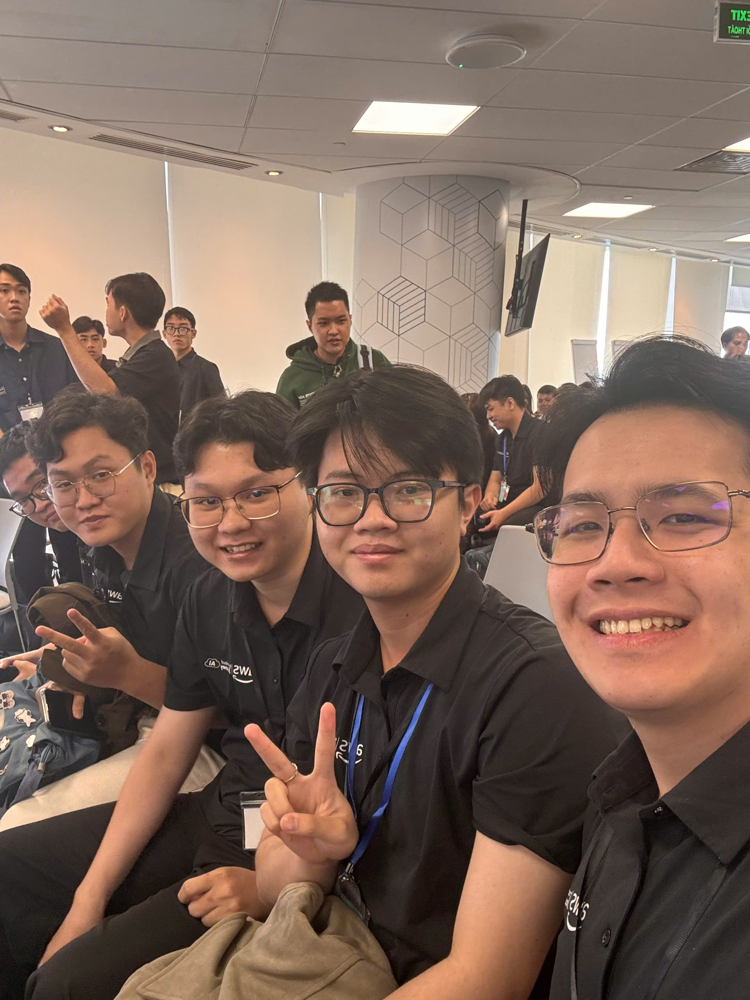

# Bản thu hoạch: "AWS First Cloud AI Journey Community Day"

### Mục tiêu sự kiện

- Hiểu cách các nhóm kỹ thuật tiếp cận phát triển phần mềm quy mô lớn, bao gồm những thách thức thực tế khi xây dựng các Software Factories.
- Khám phá các kỹ năng sinh viên cần thiết để nối kết giữa học thuật và công việc thực tế về Cloud và kỹ thuật phần mềm.
- Tìm hiểu các ý kiến trong phiên AWS Lambda Web Functions, đặc biệt về xử lý HTTP, đồng thời xử lý yêu cầu, hiệu suất và cân nhắc chi phí.
- Khám phá cách Amazon Simple Queue Service (Amazon SQS) có thể tách rời các thành phần và hỗ trợ thiết kế hệ thống bất đồng bộ.
- Học từ hành trình thực tập AWS và tìm hiểu cách bắt đầu và duy trì đóng góp vào các dự án mã nguồn mở.
- Kết nối các chủ đề kỹ thuật với các dự án Cloud trong tương lai và phát triển sự nghiệp.

### Diễn giả

Bộ 사이트 sự kiện giới thiệu sáu diễn giả từ doanh nghiệp và cộng đồng FCAJ:

- Thinh Nguyen – STYL Solutions.
- Henry Duc Bui – CloudThinker.
- Hung Tran – NAB.
- Dao Cu Long – FCAJ.
- Khang Duong – FCAJ.
- Tuan Tran – FCAJ.

Sự kiện được lên lịch từ 9:00 sáng đến 12:00 trưa ngày Thứ Bảy, 31 tháng 10 năm 2026, tại tầng 26 của Bitexco Financial Tower, 2 đường Hải Triều, Thành phố Hồ Chí Minh.

### Nội dung nổi bật

#### Bài học rút ra từ việc xây dựng các Software Factories (9:00–9:25 AM)

- Phiên tập trung vào các bài học thực tế từ việc xây dựng các Software Factories quy mô lớn thay vì coi việc phân phối phần mềm là chuỗi các nhiệm vụ lập trình tách biệt.
- Lịch trình của phiên nhấn mạnh những bẫy triển khai phổ biến và tầm quan trọng của việc xác định các phương pháp hoạt động trong các nhóm kỹ thuật thực tế.
- Một chủ đề hữu ích để nghiên cứu thêm là cách các quy trình làm việc chuẩn hóa, tự động hóa và vòng phản hồi hỗ trợ phân phối phần mềm có thể dự đoán.
- Phiên cung cấp lý do để xem xét khả năng bảo trì và trải nghiệm của nhà phát triển bên cạnh tốc độ triển khai.

#### Giáo dục (9:30–9:55 AM)

- Phiên này xem xét cách sinh viên có thể chuẩn bị cho sự nghiệp Cloud và kỹ thuật phần mềm từ góc độ của nhà giáo dục.
- Nó giải quyết khoảng cách giữa học tập đại học và kỳ vọng tại nơi làm việc.
- Cơ sở kỹ thuật, dự án thực hành, giao tiếp và giải quyết vấn đề độc lập là tất cả các lĩnh vực liên quan mà sinh viên nên suy ngẫm.
- Chủ đề thảo luận nhấn mạnh rằng hoàn thành các bài hướng dẫn khác nhau với việc giải thích quyết định thiết kế và làm việc trong nhóm.

#### AWS Lambda Web Functions: Rethinking Serverless Web Architecture (10:00–10:25 AM)

- Phiên giới thiệu một cách tiếp cận đối với các ứng dụng web Serverless liên quan đến hỗ trợ HTTP gốc và đa-tranh xử lý lên đến 128 yêu cầu, như được mô tả trong lịch trình sự kiện.
- Nó đặt ra câu hỏi về khi nào một cách tiếp cận Serverless có thể giảm chi phí chuyển đổiAdapter so với các mô hình triển khai thay thế.
- Active CPU Billing đã được đưa vào làm chủ đề phân tích hiệu quả chi phí thay vì chỉ xét số lần gọi.
- Đánh giá điểm chuẩn hiệu suất so với các khối công việc dựa trên bộ chứa trên Amazon EC2 hoặc Amazon ECS là một phần trong phạm vi phiên đã công bố.
- Câu hỏi kiến trúc chính là cách độ trễ, mô hình yêu cầu, hành vi mở rộng và chi phí vận hành tổng thể ảnh hưởng đến việc chọn nền tảng.

#### Amazon SQS: Xây dựng các hệ thống bất đồng bộ (10:30–11:00 AM)

- Amazon SQS được trình bày là một khối xây dựng cho xử lý bất đồng bộ và tách rời các dịch vụ.
- Hàng đợi cho phép công việc được đệm thay vì yêu cầu mỗi yêu cầu phải được hoàn thành ngay lập tức bởi thành phần phía dưới.
- Thiết kế thực tế cần tính đến các lần thử lại, thời gian tầm nhìn, tin nhắn trùng lặp và hàng đợi thư mục thư từ khi thích hợp.
- Một ví dụ là ứng dụng xử lý tệp: dịch vụ tải lên nhận một tệp, trong khi các công nhân độc lập xử lý các tác vụ được xếp hàng.
- Chủ đề phiên minh họa cách thiết kế bất đồng bộ có thể cải thiện khả năng phục hồi và giúp hệ thống xử lý các khối lượng công việc biến động.

#### Hành trình thực tập AWS 3 tháng của tôi (11:00–11:25 AM)

- Phiên chia sẻ góc nhìn thực tập ba tháng, bao gồm việc sử dụng các dịch vụ AWS trong một dự án thực tế.
- Một bài học liên quan là kết nối các bài tập kỹ thuật với các mục tiêu dự án rõ ràng và các kết quả có thể đo lường.
- Các dự án Cloud liên quan nhiều hơn là khởi chạy tài nguyên: bảo mật, giám sát, tài liệu, chi phí và khắc phục sự cố cũng quan trọng.
- Phiên cung cấp bối cảnh hữu ích để xem xét tiến độ học tập và chuẩn bị cho sự chuyển đổi từ các dự án đại học sang công việc chuyên nghiệp.

#### Bắt đầu & Giữ tính nhất quán với đóng góp mã nguồn mở (11:30 AM–12:00 PM)

- Phiên tập trung vào cách bắt đầu đóng góp vào các dự án mã nguồn mở và duy trì một thói quen đóng góp nhất quán.
- Đóng góp có thể bắt đầu với tài liệu, sao chép vấn đề, sửa lỗi nhỏ hoặc thử nghiệm thay vì triển khai các tính năng lớn.
- Xem xét các hướng dẫn đóng góp và làm việc với nhánh Git và các pull requests là các kỹ năng thực tế để phát triển.
- Đóng góp thường xuyên, có thể quản lý được có thể giúp xây dựng sự quen thuộc với phát triển phần mềm cộng tác và đánh giá mã.

### Những gì tôi học được

#### Kỹ thuật phần mềm và chuẩn bị sự nghiệp

- Quy trình phân phối phần mềm bền vững cần các quy ước rõ ràng, quy trình làm việc lặp lại và phản hồi, không chỉ lập trình nhanh hơn.
- Kỹ năng kỹ thuật phát triển khi các khái niệm học thuật được áp dụng vào các hệ thống thực tế và những điều đánh đổi của chúng có thể được giải thích.
- Các dự án thực tập nên được ghi chép với mục tiêu, kiến trúc, quyết định kỹ thuật và kết quả của chúng.

#### Kiến trúc Serverless và nhận thức về chi phí

- Các lựa chọn thiết kế Serverless nên được đánh giá bằng các đặc điểm khối lượng công việc như khối lượng yêu cầu, thời gian thực thi, đồng thời xử lý và độ trễ.
- Các điểm chuẩn hiệu suất cần các điều kiện so sánh trước khi kết luận có thể được rút ra về AWS Lambda, EC2 hoặc ECS.
- Phân tích chi phí nên bao gồm nhiều hơn mức chi phí tính toán được quảng cáo: các dịch vụ hỗ trợ, chi phí vận hành và dung lượng انتظار có thể ảnh hưởng đến kết quả cuối cùng.
- Các tuyên bố Lambda Web Functions trong lịch trình là những điểm khởi đầu hữu ích để xem xét tài liệu thêm và xác thực thực hành.

#### Xử lý bất đồng bộ với Amazon SQS

- Một hàng đợi tách biệt tốc độ yêu cầu đến từ tốc độ công nhân xử lý chúng.
- Nhà sản xuất và người tiêu dùng có thể được mở rộng và triển khai độc lập khi ứng dụng được thiết kế quanh một hàng đợi.
- Khả năng phục hồi yêu cầu xử lý cân nhắc các lần thử lại, tính nhất quán, tin nhắn thất bại và theo dõi độ sâu hàng đợi.
- Xử lý bất đồng bộ đặc biệt quan trọng đối với các khối lượng công việc như chuyển đổi video, thông báo nền và phiên âm âm thanh.

#### Mã nguồn mở và học tập liên tục

- Đóng góp nhỏ, nhất quán là một cách thực tế để có kinh nghiệm với các mã nguồn thực tế.
- Việc đọc mã và tài liệu hiện có là một phần quan trọng của việc đóng góp hiệu quả.
- Sự tăng trưởng kỹ thuật cũng phụ thuộc vào giao tiếp, cộng tác và thói quen đánh giá bài học từ công việc đã hoàn thành.

### Ứng dụng vào công việc

- Xem xét quy trình phát triển dự án để tìm cơ hội tự động hóa kiểm tra, xây dựng, triển khai và tài liệu.
- So sánh các lựa chọn triển khai Serverless và EC2/ECS bằng các mô hình yêu cầu thực tế, mục tiêu độ trễ và giả định chi phí.
- Khám phá Amazon SQS cho các tác vụ bất đồng bộ không cần hoàn thành trong yêu cầu HTTP hướng người dùng.
- Thiết kế công nhân nền với xử lý thử lại, thời gian tầm nhìn, tính nhất quán và chính sách hàng đợi thư mục thư từ.
- Áp dụng các chủ đề kỹ thuật Cloud của sự kiện vào tài liệu dự án: giải thích kiến trúc, quyền, giám sát và những điều đánh đổi vận hành.
- Xây dựng thói quen học tập mã nguồn opened bền vững, bắt đầu với các đóng góp nhỏ có thể xem xét.

### Trải nghiệm sự kiện

AWS First Cloud AI Journey Community Day đã kết hợp kỹ thuật phần mềm, kiến trúc Cloud và phát triển sự nghiệp vào một buổi sáng. Chương trình kết hợp quan điểm ngành công nghiệp với các phiên liên quan đến sinh viên chuẩn bị cho vai trò Cloud và phát triển phần mềm.

#### Kết nối kiến trúc với quyết định thực tế

- Phiên Software Factories đặt ra các câu hỏi về các quy trình cần thiết để phát triển và duy trì phần mềm ở quy mô lớn.
- Chủ đề AWS Lambda Web Functions kết nối kiến trúc Serverless với đo lường hiệu suất và đánh giá chi phí.
- Chủ đề Amazon SQS cho thấy tại sao các mẫu giao tiếp quan trọng khi các ứng dụng phát triển quá một dịch vụ duy nhất.

#### Kết nối việc học với thực hành chuyên nghiệp

- Các phiên Giáo dục và thực tập nhấn mạnh tầm quan trọng của việc học thực hành và giải thích các lựa chọn kỹ thuật.
- Chủ đề mã nguồn mở cung cấp một hướng đi cụ thể để thực hành các quy trình làm việc nhóm bên ngoài lớp học.
- Cùng nhau, những chủ đề này khuyến khích sự cân bằng giữa độ sâu kỹ thuật và sự phát triển chuyên nghiệp ổn định.

#### Kết nối và phát triển cá nhân

- Chương trình mang lại cơ hội để tham gia với các chủ đề AWS và kỹ thuật phần mềm từ nhiều quan điểm chuyên nghiệp.
- Sự kết hợp giữa các phiên kỹ thuật và tập trung vào sự nghiệp mang lại những hướng đi hữu ích để nghiên cứu thêm, đặc biệt là các hệ thống phân tán và quy trình của nhà phát triển.
- Các điểm thảo luận cụ thể và quan sát cá nhân có thể được thêm vào từ ghi chú sự kiện trước khi báo cáo cuối cùng được nộp.

#### Bài học rút ra

- Kỹ thuật là nhiều hơn mã: các quy trình và sự cộng tác ảnh hưởng đến cách phần mềm được phân phối.
- Đánh giá Serverless bằng bằng chứng: độ trễ, đồng thời xử lý và chi phí nên được đo lường cho khối lượng công việc mục tiêu.
- Tách rời hỗ trợ khả năng mở rộng: hàng đợi bất đồng bộ giúp tách biệt các thành phần và làm thẳng thiện các đợt tăng khối lượng công việc.
- Chi tiết vận hành quan trọng: các lần thử lại, giám sát và xử lý thất bại là điều thiết yếu trong các hệ thống sản xuất.
- Thực tập kết nối lý thuyết và thực hành: các dự án thực đòi hỏi lập luận kiến trúc và giao tiếp rõ ràng.
- Tính nhất quán hỗ trợ sự tăng trưởng: các đóng góp mã nguồn mở thường xuyên có thể củng cố các kỹ năng kỹ thuật dài hạn.

### Một số ảnh sự kiện

*AWS First Cloud AI Journey Community Day (người thứ 3 tính từ phải qua trái).*

> Tổng thể, AWS First Cloud AI Journey Community Day mang lại cơ hội để kết nối các phương pháp phân phối phần mềm, thiết kế Serverless, xử lý bất đồng bộ và chuẩn bị sự nghiệp. Các phiên cung cấp những hướng đi hữu ích để khám phá thêm: so sánh các kiến trúc Cloud với các tiêu chí có thể đo lường, sử dụng hàng đợi khi xử lý bất đồng bộ phù hợp, ghi chép kỹ các dự án thực tập AWS và phát triển một cách tiếp cận nhất quán đối với học tập mã nguồn opened.

<!-- Lưu ý của biên tập viên: Soạn thảo từ lịch trình sự kiện đã công bố và p'hối sự kiện. Xác minh các chi tiết phiên cụ thể và thêm ghi chú cá nhân/ảnh trước khi nộp. -->
