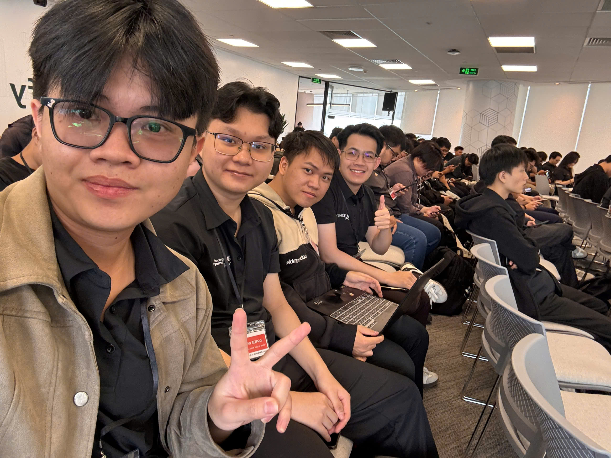

# Event Takeaways: "Cloud Mastery"

### Event Objectives

- Gain deeper insights into core Cloud computing concepts and practical AWS architectures tailored for students and aspiring Cloud engineers.
- Bridge the gap between theoretical knowledge and real-world industry requirements through direct mentorship and open Q&A sessions.
- Understand career pathways, certification roadmaps, and essential skill sets needed to pursue roles in Cloud, DevOps, and AI/ML.
- Reinforce technical knowledge through interactive group activities and a live technical quiz.
- Build connections with fellow tech students across Ho Chi Minh City and mentors from the First Cloud AI Journey (FCAJ) community.

### Event Overview & Context

The **Cloud Mastery** event was organized by the **First Cloud AI Journey (FCAJ)** community for university students across Ho Chi Minh City. 

- **Date & Time:** Saturday morning, November 14, 2026.
- **Location:** AWS Vietnam Office, 26th Floor, Bitexco Financial Tower, 2 Hai Trieu Street, District 1, Ho Chi Minh City.
- **Participants:** Young tech students from various universities in Saigon alongside experienced mentors from FCAJ.

### Key Highlights

#### Technical Sharing & Cloud Foundations

- The session covered practical perspectives on mastering Cloud technologies, emphasizing hands-on practice over passive learning.
- Mentors shared structured learning paths for students starting from foundational AWS services before advancing to complex architectures.
- Discussions highlighted the importance of understanding core infrastructure components, security best practices, and cost optimization early in a student's learning journey.

#### Extended Open Q&A Session

- One of the standout segments of the morning was an extensive, high-energy Q&A session that felt almost endless due to the strong engagement from attendees.
- Students raised practical and thought-provoking questions spanning two main areas:
  - **Career Orientation:** How to prepare portfolios, stand out in technical interviews, choose between specialized tracks (Solutions Architect, Cloud Engineer, DevOps), and transition from academic projects to internships.
  - **Technical Deep Dives:** Real-world architectural challenges, troubleshooting approaches, and best practices when building applications on AWS.
- Mentors provided candid, actionable feedback grounded in real project experience rather than textbook definitions.

#### Interactive Quiz Challenge

- The event concluded with an enthusiastic technical Quiz game designed to test participants' understanding of the morning's topics and general AWS knowledge.
- The activity created a lively, competitive atmosphere while helping students review key concepts in a memorable way.

#### Community Preview: AWS Student Community Day Vietnam 2026

- During the closing remarks, organizers shared an exciting preview of an upcoming student-focused Cloud workshop: **AWS Student Community Day Vietnam 2026**, scheduled for the following weekend.
- This announcement encouraged participants to stay active in the ecosystem and continue their learning momentum.

### What I Learned

#### Career Orientation and Skill Development

- Building a career in Cloud requires a combination of solid fundamentals, documented hands-on labs, and the ability to articulate architectural trade-offs.
- Asking specific, context-driven questions is one of the fastest ways to clarify career roadblocks and learn from industry practitioners.
- Active participation in tech communities accelerates growth by exposing students to peers facing similar technical challenges.

#### Technical Mindset

- Mastering Cloud is not about memorizing service names; it is about understanding how services integrate to solve business and scalability problems.
- Interactive assessments, such as live quizzes, are effective tools for identifying knowledge gaps and reinforcing core concepts under time constraints.

### Applying to Work

- Map out a structured personal learning roadmap combining AWS foundational labs with end-to-end mini-projects.
- Document technical challenges, architectural decisions, and troubleshooting steps in GitHub repositories or technical blogs to build a strong portfolio.
- Regularly participate in community workshops, study groups, and technical Q&A sessions to stay updated with industry practices.
- Review core AWS service fundamentals (compute, storage, networking, and IAM) to strengthen readiness for technical assessments and interviews.

### Event Experience

Cloud Mastery offered an energetic and welcoming environment for students passionate about Cloud computing in Ho Chi Minh City. Hosting the session directly at the AWS office in Bitexco Financial Tower added an inspiring, professional atmosphere to the morning.

#### The Value of Open Dialogue and Peer Learning

- Unlike traditional one-way lectures, the "endless" Q&A session transformed the event into an interactive dialogue driven by students' real concerns.
- Hearing questions from peers across different universities broadened my perspective on common technical hurdles and career preparation strategies.
- Combined with the lively wrap-up quiz and the preview of AWS Student Community Day Vietnam 2026, the event left a strong motivation to keep building and engaging with the FCAJ community. 

### Some Event Photos

*Cloud Mastery event (second person from the left).*

> Overall, Cloud Mastery offered an energetic and welcoming space for students passionate about Cloud, combining practical sharing, an extended open Q&A, a lively quiz and a preview of AWS Student Community Day Vietnam 2026. The event reinforced the value of hands-on practice, community dialogue and a clear learning roadmap in building a Cloud career.
