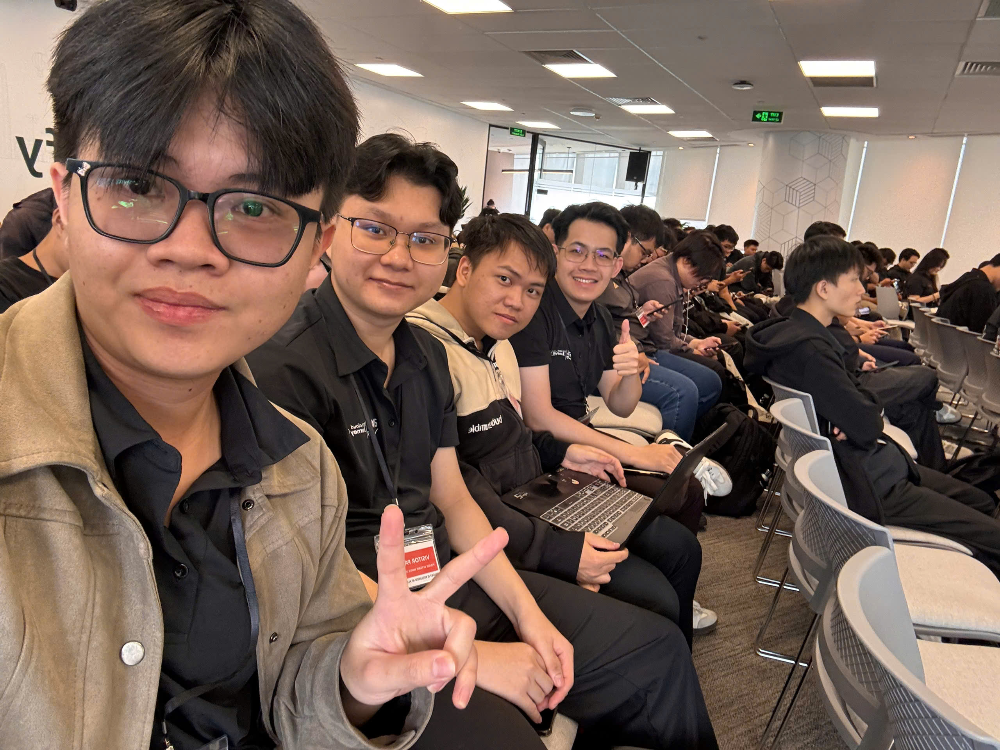

# Bản thu hoạch: "Cloud Mastery"

### Mục tiêu sự kiện

- Hiểu sâu hơn về các khái niệm cốt lõi của Cloud computing và các kiến trúc AWS thực tế, được thiết kế dành cho sinh viên và những người muốn theo đuổi sự nghiệp Cloud.
- Thu hẹp khoảng cách giữa kiến thức lý thuyết và yêu cầu thực tế của ngành thông qua các buổi cố vấn trực tiếp và phiên hỏi đáp mở.
- Tìm hiểu con đường sự nghiệp, lộ trình chứng chỉ và những kỹ năng cần thiết để theo đuổi các vị trí trong lĩnh vực Cloud, DevOps và AI/ML.
- Củng cố kiến thức kỹ thuật thông qua các hoạt động nhóm tương tác và một trò chơi đố vui kỹ thuật trực tiếp.
- Kết nối với các bạn sinh viên công nghệ khắp Thành phố Hồ Chí Minh và các mentor từ cộng đồng First Cloud AI Journey (FCAJ).

### Tổng quan và bối cảnh sự kiện

Sự kiện **Cloud Mastery** được cộng đồng **First Cloud AI Journey (FCAJ)** tổ chức dành cho sinh viên đại học trên địa bàn Thành phố Hồ Chí Minh.

- **Thời gian:** Sáng Thứ Bảy, ngày 14 tháng 11 năm 2026.
- **Địa điểm:** Văn phòng AWS Vietnam, tầng 26, Bitexco Financial Tower, 2 đường Hải Triều, Quận 1, Thành phố Hồ Chí Minh.
- **Tham dự gia:** Các bạn sinh viên công nghệ trẻ từ nhiều trường đại học tại Sài Gòn cùng với các mentor giàu kinh nghiệm từ FCAJ.

### Nội dung nổi bật

#### Chia sẻ kỹ thuật và nền tảng Cloud

- Phiên chia sẻ mang góc nhìn thực tế về cách làm chủ các công nghệ Cloud, nhấn mạnh việc thực hành trực tiếp thay vì học thụ động.
- Các mentor chia sẻ lộ trình học tập có cấu trúc cho sinh viên, bắt đầu từ các dịch vụ AWS nền tảng trước khi tiến tới các kiến trúc phức tạp.
- Cuộc thảo luận nhấn mạnh tầm quan trọng của việc hiểu các thành phần hạ tầng cốt lõi, các nguyên tắc bảo mật tốt nhất và tối ưu chi phí ngay từ giai đoạn đầu của hành trình học tập.

#### Phiên hỏi đáp mở kéo dài

- Một trong những khoảnh khắc nổi bật nhất của buổi sáng là phiên hỏi đáp dài và đầy năng lượng, tưởng như không bao giờ kết thúc vì sự tham gia nhiệt tình từ người dự.
- Sinh viên đã đặt những câu hỏi thực tế và gợi mở, xoay quanh hai chủ đề chính:
  - **Định hướng nghề nghiệp:** Làm thế nào để chuẩn bị portfolio, nổi bật trong phỏng vấn kỹ thuật, lựa chọn giữa các hướng chuyên môn (Solutions Architect, Cloud Engineer, DevOps) và chuyển tiếp từ dự án học thuật sang thực tập.
  - **Đi sâu kỹ thuật:** Các thách thức kiến trúc thực tế, cách tiếp cận khắc phục sự cố và các nguyên tắc tốt nhất khi xây dựng ứng dụng trên AWS.
- Các mentor đưa ra phản hồi thẳng thắn, dễ áp dụng dựa trên kinh nghiệm dự án thực tế thay vì những định nghĩa trong sách giáo khoa.

#### Thử thách đố vui tương tác

- Sự kiện khép lại bằng một trò chơi đố vui kỹ thuật sôi động nhằm kiểm tra mức độ hiểu biết của người tham dự về các chủ đề trong sáng và kiến thức AWS nói chung.
- Hoạt động này tạo ra không khí sôi nổi, cạnh tranh đồng thời giúp sinh viên ôn lại các khái niệm quan trọng một cách đáng nhớ.

#### Giới thiệu cộng đồng: AWS Student Community Day Vietnam 2026

- Trong phần phát biểu kết thúc, ban tổ chức đã chia sẻ một thông tin thú vị về sự kiện sắp tới dành cho sinh viên: **AWS Student Community Day Vietnam 2026**, dự kiến diễn ra vào cuối tuần ngay sau đó.
- Thông báo này khuyến khích người tham dự tiếp tục hoạt động trong hệ sinh thái và duy trì đà học tập.

### Những gì tôi học được

#### Định hướng nghề nghiệp và phát triển kỹ năng

- Xây dựng sự nghiệp trong lĩnh vực Cloud đòi hỏi sự kết hợp giữa nền tảng vững chắc, các bài thực hành được ghi chép lại và khả năng giải thích rõ các lựa chọn đánh đổi trong kiến trúc.
- Đặt những câu hỏi cụ thể, gắn với ngữ cảnh là một trong những cách nhanh nhất để làm rõ các trở ngại nghề nghiệp và học hỏi từ những người làm trong ngành.
- Tham gia tích cực vào các cộng đồng công nghệ giúp tăng tốc độ trưởng thành vì sinh viên được tiếp xúc với những người bạn đang gặp phải thách thức kỹ thuật tương tự.

#### Tư duy kỹ thuật

- Làm chủ Cloud không phải là ghi nhớ tên các dịch vụ, mà là hiểu cách các dịch vụ kết hợp với nhau để giải quyết bài toán kinh doanh và khả năng mở rộng.
- Các hình thức đánh giá tương tác như đố vui trực tiếp là công cụ hiệu quả để xác định lỗ hổng kiến thức và củng cố các khái niệm cốt lõi trong điều kiện có giới hạn thời gian.

### Ứng dụng vào công việc

- Xây dựng lộ trình học tập cá nhân có cấu trúc, kết hợp các lab nền tảng AWS với các dự án nhỏ đầu cuối.
- Ghi chép các thách thức kỹ thuật, quyết định kiến trúc và các bước khắc phục sự cố lên repository GitHub hoặc blog kỹ thuật để xây dựng portfolio vững mạnh.
- Thường xuyên tham gia các workshop cộng đồng, nhóm học tập và phiên hỏi đáp kỹ thuật để cập nhật các thông lệ của ngành.
- Ôn lại các kiến thức cốt lõi về dịch vụ AWS (compute, storage, networking và IAM) để sẵn sàng hơn cho các bài đánh giá kỹ thuật và phỏng vấn.

### Trải nghiệm sự kiện

Cloud Mastery mang đến một môi trường sôi động và thân thiện cho những sinh viên đam mê Cloud computing tại Thành phố Hồ Chí Minh. Việc tổ chức sự kiện trực tiếp tại văn phòng AWS ở Bitexco Financial Tower đã tạo thêm bầu không khí chuyên nghiệp và truyền cảm hứng cho buổi sáng.

#### Giá trị của đối thoại cởi mở và học hỏi từ bạn bè

- Khác với những bài giảng một chiều truyền thống, phiên hỏi đáp "không bao giờ kết thúc" đã biến sự kiện thành một cuộc đối thoại tương tác, được dẫn dắt bởi những băn khoăn thực tế của sinh viên.
- Việc lắng nghe câu hỏi từ các bạn ở nhiều trường đại học khác nhau đã mở rộng góc nhìn của tôi về những rào cản kỹ thuật phổ biến và chiến lược chuẩn bị nghề nghiệp.
- Kết hợp với trò đố vui sôi nổi ở phần cuối và thông tin giới thiệu về AWS Student Community Day Vietnam 2026, sự kiện đã để lại trong tôi động lực mạnh mẽ tiếp tục xây dựng và gắn kết với cộng đồng FCAJ.

### Một số ảnh sự kiện

*Cloud Mastery (người thứ 2 từ trái sang phải).*

> Tổng thể, Cloud Mastery mang đến một không gian sôi động và thân thiện cho những sinh viên đam mê Cloud, kết hợp chia sẻ thực tế, phiên hỏi đáp mở kéo dài, trò đố vui sôi nổi và thông tin giới thiệu về AWS Student Community Day Vietnam 2026. Sự kiện một lần nữa khẳng định giá trị của thực hành, đối thoại cộng đồng và một lộ trình học tập rõ ràng trên hành trình theo đuổi sự nghiệp Cloud.
