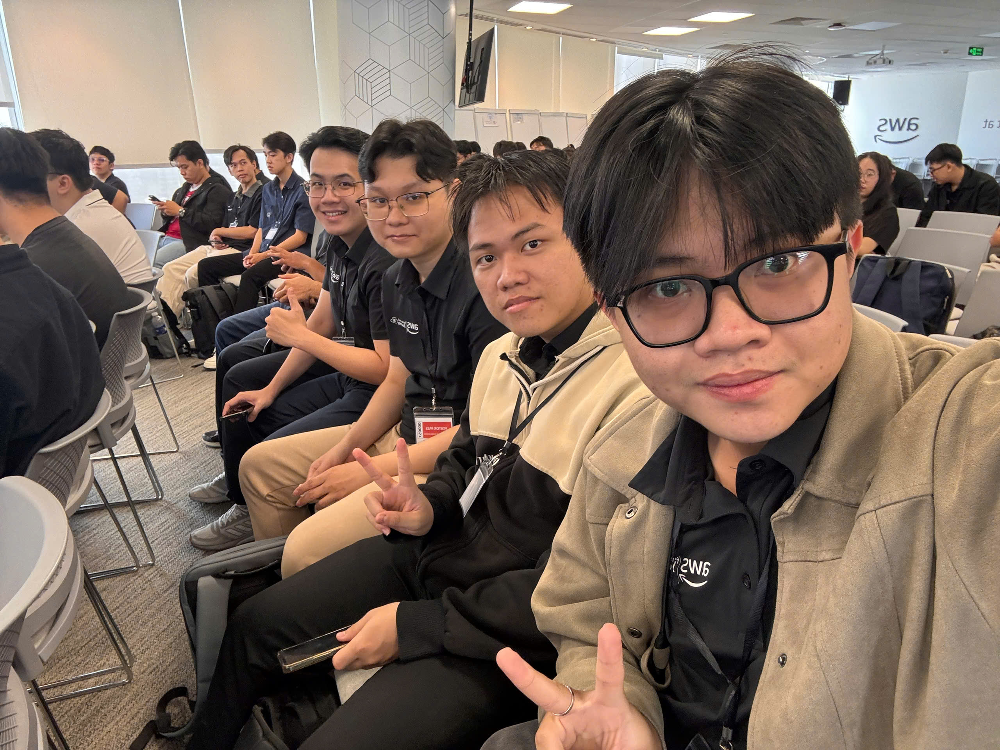

# Event Takeaways: "AWS Student Community Day Vietnam 2026"

### Event Objectives

- Gain practical, hands-on insights into Cloud Computing and Artificial Intelligence directly from experienced industry speakers.
- Explore emerging trends and real-world applications in the Cloud and AI era tailored for university students.
- Connect and network with student builders, community leaders, and tech practitioners across Ho Chi Minh City.
- Reinforce technical understanding and engage with the community through interactive Q&A sessions and live minigames.
- Fulfill community engagement milestones as part of the First Cloud AI Journey (FCAJ) OJT learning path.

### Event Overview & Co-Organizers

**AWS Student Community Day Vietnam 2026** is a flagship student-led tech conference co-organized by the alliance of **AWS Student Builder Groups (SBG)** across four major universities in Ho Chi Minh City:

- **HUFLIT** – AWS Student Builder Group at HUFLIT
- **HCMUTE** – AWS Student Builder Group HCMUTE
- **PTIT** – AWS Student Builder Group PTIT HCM
- **SGU** – AWS Student Builder Group Saigon University

**Event Logistics:**
- **Date & Time:** 9:00 AM – 11:30 AM, Saturday, November 21, 2026.
- **Venue:** 26th Floor, Bitexco Financial Tower, 02 Hai Trieu Street, Saigon Ward, Ho Chi Minh City, Vietnam.

### Key Highlights

#### Student-Led Cloud & AI Ecosystem

- Designed *by students for students*, the conference highlighted the rapid growth of university-level Cloud communities in Vietnam.
- Representatives from the four Student Builder Groups collaborated to deliver a structured program bridging campus learning with real-world AWS ecosystems.

#### Practical Cloud & AI Technical Sessions

- Industry speakers shared hands-on perspectives on deploying modern workloads using AWS Cloud and AI services.
- Sessions emphasized practical implementation, architectural thinking, and how students can leverage Cloud and AI tools to accelerate their personal projects and career readiness.

#### Interactive Q&A and Minigames

- Participants actively engaged with speakers during open Q&A segments, raising questions about technical implementation, skill building, and career progression in Cloud and AI.
- Live minigames and interactive challenges kept the energy high and rewarded attendees with exclusive AWS swags and community gifts.

### What I Learned

#### Navigating the Cloud & AI Era

- Combining foundational Cloud architecture skills with modern AI capabilities is becoming a core expectation for entry-level engineering roles.
- Practical experimentation—building, testing, and iterating on real services—is far more impactful than passive theoretical study.

#### The Power of Student Tech Communities

- Participating in cross-university alliances like AWS Student Builder Groups provides valuable peer support, shared learning resources, and leadership opportunities.
- Engaging directly with speakers and organizers helps clarify industry standards and expands professional networks early in a student's career.

### Applying to Work

- Integrate Cloud and AI services from the event's discussions into upcoming capstone or personal portfolio projects.
- Document key architectural takeaways and project implementations to strengthen technical readiness for future engineering roles.
- Stay actively involved with campus AWS Student Builder Groups and FCAJ community initiatives to continue building collaborative and technical skills.

### Event Experience

AWS Student Community Day Vietnam 2026 brought together an energetic community of young builders at the AWS Vietnam office in Bitexco Financial Tower. The collaboration among HUFLIT, HCMUTE, PTIT, and SGU created an inspiring and welcoming environment for students passionate about Cloud and AI.

#### Bridging Campus Learning and Industry Practice

- The event demonstrated how student-run initiatives can effectively connect university students with real-world Cloud practitioners.
- Between the technical talks, lively Q&A discussions, and interactive minigames, the conference provided both practical knowledge and strong motivation to keep building on AWS.

### Some Event Photos

*AWS Student Community Day Vietnam 2026 (third person from the right).*

> Overall, AWS Student Community Day Vietnam 2026 offered an energetic, student-led space to learn about Cloud and AI, connect with builders from four universities and reinforce practical skills through Q&A and minigames. The event strengthened my motivation to keep experimenting with AWS and to stay active in the FCAJ and Student Builder Group communities.
