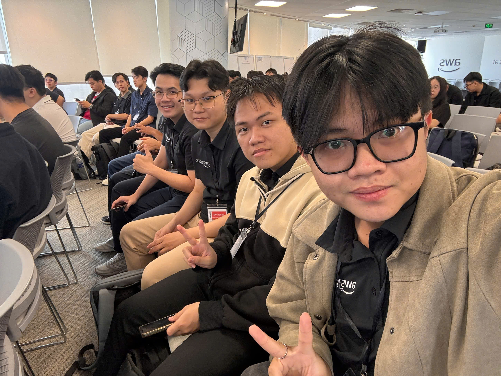

# Bản thu hoạch: "AWS Student Community Day Vietnam 2026"

### Mục tiêu sự kiện

- Tiếp cận kiến thức thực tế về Cloud Computing và Trí tuệ nhân thông qua các diễn giả giàu kinh nghiệm trong ngành.
- Khám phá các xu hướng mới nổi và ứng dụng thực tế trong kỷ nguyên Cloud và AI, dành riêng cho sinh viên đại học.
- Kết nối và giao lưu với các bạn sinh viên xây dựng công nghệ, lãnh đạo cộng đồng và những người làm công nghệ tại Thành phố Hồ Chí Minh.
- Củng cố hiểu biết kỹ thuật và gắn kết cộng đồng thông qua các phiên hỏi đáp tương tác và những trò chơi nhỏ trực tiếp.
- Hoàn thành các mốc tham gia cộng đồng trong lộ trình học tập OJT của First Cloud AI Journey (FCAJ).

### Tổng quan và các đơn vị đồng tổ chức

**AWS Student Community Day Vietnam 2026** là hội nghị công nghệ tiêu biểu do sinh viên dẫn dắt, được đồng tổ chức bởi liên minh các **AWS Student Builder Group (SBG)** tại bốn trường đại học lớn ở Thành phố Hồ Chí Minh:

- **HUFLIT** – AWS Student Builder Group tại HUFLIT
- **HCMUTE** – AWS Student Builder Group HCMUTE
- **PTIT** – AWS Student Builder Group PTIT HCM
- **SGU** – AWS Student Builder Group Saigon University

**Thông tin sự kiện:**
- **Thời gian:** 9:00 – 11:30 sáng, Thứ Bảy, ngày 21 tháng 11 năm 2026.
- **Địa điểm:** Tầng 26, Bitexco Financial Tower, số 02 đường Hải Triều, phường Sài Gòn, Thành phố Hồ Chí Minh, Việt Nam.

### Nội dung nổi bật

#### Hệ sinh thái Cloud & AI do sinh viên dẫn dắt

- Với thiết kế *do sinh viên vì sinh viên*, hội nghị làm nổi bật sự phát triển nhanh chóng của các cộng đồng Cloud cấp đại học tại Việt Nam.
- Đại diện từ bốn Student Builder Group đã cùng hợp tác xây dựng một chương trình có cấu trúc, kết nối việc học trên giảng đường với hệ sinh thái AWS thực tế.

#### Các phiên kỹ thuật thực tế về Cloud & AI

- Các diễn giả từ doanh nghiệp chia sẻ góc nhìn thực hành về triển khai các khối công việc hiện đại bằng dịch vụ AWS Cloud và AI.
- Các phiên nhấn mạnh việc triển khai thực tế, tư duy kiến trúc và cách sinh viên có thể tận dụng công cụ Cloud và AI để thúc đẩy dự án cá nhân và sự sẵn sàng nghề nghiệp.

#### Hỏi đáp tương tác và minigame

- Người tham dự tích cực trao đổi với diễn giả trong các phiên hỏi đáp mở, đặt câu hỏi về triển khai kỹ thuật, xây dựng kỹ năng và lộ trình sự nghiệp trong Cloud và AI.
- Các minigame trực tiếp và thử thách tương tác giữ không khí sôi động, đồng thời tặng người dự những quà AWS và quà cộng đồng độc quyền.

### Những gì tôi học được

#### Đi trong kỷ nguyên Cloud & AI

- Kết hợp kỹ năng kiến trúc Cloud nền tảng với năng lực AI hiện đại đang trở thành kỳ vọng cốt lõi đối với các vị trí kỹ sư mới bắt đầu.
- Thử nghiệm thực tế — xây dựng, kiểm tra và lặp lại trên các dịch vụ thật — có tác động lớn hơn nhiều so với việc học lý thuyết thụ động.

#### Sức mạnh của cộng đồng công nghệ sinh viên

- Tham gia các liên minh liên trường như AWS Student Builder Group mang lại sự hỗ trợ từ bạn bè, nguồn tài liệu học tập chung và cơ hội lãnh đạo quý giá.
- Trao đổi trực tiếp với diễn giả và ban tổ chức giúp làm rõ các tiêu chuẩn ngành và mở rộng mạng lưới chuyên nghiệp ngay từ khi còn đi học.

### Ứng dụng vào công việc

- Tích hợp các dịch vụ Cloud và AI được thảo luận tại sự kiện vào các dự án capstone hoặc portfolio cá nhân sắp tới.
- Ghi chép các bài học kiến trúc trọng tâm và cách triển khai dự án để tăng mức độ sẵn sàng kỹ thuật cho các vai trò kỹ sư trong tương lai.
- Tiếp tục tham gia tích cực các AWS Student Builder Group tại trường và các hoạt động của cộng đồng FCAJ để bồi dưỡng kỹ năng hợp tác và kỹ thuật.

### Trải nghiệm sự kiện

AWS Student Community Day Vietnam 2026 quy tụ một cộng đồng đầy năng lượng gồm những bạn trẻ xây dựng công nghệ tại văn phòng AWS Vietnam ở Bitexco Financial Tower. Sự hợp tác giữa HUFLIT, HCMUTE, PTIT và SGU đã tạo ra một môi trường truyền cảm hứng và thân thiện cho những sinh viên đam mê Cloud và AI.

#### Kết nối việc học trên giảng đường với thực hành ngành

- Sự kiện cho thấy các sáng kiến do sinh viên dẫn dắt có thể kết nối hiệu quả sinh viên đại học với những người hành nghề Cloud thực tế.
- Giữa các bài thuyết trình kỹ thuật, những cuộc thảo luận hỏi đáp sôi nổi và các minigame tương tác, hội nghị đã mang lại cả kiến thức thực tế lẫn động lực mạnh mẽ để tiếp tục xây dựng trên AWS.

### Một số ảnh sự kiện

*AWS Student Community Day Vietnam 2026 (người thứ 3 từ phải sang trái).*

> Tổng thể, AWS Student Community Day Vietnam 2026 mang đến một không gian sôi động do sinh viên dẫn dắt để tìm hiểu về Cloud và AI, kết nối với các bạn builder từ bốn trường đại học và củng cố kỹ năng thực hành qua hỏi đáp và minigame. Sự kiện đã tăng cường động lực để tôi tiếp tục thử nghiệm với AWS và duy trì hoạt động trong cộng đồng FCAJ và các Student Builder Group.
