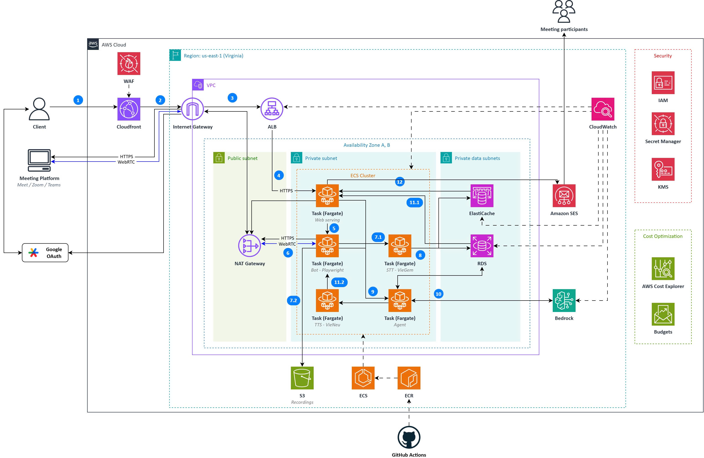

## Bạn sẽ tạo gì?

Trên tài khoản AWS mới, CloudFormation tạo VPC hai Availability Zone, ECS Fargate cluster (ARM64), S3 bucket riêng, NAT Gateway/VPC Endpoints, RDS PostgreSQL, Valkey, CloudFront + WAF, ALB nội bộ và toàn bộ các ECS service (Terminal, Gateway, Meeting/Admin API, Runtime, Bot, **VieGem ASR**, Agent/MCP/Flows và tùy chọn Voice LiveKit/VieNeu). Bạn có thể **copy nhanh bộ image `linux/arm64` dựng sẵn từ GHCR (`workshop-arm64`)** vào ECR bằng CloudShell (xem [5.4A](../5.4-full-cloudformation/)) hoặc tự build từ source. Dùng tên có `staging` vì một số template và quyền ECR yêu cầu tiền tố này; toàn bộ tài nguyên vẫn thuộc tài khoản của bạn.



```text
Trình duyệt → CloudFront/WAF → ALB nội bộ → Terminal (ECS Fargate)
                                              ↓
                                  Gateway + meeting/admin API
                                    ↓           ↓        ↓
                             Runtime/ECS bot   RDS    Valkey
                                    ↓           ↓        ↓
                                  S3         VieGem   Agent/MCP/Flows
```

Để đánh giá bài thực hành, cần xem stack của chính người học tạo thành công, service đạt trạng thái mong muốn và thử luồng đăng nhập/meeting. Stack `CREATE_COMPLETE` chỉ xác nhận AWS đã tạo tài nguyên, chưa chứng minh toàn bộ chức năng TINA hoạt động.

Sau khi hoàn thành các phần bên dưới, ảnh này thể hiện danh sách stack của **tài khoản thực hành**:



Ảnh kế tiếp thể hiện trạng thái service trong cluster của bạn:



## Tiêu chí cuối bài

- URL CloudFront của bạn mở được trang TINA và đăng nhập bằng tài khoản Google thử nghiệm.
- ECS core, runtime và terminal chạy ổn định; target group terminal healthy.
- Tạo cuộc họp thử được phép, quan sát bot; nếu bật ASR, kiểm tra transcript và ghi rõ lỗi nếu có.
- Biết nguồn chi phí và xóa đúng tài nguyên khi kết thúc.
