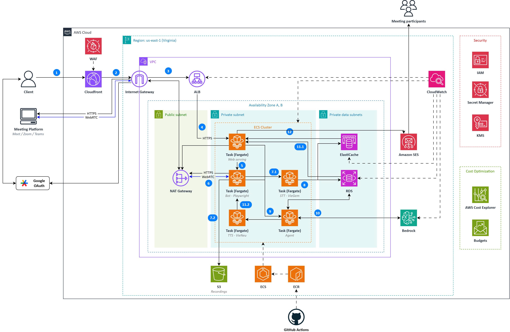

## Fast deployment overview (5 commands in CloudShell)





The `tina-full.yml` template provisions the entire TINA infrastructure in a **single stack**: a 2-AZ VPC, NAT Gateway, S3, CloudFront + WAF, an internal ALB, RDS PostgreSQL, ElastiCache Valkey, ECS Fargate (ARM64), Terminal, Bot, Runtime, **VieGem ASR**, Agent API, Agent Reach, MCP, Flows, and workspace storage.

The entire deployment is split into **5 short sequential commands in AWS CloudShell (`us-east-1`)**—wait for each command to finish before running the next, with no EC2 builder or local Docker build required:

1. **Command 1**: Set up environment variables, the ECS service-linked role, and the `crane` tool.
2. **Command 2**: Copy all **15 prebuilt `linux/arm64` images** (12 core images including **VieGem** + 3 Voice images `livekit`, `livekit-agent`, `vieneu`) from GHCR into your ECR.
3. **Command 3**: Look up Managed Prefix Lists (`CloudFront`, `S3`) and upload `tina-full.yml` to a temporary S3 bucket.
4. **Command 4**: Create the `tina-workshop-full` stack, wait for completion, and retrieve `WebsiteUrl`.
5. **Command 5**: Attach your own Google OAuth credentials to enable web sign-in.

> **Note:** Run in the **`us-east-1`** Region and avoid deploying on top of an account that already has `tina-staging-*` stacks. If you are using an **AWS Free Plan** account, check your RDS quota first (Free Plan limits the number of RDS instances—if another RDS instance already exists, you may hit `ServiceLimitExceeded`). The VieGem model is licensed for non-commercial use under **CC-BY-NC-SA-4.0** and the Gemma terms ([model card](https://huggingface.co/5CD-AI/VieGem-ASR)).

---

## Command 1 — Prepare CloudShell, ECS role, and ECR login

Open **AWS CloudShell** in the **`us-east-1`** Region, paste the following command, and press Enter:

```bash
export AWS_REGION=us-east-1
export AWS_PAGER=''
export STACK_NAME=tina-workshop-full
export AWS_ACCOUNT="$(aws sts get-caller-identity --query Account --output text)"
export ECR_REG="${AWS_ACCOUNT}.dkr.ecr.${AWS_REGION}.amazonaws.com"

# Create the ECS service-linked role (only needed on accounts that have never run ECS)
aws iam get-role --role-name AWSServiceRoleForECS >/dev/null 2>&1 \
  || aws iam create-service-linked-role --aws-service-name ecs.amazonaws.com

# Download crane into /tmp to copy images directly from CloudShell (no Docker needed)
if [ ! -x /tmp/crane ]; then
  curl -sSL "https://github.com/google/go-containerregistry/releases/latest/download/go-containerregistry_Linux_x86_64.tar.gz" \
    | tar -xz -C /tmp crane
fi

# Authenticate crane against your account's ECR registry
aws ecr get-login-password --region "$AWS_REGION" \
  | /tmp/crane auth login "$ECR_REG" -u AWS --password-stdin

echo "OK: Account=$AWS_ACCOUNT | ECR=$ECR_REG"
```

**Explanation:** This command fetches your AWS account ID (`AWS_ACCOUNT`), ensures `AWSServiceRoleForECS` exists, downloads the `crane` binary (~8 MB), and logs into ECR. Once you see `OK: Account=...`, Command 1 is complete.

---

## Command 2 — Copy all 15 ARM64 images (including VieGem & Voice) from GHCR to ECR

Paste the command below to create 15 `tina-staging/*` repositories in ECR and copy all 15 `linux/arm64` images from `ghcr.io/poor-frog/tina-*:workshop-arm64` into your ECR (takes about 2–3 minutes):

```bash
GHCR_PREFIX="ghcr.io/poor-frog"
GHCR_TAG="workshop-arm64"
SERVICES=(terminal gateway meeting-api admin-api runtime bot agent-api agent-reach agent-worker mcp flows viegem livekit livekit-agent vieneu)
: > /tmp/tina-digests.env

for name in "${SERVICES[@]}"; do
  aws ecr describe-repositories --region "$AWS_REGION" --repository-names "tina-staging/$name" >/dev/null 2>&1 \
    || aws ecr create-repository --region "$AWS_REGION" --repository-name "tina-staging/$name" \
         --image-tag-mutability IMMUTABLE --encryption-configuration encryptionType=AES256 >/dev/null

  echo ">>> Copying $name..."
  /tmp/crane copy "${GHCR_PREFIX}/tina-${name}:${GHCR_TAG}" "${ECR_REG}/tina-staging/${name}:${GHCR_TAG}"

  DIGEST="$(aws ecr describe-images --region "$AWS_REGION" --repository-name "tina-staging/$name" \
    --image-ids "imageTag=${GHCR_TAG}" --query 'imageDetails[0].imageDigest' --output text)"
  VAR_NAME="$(echo "$name" | tr '[:lower:]-' '[:upper:]_')_DIGEST"
  echo "export ${VAR_NAME}=${DIGEST}" >> /tmp/tina-digests.env
done

source /tmp/tina-digests.env
echo "=== Saved all 15 digests to /tmp/tina-digests.env ==="
cat /tmp/tina-digests.env
```

**Explanation:** Instead of launching an ARM64 EC2 instance and building Docker images for 1–2 hours, `crane copy` transfers all 15 images (12 core images including VieGem + 3 Voice images `livekit`, `livekit-agent`, `vieneu`) directly from GHCR to ECR and records all 15 `sha256:...` digests in `/tmp/tina-digests.env`. Wait until all 15 `export ..._DIGEST=sha256:...` lines are printed before moving to Command 3.

<details>
<summary style="cursor:pointer;font-weight:600;color:#0073bb;text-decoration:underline;">▶ Advanced option: build all 12 images from source on an ARM64 EC2 instance (without GHCR)</summary>

If you want to build from commit `7d6bba8109f6eac51c0d8241a7083e3e364cf59d` yourself, follow the ARM64 EC2 setup and inline `/root/tina-ecr-build.sh` script in [5.4.1 S3, ECR, and ARM64 image builds](../5.4-data-compute/5.4.1-s3-ecr-images/) and run it with the `--full` flag.

</details>

---

## Command 3 — Look up Prefix Lists & upload `tina-full.yml` to temporary S3

Download `tina-full.yml` using the button at the top of this page, click **Actions → Upload file** in CloudShell to upload it to your home directory `~/` (i.e. `~/tina-full.yml`), then run:

```bash
CF_PL="$(aws ec2 describe-managed-prefix-lists --region "$AWS_REGION" \
  --filters Name=prefix-list-name,Values=com.amazonaws.global.cloudfront.origin-facing \
  --query 'PrefixLists[0].PrefixListId' --output text)"
S3_PL="$(aws ec2 describe-managed-prefix-lists --region "$AWS_REGION" \
  --filters Name=prefix-list-name,Values=com.amazonaws.us-east-1.s3 \
  --query 'PrefixLists[0].PrefixListId' --output text)"

TPL_BUCKET="tina-cfn-tpl-${AWS_ACCOUNT}-${AWS_REGION}"
aws s3 mb "s3://${TPL_BUCKET}" --region "$AWS_REGION" 2>/dev/null || true
aws s3 cp ~/tina-full.yml "s3://${TPL_BUCKET}/tina-full.yml" --region "$AWS_REGION"

echo "OK: CF_PL=$CF_PL | S3_PL=$S3_PL | TPL=https://${TPL_BUCKET}.s3.${AWS_REGION}.amazonaws.com/tina-full.yml"
```

**Explanation:**
- `CF_PL` and `S3_PL` are the two AWS Managed Prefix List IDs in `us-east-1`, used to lock down Security Groups so only CloudFront and S3 traffic is allowed.
- Because `tina-full.yml` (~151 KB) exceeds CloudFormation's 51 KB inline template limit, it must be uploaded to a temporary S3 bucket so CloudFormation can read it via `--template-url`.

---

## Command 4 — Create stack `tina-workshop-full` and get `WebsiteUrl`

Paste the command below to create the entire stack and wait for AWS to finish provisioning (RDS + Valkey + CloudFront + ECS takes about **12–18 minutes**):

```bash
source /tmp/tina-digests.env

aws cloudformation create-stack --region "$AWS_REGION" \
  --stack-name "$STACK_NAME" \
  --template-url "https://${TPL_BUCKET}.s3.${AWS_REGION}.amazonaws.com/tina-full.yml" \
  --capabilities CAPABILITY_IAM CAPABILITY_NAMED_IAM \
  --parameters \
    ParameterKey=CloudFrontOriginPrefixListId,ParameterValue="$CF_PL" \
    ParameterKey=S3PrefixListId,ParameterValue="$S3_PL" \
    ParameterKey=WorkspaceOwnerIds,ParameterValue="" \
    ParameterKey=GoogleSecretArn,ParameterValue="" \
    ParameterKey=EnableVoice,ParameterValue="false" \
    ParameterKey=VoicePilotRoom,ParameterValue="" \
    ParameterKey=BotDigest,ParameterValue="$BOT_DIGEST" \
    ParameterKey=RuntimeDigest,ParameterValue="$RUNTIME_DIGEST" \
    ParameterKey=AdminDigest,ParameterValue="$ADMIN_API_DIGEST" \
    ParameterKey=MeetingDigest,ParameterValue="$MEETING_API_DIGEST" \
    ParameterKey=GatewayDigest,ParameterValue="$GATEWAY_DIGEST" \
    ParameterKey=TerminalDigest,ParameterValue="$TERMINAL_DIGEST" \
    ParameterKey=AgentApiDigest,ParameterValue="$AGENT_API_DIGEST" \
    ParameterKey=AgentWorkerDigest,ParameterValue="$AGENT_WORKER_DIGEST" \
    ParameterKey=AgentReachDigest,ParameterValue="$AGENT_REACH_DIGEST" \
    ParameterKey=McpDigest,ParameterValue="$MCP_DIGEST" \
    ParameterKey=FlowsDigest,ParameterValue="$FLOWS_DIGEST" \
    ParameterKey=VieGemDigest,ParameterValue="$VIEGEM_DIGEST" \
    ParameterKey=VieNeuDigest,ParameterValue="$VIENEU_DIGEST" \
    ParameterKey=LiveKitDigest,ParameterValue="$LIVEKIT_DIGEST" \
    ParameterKey=LiveKitAgentDigest,ParameterValue="$LIVEKIT_AGENT_DIGEST"

echo "Waiting for CloudFormation stack creation (~12-18 minutes)..."
aws cloudformation wait stack-create-complete --region "$AWS_REGION" --stack-name "$STACK_NAME"

WEBSITE_URL="$(aws cloudformation describe-stacks --region "$AWS_REGION" \
  --stack-name "$STACK_NAME" \
  --query "Stacks[0].Outputs[?OutputKey=='WebsiteUrl'].OutputValue" --output text)"
echo "WebsiteUrl: $WEBSITE_URL"
curl -sS "${WEBSITE_URL}/edge-health" && echo ""
```

**Explanation:**
- `GoogleSecretArn` is left empty on initial creation because you need the CloudFront-generated `WebsiteUrl` before registering the Redirect URI in Google.
- When finished, `curl .../edge-health` prints **`TINA_EDGE_READY`**, and opening `WebsiteUrl` in your browser shows the TINA landing page.



---

## Command 5 — Attach your own Google OAuth for web sign-in

1. Open the [Google Cloud Console](https://console.cloud.google.com/) → **Google Auth Platform → Clients → Create client → Web application**.
2. Add an **Authorized redirect URI** matching `WebsiteUrl` from Command 4:
   `https://<your-cloudfront-domain>/api/auth/callback/google`
   Save it to obtain your `Client ID` and `Client secret` (if the app is in **Testing** mode, add your Gmail address under **Test users**).



3. Return to **CloudShell**, replace `PASTE_GOOGLE_CLIENT_ID` and `PASTE_GOOGLE_CLIENT_SECRET`, and run the final command:

```bash
umask 077
GOOGLE_JSON="$(mktemp)"
cat > "$GOOGLE_JSON" <<'EOF'
{"client_id":"PASTE_GOOGLE_CLIENT_ID","client_secret":"PASTE_GOOGLE_CLIENT_SECRET"}
EOF

GOOGLE_SECRET_ARN="$(aws secretsmanager create-secret --region "$AWS_REGION" \
  --name "${STACK_NAME}-google-oauth" --secret-string "file://$GOOGLE_JSON" \
  --query ARN --output text)"
rm -f -- "$GOOGLE_JSON"

aws cloudformation update-stack --region "$AWS_REGION" \
  --stack-name "$STACK_NAME" \
  --use-previous-template \
  --capabilities CAPABILITY_IAM CAPABILITY_NAMED_IAM \
  --parameters \
    ParameterKey=CloudFrontOriginPrefixListId,UsePreviousValue=true \
    ParameterKey=S3PrefixListId,UsePreviousValue=true \
    ParameterKey=WorkspaceOwnerIds,UsePreviousValue=true \
    ParameterKey=GoogleSecretArn,ParameterValue="$GOOGLE_SECRET_ARN" \
    ParameterKey=EnableVoice,UsePreviousValue=true \
    ParameterKey=VoicePilotRoom,UsePreviousValue=true \
    ParameterKey=BotDigest,UsePreviousValue=true \
    ParameterKey=RuntimeDigest,UsePreviousValue=true \
    ParameterKey=AdminDigest,UsePreviousValue=true \
    ParameterKey=MeetingDigest,UsePreviousValue=true \
    ParameterKey=GatewayDigest,UsePreviousValue=true \
    ParameterKey=TerminalDigest,UsePreviousValue=true \
    ParameterKey=AgentApiDigest,UsePreviousValue=true \
    ParameterKey=AgentWorkerDigest,UsePreviousValue=true \
    ParameterKey=AgentReachDigest,UsePreviousValue=true \
    ParameterKey=McpDigest,UsePreviousValue=true \
    ParameterKey=FlowsDigest,UsePreviousValue=true \
    ParameterKey=VieGemDigest,UsePreviousValue=true \
    ParameterKey=VieNeuDigest,UsePreviousValue=true \
    ParameterKey=LiveKitDigest,UsePreviousValue=true \
    ParameterKey=LiveKitAgentDigest,UsePreviousValue=true

aws cloudformation wait stack-update-complete --region "$AWS_REGION" --stack-name "$STACK_NAME"
echo "DONE! Open $WEBSITE_URL to sign in with Google."
```

**Explanation:** This command stores your Google OAuth credentials in Secrets Manager (and immediately removes the temporary file from CloudShell), then updates the `Terminal` container to receive `GOOGLE_CLIENT_ID` and `GOOGLE_CLIENT_SECRET`. Wait ~1–2 minutes for Terminal to restart, then sign in with Google to use the web app, bot, and VieGem.

---

## Voice and cleanup when finished

- **Voice (optional):** The 3 `linux/arm64` images for the Voice stack are also available on GHCR (`ghcr.io/poor-frog/tina-livekit:workshop-arm64`, `tina-livekit-agent:workshop-arm64`, `tina-vieneu:workshop-arm64`). To enable Voice, copy these 3 images into `tina-staging/{livekit,livekit-agent,vieneu}` in ECR and update the stack with `EnableVoice=true`, `VoicePilotRoom`, and the 3 corresponding digests (`LiveKitDigest`, `LiveKitAgentDigest`, `VieNeuDigest`).
- **Cleanup:** Run `aws cloudformation delete-stack --stack-name tina-workshop-full --region us-east-1`, then review and remove retained resources (`DeletionPolicy: Retain`: S3 buckets, KMS key, RDS snapshot) following [5.6 Cleanup and evidence](../5.6-cleanup-evidence/).
