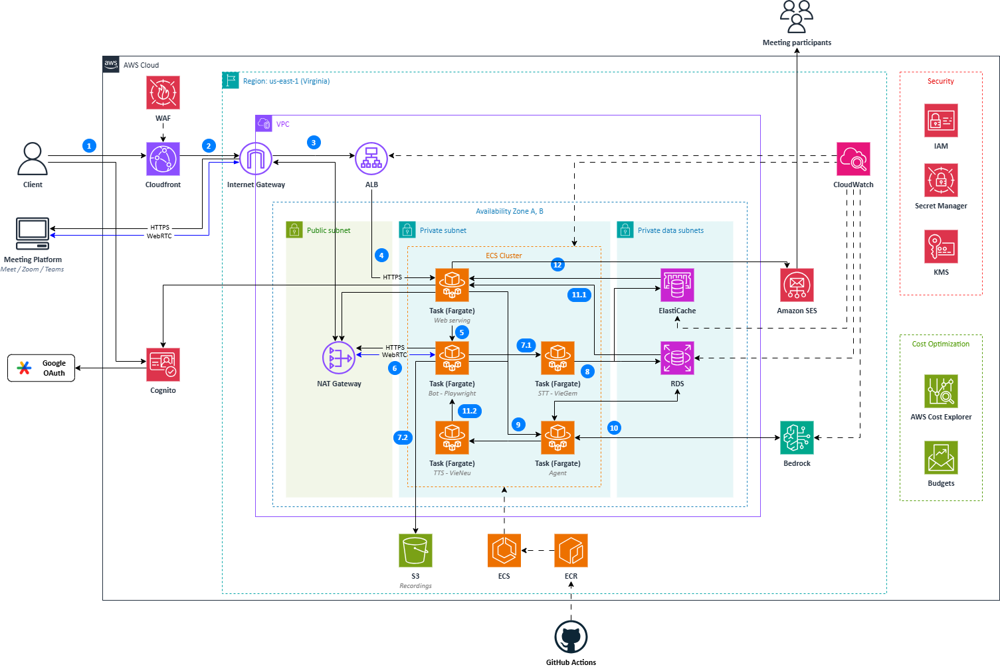

# Workshop: Dựng toàn bộ kiến trúc TINA từ đầu

#### Tổng quan

Workshop dựng lại **mọi thứ** trong proposal TINA: hạ tầng AWS (VPC, mạng, kho dữ liệu, định danh, AI, email, biên) **và** service ứng dụng biên dịch từ source. Repo GitHub chỉ là source đầu vào — bạn tự tạo tài nguyên AWS, build từ Dockerfile, push image lên ECR, deploy lên ECS Fargate rồi kiểm tra và chụp ảnh.

Bắt đầu từ tài khoản AWS trống tại `us-east-1`.



#### Làm tay hay CloudFormation

**Làm tay trước:**

1. `tina-vpc` (`10.0.0.0/16`) và 6 subnet trải `us-east-1a`/`us-east-1b` — 2 public, 2 private-app, 2 private-data.
2. Internet Gateway `tina-igw`, EIP, NAT Gateway `tina-nat`, 3 route table.
3. 6 repository ECR (`tina-terminal`, `tina-gateway`, `tina-bot`, `tina-stt`, `tina-tts`, `tina-agent`). Tạo **trước** để push image — ECS service do stack tạo sẽ tham chiếu image `:prod` và không đợi image có sẵn.

**CloudFormation tạo:** VPC endpoint (S3/ECR), S3, KMS, IAM, Secrets Manager, RDS, ElastiCache, Cognito, ALB, ECS cluster + 5 service Fargate, CloudWatch, CloudFront + WAF, Budgets.

Template: `static/cloudformation/tina-infrastructure.yaml`.

```bash
aws cloudformation deploy \
  --template-file tina-infrastructure.yaml \
  --stack-name tina-infra \
  --capabilities CAPABILITY_NAMED_IAM \
  --region us-east-1 \
  --parameter-overrides \
      VpcId=<vpc-id> PublicSubnet1=<public-1a> PublicSubnet2=<public-1b> \
      PrivateSubnet1=<app-1a> PrivateSubnet2=<app-1b> \
      AppRouteTableId=<app-rt> DataRouteTableId=<data-rt> \
      DBPassword='<mat-khau-manh>' CertificateArn=<acm-cert-arn>
```

Bedrock (cấp quyền model), SES (xác minh domain) và Cost Explorer làm trên console.

#### Bảng kiểm tra đủ dịch vụ

| Dịch vụ yêu cầu | Tạo bởi | Cách |
| --- | --- | --- |
| VPC | Bước 1 | Tay |
| 2 Availability Zone | Bước 1 (`us-east-1a`, `us-east-1b`) | Tay |
| Public subnet + 2 private subnet | Bước 1 (thêm 2 subnet data) | Tay |
| Internet Gateway | Bước 1 (`tina-igw`) | Tay |
| NAT Gateway | Bước 1 (`tina-nat`) | Tay |
| ECR | Bước 2 (6 repository) | Tay |
| VPC endpoint S3/ECR | Stack | CloudFormation |
| S3 | Stack (recordings/exports) | CloudFormation |
| KMS | Stack (`tina-key`) | CloudFormation |
| IAM | Stack (task role) | CloudFormation |
| Secrets Manager | Stack (`tina/core`) | CloudFormation |
| RDS | Stack (`tina-db`) | CloudFormation |
| ElastiCache | Stack (`tina-cache`) | CloudFormation |
| Cognito | Stack (`tina-users`) | CloudFormation |
| ALB | Stack (`tina-alb`) | CloudFormation |
| ECS + 5 Fargate service | Stack (`tina-cluster`) | CloudFormation |
| CloudWatch | Stack (`/ecs/tina` + alarm) | CloudFormation |
| CloudFront | Stack (`tina-cdn`) | CloudFormation |
| WAF | Stack (`tina-waf-acl`, gắn vào CloudFront) | CloudFormation |
| AWS Budgets | Stack (`tina-monthly`, 50/80/100%) | CloudFormation |
| Bedrock | Console (quyền model) | Console |
| SES | Console (domain đã xác minh) | Console |
| Cost Explorer | Console (xem chi phí 7 ngày) | Console |

#### Quy ước đặt tên

| Tài nguyên | Tên / giá trị |
| --- | --- |
| Region | `us-east-1` |
| VPC | `tina-vpc`, `10.0.0.0/16` |
| Subnet public | `tina-public-1a` `10.0.1.0/24`, `tina-public-1b` `10.0.2.0/24` |
| Subnet private app | `tina-app-1a` `10.0.11.0/24`, `tina-app-1b` `10.0.12.0/24` |
| Subnet private data | `tina-data-1a` `10.0.21.0/24`, `tina-data-1b` `10.0.22.0/24` |
| IGW / NAT | `tina-igw`, `tina-nat` (1 EIP) |
| Route table | `tina-public-rt`, `tina-app-rt`, `tina-data-rt` |
| S3 | `tina-<ten>-recordings`, `tina-<ten>-exports` |
| ECR | `tina-<service>` (6 repo) |
| ECS cluster/service | `tina-cluster`; `tina-web`, `tina-bot`, `tina-stt`, `tina-tts`, `tina-agent` |
| ALB / target group | `tina-alb`, `tina-web-tg` |
| RDS / ElastiCache | `tina-db` (db.t4g.micro), `tina-cache` (cache.t4g.micro) |
| Cognito / Bedrock | `tina-users`, Claude/Nova |
| SES / CloudFront / WAF | domain, `tina-cdn`, `tina-waf-acl` |
| Secret / KMS / Budget | `tina/core`, `tina-key`, `tina-monthly` |

#### Hướng dẫn từng bước

**Bước 0 — Chuẩn bị**
```bash
git clone https://github.com/poor-frog/TINA.git
cd TINA
git rev-parse --short HEAD
chmod 600 .env.keys
aws configure            # us-east-1, không dán bí mật vào ảnh
```
- **Ảnh cần chụp:** `screenshot-00-prereqs.png`, `screenshot-01-clone.png`.

**Bước 1 — Dựng VPC và mạng bằng tay**
Tạo VPC, 6 subnet, IGW, NAT, 3 route table. Public `0.0.0.0/0 → IGW`; app `0.0.0.0/0 → NAT`; data không có route ra Internet.
- **Ảnh cần chụp:** `screenshot-02-vpc-subnets.png`, `screenshot-03-route-tables.png`.

**Bước 2 — Tạo ECR, build từ source, push image**
```bash
for s in terminal gateway bot stt tts agent; do
  aws ecr create-repository --repository-name tina-$s --region us-east-1
done
make build && make bot
ACCOUNT=$(aws sts get-caller-identity --query Account --output text)
aws ecr get-login-password --region us-east-1 | docker login --username AWS --password-stdin $ACCOUNT.dkr.ecr.us-east-1.amazonaws.com
# tag/push từng tina/v012-<service>:dev thành <account>.dkr.ecr.us-east-1.amazonaws.com/tina-<service>:prod
```
- **Ảnh cần chụp:** `screenshot-04-ecr-repos.png`, `screenshot-05-images-built.png`.

**Bước 3 — Deploy phần còn lại bằng CloudFormation**
Chạy lệnh `aws cloudformation deploy` ở trên, chờ stack `CREATE_COMPLETE`.
- **Ảnh cần chụp:** `screenshot-06-stack-complete.png`.

**Bước 4 — Dịch vụ trên console**
Cấp quyền model Bedrock, xác minh domain SES, mở Cost Explorer.
- **Ảnh cần chụp:** `screenshot-07-bedrock-ses.png`, `screenshot-08-cost-explorer.png`.

**Bước 5 — Kiểm tra**
Dùng các trang con: [dữ liệu & compute](5.4-s3-onprem/), [ALB/ECS](5.4-s3-onprem/5.4.3-test-endpoint/), [hệ thống chạy](5.4-s3-onprem/5.4.4-dns-simulation/), [bảo mật & chi phí](5.5-policy/).
- **Ảnh cần chụp:** `screenshot-13-ecs-alb-healthy.png`, `screenshot-17-app-running.png`, `screenshot-18-transcript.png`.

**Bước 6 — Dọn dẹp**
Xóa stack CloudFormation, rồi tài nguyên VPC tạo tay; local chạy `make down`.

#### Mẹo

* Windows native Python/PowerShell không hỗ trợ — dùng WSL2; Apple Silicon dùng MPS; Linux/WSL2 NVIDIA dùng CUDA. Không fallback CPU tự động — dùng `TINA_VIEGEM_DEVICE=cpu make all`.
* Build source cần ~8 vCPU/16 GB RAM và thời gian tải model.
* Không commit hay chụp `.env.keys`, API key, OAuth secret hay mật khẩu DB.

#### Nội dung

1. [Tổng quan workshop](5.1-workshop-overview/)
2. [Chuẩn bị](5.2-prerequiste/)
3. [Dựng VPC & mạng](5.3-s3-vpc/)
4. [Dựng dữ liệu, định danh & compute](5.4-s3-onprem/)
5. [Bảo mật, giám sát & chi phí](5.5-policy/)
6. [Dọn dẹp](5.6-cleanup/)
